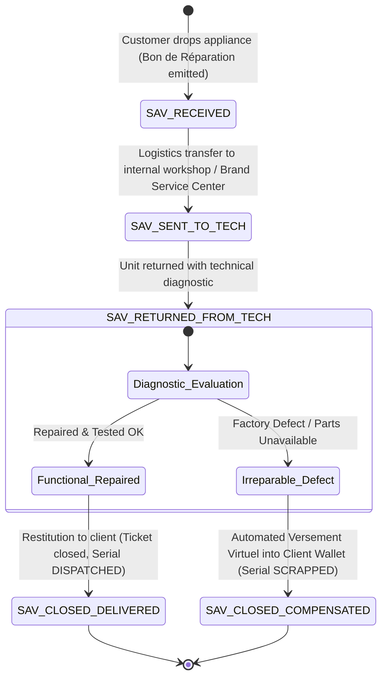

# Backend Architecture & Schema Specification: Home Electrical Products Store
## High-Precision Appliance Retail, Inventory Lifecycle & Multi-Desk Orchestration

---

## Executive Summary & Domain Engineering Context

Modern retail stores specializing in domestic electrical appliances (*Magasin d'Électroménager*) operate under operational, logistical, and financial constraints fundamentally distinct from FMCG (Fast-Moving Consumer Goods) or apparel retail:

1. **High Unit Value & Traceability Mandate**: Every major appliance (refrigerators, washing machines, OLED TVs, split air conditioners) carries a significant financial value and a unique manufacturer Serial Number ($N^\circ\text{ de Série}$). Traceability cannot be aggregated at the SKU or barcode level; each physical box represents an individually serialized, warranted asset.
2. **Decoupling of Showroom Floor from Back-Store Logistics**: Showroom sales desks display floor demonstration models (*modèles d'exposition*). Sales representatives handle commercial negotiations, customer profiles, and theoretical allocations without physical access to heavy packaged stock stored in back warehouses or pallet racks.
3. **Four-Desk Operational Segregation**: Strict separation of duties (SoD) enforces four distinct operational posts:
   - **Order Desk (*Comptoir de Vente*)**: Customer selection and theoretical booking.
   - **Cashier (*Caisse*)**: Financial settlement, payment validation, and credit verification.
   - **Logistics Dock (*Magasin / Comptoir de Sortie*)**: Physical unit barcode/serial scanning, verification, and gate pass issuance.
   - **After-Sales Service (*SAV / Réparation*)**: Intake of malfunctioning units, warranty tracking, repair dispatch, and compensation.
4. **Liquidity Defense via Virtual Wallets (*Versement Virtuel*)**: Refunding high-ticket appliances with direct cash drawers causes fatal cash till depletion (*assèchement de caisse*) and exposes the enterprise to cash-skimming fraud. All product returns (*Bons de Retour*) and irreparable after-sales compensations credit an immutable customer store credit wallet (*Versement Virtuel / Portefeuille Client*).
5. **Credit Governance (*Bon Crédit*)**: Installment and credit sales demand dual-custody authorization. Frontline cashiers are cryptographically barred from approving term vouchers without manager override and automated credit ledger checks.

---

## 1. Product & Inventory Lifecycle Management

### 1.1. Batch Management (Gestion des Arrivages & Lots)

Every consignment of electrical appliances enters the warehouse via a structured arrival batch (`Inventory_Batches`). Unlike perishable food lots tracking expiry dates, appliance batches govern:
- **Arrival Timestamp & Manifest Tracking**: Precise arrival date, customs clearance reference, and container/shipping bill IDs.
- **Supplier Warranty Terms**: Inbound manufacturer warranty period (typically 12, 24, 36, or 60 months) from reception date.
- **Landed Cost Computation (*Coût de Revient Réel*)**: Ingestion of FOB purchase price, allocated freight, maritime insurance, customs tariffs, and local port unloading charges to determine the true weighted landed cost ($PUMP$) per unit.
- **Batch State Transition**: From `ACTIVE` (available for picking) to `DEPLETED` (all serials allocated and exited) or `QUARANTINE` (systemic batch damage during transport).

### 1.2. Appliance Product Attributes & Hierarchies

Electrical appliances demand multi-dimensional technical attributes for stock filtering, showroom matching, and warranty registration:
- **Brand Identity (`Product_Brands`)**: Bosch, Samsung, LG, Whirlpool, Brandt, Cristor, Condor, Midea, Moulinex, Philips, etc.
- **Category Taxonomy (`Product_Categories`)**:
  - *Gros Électroménager (GEM / Major Appliances)*: Cold (refrigerators, deep freezers), Washing (front/top-load washing machines, washer-dryers, dishwashers), Cooking (built-in ovens, hobs, freestanding ranges).
  - *Petit Électroménager (PEM / Small Domestic Appliances)*: Food preparation (food processors, blenders), Beverage (espresso machines), Home comfort (vacuum cleaners, irons).
  - *Climatisation & Chauffage (HVAC)*: Inverter split systems, mobile units, water heaters.
  - *Multimédia & Image/Son*: Smart TVs, soundbars, audio systems.
- **Physical & Technical Dimensions**: Finish/Color (Inox brossé, Noir mat, Blanc laqué, Silver), Energy efficiency rating (Classe A+++, A++, A+), Dimensions ($H \times W \times D$ in cm), Net Capacity (liters for refrigeration, kg for laundry), Total Electrical Wattage ($W$).

### 1.3. Serial Number Architecture (`Product_Serials`)

Every physical unit carries a dedicated record in `Product_Serials`. A serialized appliance possesses an immutable lifecycle governed by a strict state machine:

```
                  +-------------------------------------------------------+
                  |                                                       |
                  v                                                       |
          +---------------+   Reserve (Order Desk)   +----------------+   |
Arrival ->|   IN_STOCK    |------------------------->|    RESERVED    |   |
          +---------------+                          +----------------+   |
                  |                                           |           |
                  | Logistical Dispatch (Exit Desk Scan)      | Exit Scan |
                  +---------------------+---------------------+           |
                                        |                                 |
                                        v                                 |
                              +-------------------+                       |
                              |    DISPATCHED     |                       |
                              +-------------------+                       |
                                |               |                         |
               Customer Return  |               | Defect Reported         |
               (Bon de Retour)  |               | (Bon de Réparation)     |
                                v               v                         |
                      +---------------+   +---------------+               |
                      |   RETURNED    |   |    IN_SAV     |               |
                      +---------------+   +---------------+               |
                        |           |       |           |                 |
         Restock Passed |           | Scrap | Repaired  | Irreparable     |
                        +-----------+       +-----------+                 |
                                    |                   |                 |
                                    v                   v                 |
                            +-----------------------------------+         |
                            |              SCRAPPED             |         |
                            +-----------------------------------+         |
```

#### Status Enumeration Definitions:
1. `IN_STOCK`: Verified on warehouse pallet or showroom floor, unassigned, active and intact.
2. `RESERVED`: Temporarily locked by a confirmed Order Desk draft awaiting payment validation or exit scanning. Prevents double-selling across desks.
3. `DISPATCHED`: Physically verified, scanned at the Exit Desk, removed from physical warehouse premises, customer warranty clock initiated.
4. `RETURNED`: Returned by customer under `Bon de Retour`. Inspected at quarantine bench for restock or scrap.
5. `IN_SAV`: Checked in at the After-Sales desk under `Bon de Réparation`. Transferred to technical workshop for testing or component repair.
6. `SCRAPPED`: Marked as permanently defective, written off inventory, salvaged for spare parts, or staged for manufacturer RMA write-off.

### 1.4. Theoretical vs. Actual Designation Separation

A core failure in generic POS systems applied to appliance retail is forcing the sales clerk to specify serial numbers at initial order capture. Showroom salespeople do not have physical custody of packaged boxes in the high-bay warehouse.

Our architecture enforces a **Dual-Stage Fulfillment Model**:
- **Theoretical Allocation (Désignation Théorique)**:
  - *Location*: Comptoir de Vente (Order Desk).
  - *Action*: Clerk captures customer choice: Product SKU (`Product_ID`), Color variant preference, Quantity ($Q$).
  - *Database Effect*: The system reserves $Q$ units theoretically. `Inventory_Batches.Theoretical_Reserved_Qty` is incremented. Available quantity for sale ($Q_{\text{avail}} = Q_{\text{physical}} - Q_{\text{reserved}}$) is updated across all terminals. Zero physical serial numbers are assigned.
- **Actual Designation (Désignation Réelle)**:
  - *Location*: Magasin / Quai de Sortie (Logistical Exit Desk).
  - *Action*: Once the financial transaction is confirmed, the warehouseman picks the physical boxes and scans:
    1. The Manufacturer Master Barcode (EAN-13 / UPC).
    2. The Unique Manufacturer Serial Number ($N^\circ\text{ de Série}$ / GS1-128 / DataMatrix).
  - *Database Effect*: The system verifies that the scanned serial is `IN_STOCK` and matches the SKU. It binds the scanned `Serial_ID` records to `Delivery_Exit_Serials` and updates `Product_Serials.Status` to `DISPATCHED`. `Inventory_Batches.Quantity_Current` and `Theoretical_Reserved_Qty` are decremented synchronously.

---

## 2. Multi-Role Access Control (RBAC) & Security Architecture

### 2.1. Separation of Duties (SoD) Principles

To eliminate internal shrinkage, phantom returns, and till embezzlement, the backend enforces cryptographic and relational access boundaries:
- **No Cash at Order Desk**: Sales clerks cannot collect cash, open a till drawer, or confirm a financial voucher.
- **No Inventory Release at Cashier**: Cashiers cannot scan serial numbers or trigger the logistical exit gate.
- **No Pricing or Cash at Exit Desk**: Warehousemen only see picking lists and serial scanning interfaces. They have zero visibility into profit margins, customer payment balances, or cash drawers.
- **No Unsupervised Credit**: Cashiers cannot switch an invoice to `Bon Crédit` without manager authentication.

### 2.2. Permissions Matrix

| Permission Key | Description | Vente (Sales Desk) | Caisse (Cashier) | Magasin (Dispatch) | SAV (Repair Desk) | Admin / Gérant |
| :--- | :--- | :---: | :---: | :---: | :---: | :---: |
| `CATALOG_VIEW_PRICING` | View product catalog and public retail prices | **ALLOW** | **ALLOW** | **ALLOW** | **ALLOW** | **ALLOW** |
| `CATALOG_VIEW_COST_MARGIN` | View landed purchase cost and gross profit margin | **DENY** | **DENY** | **DENY** | **DENY** | **ALLOW** |
| `SALES_ORDER_CREATE` | Create theoretical order draft (*Bon de Commande*) | **ALLOW** | **DENY** | **DENY** | **DENY** | **ALLOW** |
| `SALES_PRICE_OVERRIDE` | Apply non-standard discount exceeding standard limit | **DENY** | **DENY** | **DENY** | **DENY** | **ALLOW** |
| `CASH_SESSION_OPEN_CLOSE` | Open, reconcile, and close daily cash till drawer | **DENY** | **ALLOW** | **DENY** | **DENY** | **ALLOW** |
| `PAYMENT_VALIDATE_CASH` | Collect cash and emit `Bon C` | **DENY** | **ALLOW** | **DENY** | **DENY** | **ALLOW** |
| `CREDIT_INITIATE` | Request installment or deferred payment | **ALLOW** | **ALLOW** | **DENY** | **DENY** | **ALLOW** |
| `CREDIT_ADMIN_AUTHORIZE` | Enter supervisor credentials to approve `Bon Crédit` | **DENY** | **DENY** | **DENY** | **DENY** | **ALLOW** |
| `DISPATCH_QUEUE_VIEW` | Access queue of paid orders awaiting physical release | **DENY** | **DENY** | **ALLOW** | **DENY** | **ALLOW** |
| `SERIAL_SCAN_DISPATCH` | Scan barcode/serial numbers and issue `Bon de Sortie` | **DENY** | **DENY** | **ALLOW** | **DENY** | **ALLOW** |
| `RETURN_INTAKE_INSPECT` | Receive returned physical unit and perform QC check | **DENY** | **DENY** | **ALLOW** | **ALLOW** | **ALLOW** |
| `WALLET_ISSUE_CREDIT` | Emit `Bon de Retour` virtual wallet store credit | **DENY** | **DENY** | **DENY** | **DENY** | **ALLOW** |
| `SAV_TICKET_CREATE` | Check in broken appliance and print `Bon de Réparation` | **DENY** | **DENY** | **DENY** | **ALLOW** | **ALLOW** |
| `SAV_TECH_DISPATCH` | Transfer unit to internal/external authorized workshop | **DENY** | **DENY** | **DENY** | **ALLOW** | **ALLOW** |
| `SAV_COMPENSATION_AUTO` | Authorize automatic wallet credit for irreparable defect | **DENY** | **DENY** | **DENY** | **DENY** | **ALLOW** |
| `STOCK_SCRAP_DECOMMISSION`| Write off unit to `SCRAPPED` status | **DENY** | **DENY** | **DENY** | **DENY** | **ALLOW** |

---

## 3. Bond Lifecycle & Financial Settlement Engine

```
 [Comptoir de Vente]
        |
        | 1. Create Theoretical Order
        v
 [Sales_Orders_Theoretical] (Status: CONFIRMED_PENDING_PAYMENT)
        |
        +-----------------------------------+
        |                                   |
        | Customer Pays Cash/Card           | Customer Requests Term Credit
        v                                   v
 [Caisse Desk: Bon C]              [Caisse Desk: Bon Crédit]
 - Cash Till Debited               - Requires Admin Password Override
 - Status: PAID_PENDING_DISPATCH   - Checks Credit Limit & Aging Debts
        |                          - Status: APPROVED_CREDIT_PENDING_DISPATCH
        +-----------------------------------+
        |
        | 2. Order enters Dispatch Queue
        v
 [Magasin / Quai de Sortie: Bon de Sortie]
 - Scan physical Barcode & Serial Number (N° de Série)
 - Zero Cash Impact (financial_impact = NONE)
 - Serials transition: IN_STOCK -> DISPATCHED
 - Deduct Inventory_Batches.Quantity_Current
 - Print Logistical Delivery Gate Pass with Security QR
        |
        +-------------------------------------------------------+
        |                                                       |
        | Customer Returns Product                              | Customer Appliance Malfunctions
        v                                                       v
 [Bon de Retour]                                         [Service Après-Vente (SAV)]
 - Strict Inspection of Serial Number                    - 4-Stage State Machine
 - ZERO Cash Drained from Till Register                  - Stage 1: Bon de Réparation
 - Credit Customer Virtual Wallet (Versement Virtuel)    - Stage 2: Sent to Workshop
 - Wallet redeemable on future purchases                 - Stage 3: Returned from Tech
                                                         - Stage 4: Restitution or Irreparable
                                                           -> Automated Versement Virtuel
```

### 3.1. Bon C (Bon Comptant / Immediate Settlement)
- **Role**: Generated upon full payment via Cash, POS Bank Card (TPE), or pre-existing Virtual Wallet balance.
- **Ledger Impact**: 
  - Debit: `530 Caisse Centrale` (Cash till register) or `512 Banque` (Card).
  - Credit: `701 Ventes de Marchandises`.
- **System Effect**: Generates immutable financial invoice record `Sales_Invoices`. Emits real-time event to the Dispatch Queue with state `PAID_PENDING_DISPATCH`.

### 3.2. Bon Crédit (Term / Installment Sale with Admin Authorization)
- **Role**: Used when the customer is granted credit terms (e.g., corporate accounts, civil servant installment schemes, VIP clients).
- **Security Check & Admin Gate**:
  - The Cashier terminal prompts for Administrator Credentials (`Admin_User_ID` and bcrypt password hash verification).
  - The backend verifies that the requested credit amount plus existing debt does not exceed `Clients.Credit_Limit`.
  - Checks for overdue unpaid invoices beyond allowed grace periods (`Max_Overdue_Days`).
- **Accounting Impact**:
  - Debit: `411 Clients - Comptes de créances` (Accounts Receivable).
  - Credit: `701 Ventes de Marchandises`.
  - **Zero Cash Impact** on the cash register drawer (`POS_Cash_Movements.Amount = 0.00`).
- **Installment Generation**: The system creates rows in `Client_Payment_Schedules` with designated due dates, interest breakdown (if applicable), and stamp duties.
- **System Effect**: Invoice marked as `APPROVED_CREDIT_PENDING_DISPATCH`.

### 3.3. Bon de Sortie (Logistical Exit & Gate Pass)
- **Role**: Purely logistical document confirming physical custody handover.
- **Financial Neutrality**: `financial_impact = NONE`. It cannot accept payments or alter invoice totals.
- **Scanning Protocol**:
  - The warehouseman scans the physical unit's serial barcode.
  - The system checks that the scanned serial exists in `Product_Serials`, is attached to the correct SKU, and is currently `IN_STOCK`.
  - Upon scanning all line items, the system compiles the `Delivery_Exit_Bonds` document.
  - Automatically begins the customer warranty period: `Warranty_Start_Date = CURRENT_DATE()`.
  - Generates a tamper-evident Exit Gate Pass with a cryptographic QR code for the security guard stationed at the facility exit.

### 3.4. Bon de Retour & Versement Virtuel (Client Store Wallet)
- **The Liquidity Protection Imperative**: Refunding high-value appliances with cash drains the operational till, leaving the store unable to provide change for subsequent buyers, while opening vulnerabilities to cashier-customer collusion.
- **Operational Protocol**:
  - Customer presents the appliance and the original invoice.
  - Inspection Desk verifies that the serial number on the appliance matches the `Sales_Detail_Serials` of the invoice.
  - Inspection confirms the item is complete (packaging, manuals, power cords, warranty card).
- **The Financial Mechanism**:
  - The returned appliance is returned to stock (`Product_Serials.Status = 'IN_STOCK'`) or marked for refurbishment.
  - The system issues a `Bon de Retour` and executes an **Automated Versement Virtuel**:
    - Creates a record in `Client_Wallet_Transactions`.
    - Increments `Client_Wallets.Current_Balance`.
    - Credits the client account without opening the physical cash till.
  - The customer receives a Wallet Balance Certificate (and optional SMS alert) redeemable for subsequent store purchases or subject to administrative finance clearance.

---

## 4. After-Sales Service (SAV / Réparation) Engine

### 4.1. The 4-Stage State Machine

Appliance after-sales service requires a deterministic state machine to track hardware movement across external certified centers and internal technicians.



#### Detailed Stage Specifications:
1. **Stage 1: Reception (`SAV_RECEIVED`) - Bon de Réparation**:
   - Customer brings defective appliance to SAV Desk.
   - SAV clerk scans serial number. System fetches original sale invoice, customer profile, and calculates warranty validity:
     $$\text{Is\_Under\_Warranty} = (\text{Current\_Date} \le \text{Warranty\_End\_Date})$$
   - Documents physical cosmetic condition (e.g., "Scratch on left door", "Dent on bottom base"), missing accessories (e.g., "No remote control", "Supplied without inlet hose"), and reported symptoms (*panne déclarée*).
   - Generates official `Bon de Réparation` with tracking barcode.
   - Serial transitions to `IN_SAV`.
2. **Stage 2: Sent to Technician (`SAV_SENT_TO_TECH`)**:
   - Appliance grouped into a transfer manifest (*Bordereau de Transfert SAV*) and routed to an internal master technician or official brand repair center (e.g., Samsung Authorized Service Partner, LG Atelier Central).
   - Records recipient technician/center ID, outbound carrier, and estimated completion SLA date.
3. **Stage 3: Return from Technician (`SAV_RETURNED_FROM_TECH`)**:
   - Appliance arrives back at the store depot with an attached diagnostic certificate.
   - Logs technical actions performed: replaced parts (`SAV_Ticket_Parts`), labor hours, warranty liability attribution (Manufacturer Warranty Claim vs. Billable Client Repair).
   - **Branching Decision**:
     - *Repaired*: Quality control bench validates electrical safety and functional performance. Ticket marked `READY_FOR_PICKUP`.
     - *Irreparable*: Technical center certifies factory defect, obsolete mainboard, or internal refrigerant gas leakage.
4. **Stage 4: Restitution & Ticket Closure (`SAV_CLOSED_DELIVERED`)**:
   - Customer returns `Bon de Réparation`.
   - Repaired unit tested in customer presence.
   - Any billable repair charges processed at Caisse.
   - Customer signs delivery acknowledgment. Serial status returned to `DISPATCHED`. Ticket closed.

### 4.2. Irreparable Defect Compensation Protocol

When an appliance is certified `IRREPARABLE`:
1. **Decommissioning**: The physical unit is transferred to write-off quarantine. Its serial status is set to `SCRAPPED` with mandatory manager sign-off.
2. **Compensation Value Determination**:
   - *In-Warranty Unit*: 100% of the original invoice purchase price is credited.
   - *Out-of-Warranty / Commercial Good-Will*: Adjusted depreciated value or management-approved compensation figure.
3. **Automated Versement Virtuel**:
   - The backend service executes an atomic database transaction:
     - Emits `Client_Wallet_Transactions` row (`Transaction_Type = 'SAV_IRREPARABLE_COMPENSATION'`).
     - Increments `Client_Wallets.Current_Balance`.
     - Associates the transaction with `SAV_Tickets.SAV_Ticket_ID`.
     - Flags `SAV_Tickets.Current_Stage = 'SAV_CLOSED_DELIVERED'` and `Resolution_Status = 'IRREPARABLE'`.
4. **Customer Communication & Showroom Re-allocation**:
   - Customer receives an instant compensation voucher.
   - The customer walks to the Order Desk (*Comptoir de Vente*) and applies the virtual balance immediately to purchase a replacement appliance.

---

## 5. Comprehensive Relational DDL Schema (MySQL 8.0+ / InnoDB)

```sql
-- ============================================================================
-- DATABASE SCHEMA: STOCKLAM PLUS - ELECTRICAL APPLIANCES SYSTEM
-- Engine: InnoDB | Character Set: utf8mb4 | Collation: utf8mb4_unicode_ci
-- ============================================================================

SET FOREIGN_KEY_CHECKS = 0;

-- ----------------------------------------------------------------------------
-- 1. PRODUCT HIERARCHY, BRANDS & MASTER DATA
-- ----------------------------------------------------------------------------

CREATE TABLE IF NOT EXISTS Product_Brands (
    Brand_ID INT AUTO_INCREMENT PRIMARY KEY,
    Brand_Code VARCHAR(32) NOT NULL UNIQUE,
    Brand_Name VARCHAR(100) NOT NULL,
    Manufacturer_Country VARCHAR(64) DEFAULT 'Unknown',
    Official_Distributor VARCHAR(150),
    SAV_Hotline VARCHAR(50),
    Is_Active BOOLEAN DEFAULT TRUE,
    Created_At DATETIME DEFAULT CURRENT_TIMESTAMP,
    INDEX idx_brand_name (Brand_Name)
) ENGINE=InnoDB DEFAULT CHARSET=utf8mb4 COLLATE=utf8mb4_unicode_ci;

CREATE TABLE IF NOT EXISTS Product_Categories (
    Category_ID INT AUTO_INCREMENT PRIMARY KEY,
    Parent_Category_ID INT NULL,
    Category_Code VARCHAR(32) NOT NULL UNIQUE,
    Category_Name VARCHAR(100) NOT NULL,
    Appliance_Type ENUM('GROS_ELECTRO', 'PETIT_ELECTRO', 'CLIMATISATION', 'MULTIMEDIA', 'ACCESSOIRES') NOT NULL,
    Default_Warranty_Months INT DEFAULT 24,
    Is_Active BOOLEAN DEFAULT TRUE,
    Created_At DATETIME DEFAULT CURRENT_TIMESTAMP,
    CONSTRAINT fk_cat_parent FOREIGN KEY (Parent_Category_ID) REFERENCES Product_Categories(Category_ID) ON DELETE SET NULL,
    INDEX idx_cat_type (Appliance_Type)
) ENGINE=InnoDB DEFAULT CHARSET=utf8mb4 COLLATE=utf8mb4_unicode_ci;

CREATE TABLE IF NOT EXISTS Products_Master_Appliance (
    Product_ID INT AUTO_INCREMENT PRIMARY KEY,
    SKU VARCHAR(64) NOT NULL UNIQUE,
    EAN13_Barcode VARCHAR(14) NOT NULL UNIQUE,
    Product_Name VARCHAR(255) NOT NULL,
    Commercial_Model_Number VARCHAR(100) NOT NULL,
    Brand_ID INT NOT NULL,
    Category_ID INT NOT NULL,
    Color_Finish VARCHAR(50) NOT NULL,
    Energy_Efficiency_Class ENUM('A+++', 'A++', 'A+', 'A', 'B', 'C', 'D', 'E', 'F', 'G') DEFAULT 'A+',
    Electrical_Power_Watts INT NULL,
    Dimensions_HxWxD_CM VARCHAR(50) NULL,
    Capacity_Unit_Value DECIMAL(10,2) NULL COMMENT 'Liters for fridge, KG for washer, BTU for AC',
    Capacity_Unit_Type VARCHAR(20) NULL,
    Requires_Serial_Tracking BOOLEAN DEFAULT TRUE,
    Supplier_Warranty_Months INT DEFAULT 24,
    Customer_Warranty_Months INT DEFAULT 24,
    Standard_Retail_Price DECIMAL(15,2) NOT NULL DEFAULT 0.00,
    Minimum_Floor_Price DECIMAL(15,2) NOT NULL DEFAULT 0.00,
    Is_Active BOOLEAN DEFAULT TRUE,
    Created_At DATETIME DEFAULT CURRENT_TIMESTAMP,
    Updated_At DATETIME DEFAULT CURRENT_TIMESTAMP ON UPDATE CURRENT_TIMESTAMP,
    CONSTRAINT fk_prod_brand FOREIGN KEY (Brand_ID) REFERENCES Product_Brands(Brand_ID),
    CONSTRAINT fk_prod_cat FOREIGN KEY (Category_ID) REFERENCES Product_Categories(Category_ID),
    INDEX idx_prod_sku (SKU),
    INDEX idx_prod_barcode (EAN13_Barcode),
    INDEX idx_prod_model (Commercial_Model_Number)
) ENGINE=InnoDB DEFAULT CHARSET=utf8mb4 COLLATE=utf8mb4_unicode_ci;

-- ----------------------------------------------------------------------------
-- 2. BATCH MANAGEMENT (ARRIVAGES & VALUATION)
-- ----------------------------------------------------------------------------

CREATE TABLE IF NOT EXISTS Inventory_Batches (
    Batch_ID INT AUTO_INCREMENT PRIMARY KEY,
    Batch_Number VARCHAR(64) NOT NULL UNIQUE,
    Product_ID INT NOT NULL,
    Supplier_ID INT NOT NULL,
    Purchase_Order_ID INT NULL,
    Reception_Date DATE NOT NULL,
    Supplier_Invoice_Ref VARCHAR(100),
    Supplier_Warranty_Expiry DATE NULL,
    Unit_Purchase_Cost_HT DECIMAL(15,2) NOT NULL,
    Freight_Customs_Allocation DECIMAL(15,2) NOT NULL DEFAULT 0.00,
    Landed_Cost_HT DECIMAL(15,2) GENERATED ALWAYS AS (Unit_Purchase_Cost_HT + Freight_Customs_Allocation) STORED,
    Tax_Rate DECIMAL(5,2) DEFAULT 19.00,
    Unit_Cost_TTC DECIMAL(15,2) GENERATED ALWAYS AS ((Unit_Purchase_Cost_HT + Freight_Customs_Allocation) * (1 + (Tax_Rate / 100))) STORED,
    Quantity_Initial INT NOT NULL,
    Quantity_Current INT NOT NULL,
    Theoretical_Reserved_Qty INT NOT NULL DEFAULT 0,
    Batch_Status ENUM('ACTIVE', 'DEPLETED', 'QUARANTINE', 'EXPIRED') DEFAULT 'ACTIVE',
    Notes TEXT NULL,
    Created_At DATETIME DEFAULT CURRENT_TIMESTAMP,
    CONSTRAINT fk_batch_product FOREIGN KEY (Product_ID) REFERENCES Products_Master_Appliance(Product_ID),
    CONSTRAINT chk_batch_qty CHECK (Quantity_Current >= 0),
    CONSTRAINT chk_batch_res CHECK (Theoretical_Reserved_Qty >= 0),
    INDEX idx_batch_prod (Product_ID, Batch_Status)
) ENGINE=InnoDB DEFAULT CHARSET=utf8mb4 COLLATE=utf8mb4_unicode_ci;

-- ----------------------------------------------------------------------------
-- 3. UNIQUE SERIAL TRACKING & IMMUTABLE HISTORY LEDGER
-- ----------------------------------------------------------------------------

CREATE TABLE IF NOT EXISTS Product_Serials (
    Serial_ID BIGINT AUTO_INCREMENT PRIMARY KEY,
    Product_ID INT NOT NULL,
    Batch_ID INT NOT NULL,
    Serial_Number VARCHAR(128) NOT NULL,
    Barcode_Serial_Composite VARCHAR(150) NOT NULL UNIQUE,
    IMEI_MAC_Identifier VARCHAR(64) NULL,
    Status ENUM('IN_STOCK', 'RESERVED', 'DISPATCHED', 'RETURNED', 'IN_SAV', 'SCRAPPED') NOT NULL DEFAULT 'IN_STOCK',
    Current_Location_ID INT NULL,
    Customer_Warranty_Start DATE NULL,
    Customer_Warranty_End DATE NULL,
    Original_Sales_Invoice_ID BIGINT NULL,
    Original_Client_ID INT NULL,
    Last_Inspected_At DATETIME NULL,
    Created_At DATETIME DEFAULT CURRENT_TIMESTAMP,
    Updated_At DATETIME DEFAULT CURRENT_TIMESTAMP ON UPDATE CURRENT_TIMESTAMP,
    CONSTRAINT uq_prod_serial UNIQUE (Product_ID, Serial_Number),
    CONSTRAINT fk_serial_prod FOREIGN KEY (Product_ID) REFERENCES Products_Master_Appliance(Product_ID),
    CONSTRAINT fk_serial_batch FOREIGN KEY (Batch_ID) REFERENCES Inventory_Batches(Batch_ID),
    INDEX idx_serial_status (Status),
    INDEX idx_serial_num (Serial_Number),
    INDEX idx_serial_warranty (Customer_Warranty_End)
) ENGINE=InnoDB DEFAULT CHARSET=utf8mb4 COLLATE=utf8mb4_unicode_ci;

CREATE TABLE IF NOT EXISTS Product_Serial_History (
    History_ID BIGINT AUTO_INCREMENT PRIMARY KEY,
    Serial_ID BIGINT NOT NULL,
    Previous_Status ENUM('IN_STOCK', 'RESERVED', 'DISPATCHED', 'RETURNED', 'IN_SAV', 'SCRAPPED') NULL,
    New_Status ENUM('IN_STOCK', 'RESERVED', 'DISPATCHED', 'RETURNED', 'IN_SAV', 'SCRAPPED') NOT NULL,
    Voucher_Type ENUM('RECEPTION', 'ORDER_RESERVATION', 'BON_SORTIE', 'BON_RETOUR', 'BON_REPARATION', 'SAV_TECH_DISPATCH', 'SAV_RESTITUTION', 'SCRAP_VOUCHER') NOT NULL,
    Voucher_ID BIGINT NOT NULL,
    From_Location_ID INT NULL,
    To_Location_ID INT NULL,
    Changed_By_User_ID INT NOT NULL,
    Change_Timestamp DATETIME DEFAULT CURRENT_TIMESTAMP,
    Action_Notes VARCHAR(255) NULL,
    CONSTRAINT fk_hist_serial FOREIGN KEY (Serial_ID) REFERENCES Product_Serials(Serial_ID) ON DELETE CASCADE,
    INDEX idx_hist_serial_date (Serial_ID, Change_Timestamp)
) ENGINE=InnoDB DEFAULT CHARSET=utf8mb4 COLLATE=utf8mb4_unicode_ci;

-- ----------------------------------------------------------------------------
-- 4. SALES ORDERS (THEORETICAL ALLOCATION AT ORDER DESK)
-- ----------------------------------------------------------------------------

CREATE TABLE IF NOT EXISTS Sales_Orders_Theoretical (
    Order_ID BIGINT AUTO_INCREMENT PRIMARY KEY,
    Order_Number VARCHAR(64) NOT NULL UNIQUE,
    Client_ID INT NOT NULL,
    Order_Desk_User_ID INT NOT NULL,
    Order_Date DATETIME DEFAULT CURRENT_TIMESTAMP,
    Total_Amount_HT DECIMAL(15,2) NOT NULL DEFAULT 0.00,
    Total_Amount_TTC DECIMAL(15,2) NOT NULL DEFAULT 0.00,
    Status ENUM('DRAFT', 'CONFIRMED_PENDING_PAYMENT', 'PAID_PENDING_DISPATCH', 'APPROVED_CREDIT_PENDING_DISPATCH', 'PARTIALLY_DISPATCHED', 'COMPLETED', 'CANCELLED') NOT NULL DEFAULT 'DRAFT',
    Payment_Method_Requested ENUM('CASH', 'CREDIT', 'CARD', 'WALLET_AVOIR', 'MIXED') NOT NULL DEFAULT 'CASH',
    Cancellation_Reason VARCHAR(255) NULL,
    Updated_At DATETIME DEFAULT CURRENT_TIMESTAMP ON UPDATE CURRENT_TIMESTAMP,
    INDEX idx_order_status (Status),
    INDEX idx_order_client (Client_ID)
) ENGINE=InnoDB DEFAULT CHARSET=utf8mb4 COLLATE=utf8mb4_unicode_ci;

CREATE TABLE IF NOT EXISTS Sales_Order_Lines_Theoretical (
    Line_ID BIGINT AUTO_INCREMENT PRIMARY KEY,
    Order_ID BIGINT NOT NULL,
    Product_ID INT NOT NULL,
    Preferred_Batch_ID INT NULL,
    Quantity_Ordered INT NOT NULL,
    Quantity_Dispatched INT NOT NULL DEFAULT 0,
    Unit_Price_HT DECIMAL(15,2) NOT NULL,
    Tax_Rate DECIMAL(5,2) DEFAULT 19.00,
    Unit_Price_TTC DECIMAL(15,2) NOT NULL,
    Line_Total_TTC DECIMAL(15,2) GENERATED ALWAYS AS (Quantity_Ordered * Unit_Price_TTC) STORED,
    CONSTRAINT fk_sol_order FOREIGN KEY (Order_ID) REFERENCES Sales_Orders_Theoretical(Order_ID) ON DELETE CASCADE,
    CONSTRAINT fk_sol_prod FOREIGN KEY (Product_ID) REFERENCES Products_Master_Appliance(Product_ID),
    CONSTRAINT chk_sol_qty CHECK (Quantity_Ordered > 0),
    INDEX idx_sol_order (Order_ID)
) ENGINE=InnoDB DEFAULT CHARSET=utf8mb4 COLLATE=utf8mb4_unicode_ci;

-- ----------------------------------------------------------------------------
-- 5. FINANCIAL INVOICES & SETTLEMENTS (BON C & BON CRÉDIT)
-- ----------------------------------------------------------------------------

CREATE TABLE IF NOT EXISTS Sales_Invoices (
    Invoice_ID BIGINT AUTO_INCREMENT PRIMARY KEY,
    Invoice_Number VARCHAR(64) NOT NULL UNIQUE,
    Order_ID BIGINT NOT NULL UNIQUE,
    Client_ID INT NOT NULL,
    Cashier_User_ID INT NOT NULL,
    Cash_Session_ID INT NOT NULL,
    Invoice_Type ENUM('BON_C_CASH', 'BON_CREDIT', 'BON_WALLET_AVOIR', 'BON_MIXED') NOT NULL,
    Total_Amount_TTC DECIMAL(15,2) NOT NULL,
    Amount_Paid_Cash DECIMAL(15,2) DEFAULT 0.00,
    Amount_Paid_Card DECIMAL(15,2) DEFAULT 0.00,
    Amount_Paid_Wallet DECIMAL(15,2) DEFAULT 0.00,
    Amount_Remaining_Credit DECIMAL(15,2) DEFAULT 0.00,
    Payment_Timestamp DATETIME DEFAULT CURRENT_TIMESTAMP,
    CONSTRAINT fk_inv_order FOREIGN KEY (Order_ID) REFERENCES Sales_Orders_Theoretical(Order_ID),
    INDEX idx_inv_cash_session (Cash_Session_ID),
    INDEX idx_inv_type (Invoice_Type)
) ENGINE=InnoDB DEFAULT CHARSET=utf8mb4 COLLATE=utf8mb4_unicode_ci;

CREATE TABLE IF NOT EXISTS Sales_Invoices_Credit_Approvals (
    Approval_ID BIGINT AUTO_INCREMENT PRIMARY KEY,
    Invoice_ID BIGINT NOT NULL UNIQUE,
    Client_ID INT NOT NULL,
    Admin_User_ID INT NOT NULL,
    Authorization_Code_Hash VARCHAR(255) NOT NULL,
    Client_Prior_Debt DECIMAL(15,2) NOT NULL,
    Client_Credit_Limit DECIMAL(15,2) NOT NULL,
    Approved_Credit_Amount DECIMAL(15,2) NOT NULL,
    Approval_Timestamp DATETIME DEFAULT CURRENT_TIMESTAMP,
    Admin_Notes TEXT NOT NULL,
    Terminal_IP VARCHAR(45) NOT NULL,
    CONSTRAINT fk_appr_inv FOREIGN KEY (Invoice_ID) REFERENCES Sales_Invoices(Invoice_ID)
) ENGINE=InnoDB DEFAULT CHARSET=utf8mb4 COLLATE=utf8mb4_unicode_ci;

CREATE TABLE IF NOT EXISTS Client_Payment_Schedules (
    Schedule_ID BIGINT AUTO_INCREMENT PRIMARY KEY,
    Invoice_ID BIGINT NOT NULL,
    Client_ID INT NOT NULL,
    Installment_Number INT NOT NULL,
    Due_Date DATE NOT NULL,
    Amount_Due DECIMAL(15,2) NOT NULL,
    Amount_Paid DECIMAL(15,2) DEFAULT 0.00,
    Status ENUM('PENDING', 'PARTIAL', 'PAID', 'OVERDUE') DEFAULT 'PENDING',
    Settled_Date DATE NULL,
    Receipt_Voucher_Ref VARCHAR(64) NULL,
    CONSTRAINT fk_cps_inv FOREIGN KEY (Invoice_ID) REFERENCES Sales_Invoices(Invoice_ID),
    INDEX idx_cps_due (Client_ID, Due_Date, Status)
) ENGINE=InnoDB DEFAULT CHARSET=utf8mb4 COLLATE=utf8mb4_unicode_ci;

-- ----------------------------------------------------------------------------
-- 6. LOGISTICAL EXIT & PHYSICAL DISPATCH (BON DE SORTIE)
-- ----------------------------------------------------------------------------

CREATE TABLE IF NOT EXISTS Delivery_Exit_Bonds (
    Exit_Bond_ID BIGINT AUTO_INCREMENT PRIMARY KEY,
    Exit_Bond_Number VARCHAR(64) NOT NULL UNIQUE,
    Order_ID BIGINT NOT NULL,
    Invoice_ID BIGINT NOT NULL,
    Storekeeper_User_ID INT NOT NULL,
    Exit_Timestamp DATETIME DEFAULT CURRENT_TIMESTAMP,
    Security_Gate_Pass_Barcode VARCHAR(64) NOT NULL UNIQUE,
    Security_Officer_Verified BOOLEAN DEFAULT FALSE,
    Security_Verification_Timestamp DATETIME NULL,
    Exit_Status ENUM('SCANNING_IN_PROGRESS', 'VALIDATED_EXIT', 'CANCELLED') NOT NULL DEFAULT 'SCANNING_IN_PROGRESS',
    Logistics_Notes TEXT NULL,
    CONSTRAINT fk_deb_order FOREIGN KEY (Order_ID) REFERENCES Sales_Orders_Theoretical(Order_ID),
    CONSTRAINT fk_deb_inv FOREIGN KEY (Invoice_ID) REFERENCES Sales_Invoices(Invoice_ID),
    INDEX idx_deb_gate (Security_Gate_Pass_Barcode)
) ENGINE=InnoDB DEFAULT CHARSET=utf8mb4 COLLATE=utf8mb4_unicode_ci;

CREATE TABLE IF NOT EXISTS Delivery_Exit_Serials (
    Exit_Serial_ID BIGINT AUTO_INCREMENT PRIMARY KEY,
    Exit_Bond_ID BIGINT NOT NULL,
    Order_Line_ID BIGINT NOT NULL,
    Product_ID INT NOT NULL,
    Serial_ID BIGINT NOT NULL,
    Scanned_Barcode VARCHAR(150) NOT NULL,
    Scanned_At DATETIME DEFAULT CURRENT_TIMESTAMP,
    Scanned_By_User_ID INT NOT NULL,
    CONSTRAINT fk_des_bond FOREIGN KEY (Exit_Bond_ID) REFERENCES Delivery_Exit_Bonds(Exit_Bond_ID) ON DELETE CASCADE,
    CONSTRAINT fk_des_line FOREIGN KEY (Order_Line_ID) REFERENCES Sales_Order_Lines_Theoretical(Line_ID),
    CONSTRAINT fk_des_serial FOREIGN KEY (Serial_ID) REFERENCES Product_Serials(Serial_ID),
    CONSTRAINT uq_bond_serial UNIQUE (Exit_Bond_ID, Serial_ID)
) ENGINE=InnoDB DEFAULT CHARSET=utf8mb4 COLLATE=utf8mb4_unicode_ci;

-- ----------------------------------------------------------------------------
-- 7. CLIENT WALLETS & VIRTUAL CREDIT (BON DE RETOUR)
-- ----------------------------------------------------------------------------

CREATE TABLE IF NOT EXISTS Client_Wallets (
    Wallet_ID INT AUTO_INCREMENT PRIMARY KEY,
    Client_ID INT NOT NULL UNIQUE,
    Current_Balance DECIMAL(15,2) NOT NULL DEFAULT 0.00,
    Total_Lifetime_Credited DECIMAL(15,2) NOT NULL DEFAULT 0.00,
    Total_Lifetime_Debited DECIMAL(15,2) NOT NULL DEFAULT 0.00,
    Wallet_Status ENUM('ACTIVE', 'FROZEN', 'CLOSED') DEFAULT 'ACTIVE',
    Last_Transaction_At DATETIME NULL,
    Updated_At DATETIME DEFAULT CURRENT_TIMESTAMP ON UPDATE CURRENT_TIMESTAMP,
    CONSTRAINT chk_wallet_bal CHECK (Current_Balance >= 0.00)
) ENGINE=InnoDB DEFAULT CHARSET=utf8mb4 COLLATE=utf8mb4_unicode_ci;

CREATE TABLE IF NOT EXISTS Client_Wallet_Transactions (
    Transaction_ID BIGINT AUTO_INCREMENT PRIMARY KEY,
    Wallet_ID INT NOT NULL,
    Client_ID INT NOT NULL,
    Transaction_Type ENUM('RETURN_VIRTUAL_CREDIT', 'SAV_IRREPARABLE_COMPENSATION', 'SALES_PURCHASE_DEBIT', 'ADMIN_ADJUSTMENT', 'CASH_DISBURSEMENT_REFUND') NOT NULL,
    Amount DECIMAL(15,2) NOT NULL,
    Balance_Before DECIMAL(15,2) NOT NULL,
    Balance_After DECIMAL(15,2) NOT NULL,
    Source_Document_Type ENUM('BON_RETOUR', 'SAV_TICKET', 'SALES_INVOICE', 'MANUAL_OVERRIDE') NOT NULL,
    Source_Document_ID BIGINT NOT NULL,
    Authorized_By_User_ID INT NOT NULL,
    Transaction_Notes VARCHAR(255) NULL,
    Created_At DATETIME DEFAULT CURRENT_TIMESTAMP,
    CONSTRAINT fk_cwt_wallet FOREIGN KEY (Wallet_ID) REFERENCES Client_Wallets(Wallet_ID),
    INDEX idx_cwt_client_date (Client_ID, Created_At)
) ENGINE=InnoDB DEFAULT CHARSET=utf8mb4 COLLATE=utf8mb4_unicode_ci;

CREATE TABLE IF NOT EXISTS Return_Bonds (
    Return_Bond_ID BIGINT AUTO_INCREMENT PRIMARY KEY,
    Return_Bond_Number VARCHAR(64) NOT NULL UNIQUE,
    Original_Invoice_ID BIGINT NOT NULL,
    Client_ID INT NOT NULL,
    Received_By_User_ID INT NOT NULL,
    Return_Date DATETIME DEFAULT CURRENT_TIMESTAMP,
    Return_Reason VARCHAR(255) NOT NULL,
    Total_Return_Value DECIMAL(15,2) NOT NULL,
    Wallet_Credit_Transaction_ID BIGINT NULL,
    Return_Status ENUM('PENDING_INSPECTION', 'APPROVED_VIRTUAL_CREDITED', 'REJECTED') DEFAULT 'PENDING_INSPECTION',
    CONSTRAINT fk_rb_inv FOREIGN KEY (Original_Invoice_ID) REFERENCES Sales_Invoices(Invoice_ID),
    CONSTRAINT fk_rb_cwt FOREIGN KEY (Wallet_Credit_Transaction_ID) REFERENCES Client_Wallet_Transactions(Transaction_ID)
) ENGINE=InnoDB DEFAULT CHARSET=utf8mb4 COLLATE=utf8mb4_unicode_ci;

CREATE TABLE IF NOT EXISTS Return_Bond_Serials (
    Return_Detail_ID BIGINT AUTO_INCREMENT PRIMARY KEY,
    Return_Bond_ID BIGINT NOT NULL,
    Serial_ID BIGINT NOT NULL,
    Inspection_Condition ENUM('LIKE_NEW_RESTOCK', 'MINOR_BLEMISH_RESTOCK', 'DEFECTIVE_NEEDS_SAV', 'SCRAP_TOTAL_LOSS') NOT NULL,
    Unit_Credit_Value DECIMAL(15,2) NOT NULL,
    Target_Batch_ID INT NULL COMMENT 'If restocked into inventory',
    CONSTRAINT fk_rbs_bond FOREIGN KEY (Return_Bond_ID) REFERENCES Return_Bonds(Return_Bond_ID) ON DELETE CASCADE,
    CONSTRAINT fk_rbs_serial FOREIGN KEY (Serial_ID) REFERENCES Product_Serials(Serial_ID)
) ENGINE=InnoDB DEFAULT CHARSET=utf8mb4 COLLATE=utf8mb4_unicode_ci;

-- ----------------------------------------------------------------------------
-- 8. AFTER-SALES SERVICE (SAV / 4-STAGE REPAIR ENGINE)
-- ----------------------------------------------------------------------------

CREATE TABLE IF NOT EXISTS SAV_Technicians (
    Technician_ID INT AUTO_INCREMENT PRIMARY KEY,
    Tech_Code VARCHAR(32) NOT NULL UNIQUE,
    Full_Name VARCHAR(100) NOT NULL,
    Affiliation_Type ENUM('INTERNAL_WORKSHOP', 'BRAND_AUTHORIZED_CENTER', 'EXTERNAL_CONTRACTOR') NOT NULL,
    Organization_Name VARCHAR(150) DEFAULT 'StockLam In-House SAV',
    Phone_Number VARCHAR(50),
    Specialty_Categories VARCHAR(255) COMMENT 'Comma separated category codes e.g. FRIDGE, WASH, TV',
    Is_Active BOOLEAN DEFAULT TRUE
) ENGINE=InnoDB DEFAULT CHARSET=utf8mb4 COLLATE=utf8mb4_unicode_ci;

CREATE TABLE IF NOT EXISTS SAV_Tickets (
    SAV_Ticket_ID BIGINT AUTO_INCREMENT PRIMARY KEY,
    Ticket_Number VARCHAR(64) NOT NULL UNIQUE,
    Serial_ID BIGINT NOT NULL,
    Product_ID INT NOT NULL,
    Client_ID INT NOT NULL,
    Original_Invoice_ID BIGINT NULL,
    Reception_Date DATETIME DEFAULT CURRENT_TIMESTAMP,
    Received_By_User_ID INT NOT NULL,
    Customer_Stated_Symptom TEXT NOT NULL,
    Cosmetic_Condition_Notes TEXT NOT NULL,
    Accessories_Included TEXT NULL COMMENT 'Remote, cables, glass trays, hoses',
    Is_Under_Warranty BOOLEAN NOT NULL,
    Current_Stage ENUM('SAV_RECEIVED', 'SAV_SENT_TO_TECH', 'SAV_RETURNED_FROM_TECH', 'SAV_CLOSED_DELIVERED') NOT NULL DEFAULT 'SAV_RECEIVED',
    Resolution_Status ENUM('PENDING_EVALUATION', 'REPAIRED', 'IRREPARABLE', 'CLIENT_REFUSED_ESTIMATE') NOT NULL DEFAULT 'PENDING_EVALUATION',
    Assigned_Technician_ID INT NULL,
    Diagnostic_Summary TEXT NULL,
    Parts_Total_Cost DECIMAL(15,2) DEFAULT 0.00,
    Labor_Fee DECIMAL(15,2) DEFAULT 0.00,
    Customer_Charge_Total DECIMAL(15,2) DEFAULT 0.00,
    Irreparable_Wallet_Transaction_ID BIGINT NULL,
    Delivered_To_Client_Date DATETIME NULL,
    Delivery_Acknowledgment_Signature VARCHAR(255) NULL,
    CONSTRAINT fk_sav_serial FOREIGN KEY (Serial_ID) REFERENCES Product_Serials(Serial_ID),
    CONSTRAINT fk_sav_prod FOREIGN KEY (Product_ID) REFERENCES Products_Master_Appliance(Product_ID),
    CONSTRAINT fk_sav_tech FOREIGN KEY (Assigned_Technician_ID) REFERENCES SAV_Technicians(Technician_ID),
    CONSTRAINT fk_sav_cwt FOREIGN KEY (Irreparable_Wallet_Transaction_ID) REFERENCES Client_Wallet_Transactions(Transaction_ID),
    INDEX idx_sav_stage (Current_Stage),
    INDEX idx_sav_res (Resolution_Status)
) ENGINE=InnoDB DEFAULT CHARSET=utf8mb4 COLLATE=utf8mb4_unicode_ci;

CREATE TABLE IF NOT EXISTS SAV_Ticket_History (
    Event_ID BIGINT AUTO_INCREMENT PRIMARY KEY,
    SAV_Ticket_ID BIGINT NOT NULL,
    From_Stage ENUM('SAV_RECEIVED', 'SAV_SENT_TO_TECH', 'SAV_RETURNED_FROM_TECH', 'SAV_CLOSED_DELIVERED') NULL,
    To_Stage ENUM('SAV_RECEIVED', 'SAV_SENT_TO_TECH', 'SAV_RETURNED_FROM_TECH', 'SAV_CLOSED_DELIVERED') NOT NULL,
    Action_Performed_By_User_ID INT NOT NULL,
    Event_Timestamp DATETIME DEFAULT CURRENT_TIMESTAMP,
    Stage_Notes TEXT NULL,
    CONSTRAINT fk_sth_ticket FOREIGN KEY (SAV_Ticket_ID) REFERENCES SAV_Tickets(SAV_Ticket_ID) ON DELETE CASCADE
) ENGINE=InnoDB DEFAULT CHARSET=utf8mb4 COLLATE=utf8mb4_unicode_ci;

CREATE TABLE IF NOT EXISTS SAV_Ticket_Parts (
    Part_Entry_ID BIGINT AUTO_INCREMENT PRIMARY KEY,
    SAV_Ticket_ID BIGINT NOT NULL,
    Part_Code VARCHAR(64) NOT NULL,
    Part_Description VARCHAR(255) NOT NULL,
    Quantity_Used INT NOT NULL DEFAULT 1,
    Unit_Cost_Price DECIMAL(15,2) NOT NULL,
    Unit_Billed_Price DECIMAL(15,2) NOT NULL,
    Is_Covered_By_Warranty BOOLEAN NOT NULL DEFAULT TRUE,
    CONSTRAINT fk_stp_ticket FOREIGN KEY (SAV_Ticket_ID) REFERENCES SAV_Tickets(SAV_Ticket_ID) ON DELETE CASCADE
) ENGINE=InnoDB DEFAULT CHARSET=utf8mb4 COLLATE=utf8mb4_unicode_ci;

-- ----------------------------------------------------------------------------
-- 9. RBAC: ROLES, PERMISSIONS & WORKSTATIONS
-- ----------------------------------------------------------------------------

CREATE TABLE IF NOT EXISTS App_Roles (
    Role_ID INT AUTO_INCREMENT PRIMARY KEY,
    Role_Name VARCHAR(50) NOT NULL UNIQUE,
    Description VARCHAR(255) NULL
) ENGINE=InnoDB DEFAULT CHARSET=utf8mb4 COLLATE=utf8mb4_unicode_ci;

CREATE TABLE IF NOT EXISTS App_Permissions (
    Permission_ID INT AUTO_INCREMENT PRIMARY KEY,
    Permission_Key VARCHAR(64) NOT NULL UNIQUE,
    Module VARCHAR(50) NOT NULL,
    Description VARCHAR(255) NULL
) ENGINE=InnoDB DEFAULT CHARSET=utf8mb4 COLLATE=utf8mb4_unicode_ci;

CREATE TABLE IF NOT EXISTS Role_Permissions (
    Role_ID INT NOT NULL,
    Permission_ID INT NOT NULL,
    PRIMARY KEY (Role_ID, Permission_ID),
    CONSTRAINT fk_rp_role FOREIGN KEY (Role_ID) REFERENCES App_Roles(Role_ID) ON DELETE CASCADE,
    CONSTRAINT fk_rp_perm FOREIGN KEY (Permission_ID) REFERENCES App_Permissions(Permission_ID) ON DELETE CASCADE
) ENGINE=InnoDB DEFAULT CHARSET=utf8mb4 COLLATE=utf8mb4_unicode_ci;

CREATE TABLE IF NOT EXISTS User_Roles (
    User_ID INT NOT NULL,
    Role_ID INT NOT NULL,
    Assigned_At DATETIME DEFAULT CURRENT_TIMESTAMP,
    PRIMARY KEY (User_ID, Role_ID),
    CONSTRAINT fk_ur_role FOREIGN KEY (Role_ID) REFERENCES App_Roles(Role_ID) ON DELETE CASCADE
) ENGINE=InnoDB DEFAULT CHARSET=utf8mb4 COLLATE=utf8mb4_unicode_ci;

CREATE TABLE IF NOT EXISTS Workstation_Profiles (
    Workstation_ID INT AUTO_INCREMENT PRIMARY KEY,
    Workstation_Name VARCHAR(64) NOT NULL UNIQUE,
    Workstation_Type ENUM('VENTE_ORDER_DESK', 'CAISSE_CASHIER_DESK', 'MAGASIN_DISPATCH_DESK', 'SAV_REPAIR_DESK', 'MANAGER_OFFICE') NOT NULL,
    Bound_IP_Address VARCHAR(45) NULL,
    Hardware_Scanner_ID VARCHAR(128) NULL,
    Assigned_Location_ID INT NOT NULL,
    Is_Active BOOLEAN DEFAULT TRUE
) ENGINE=InnoDB DEFAULT CHARSET=utf8mb4 COLLATE=utf8mb4_unicode_ci;

SET FOREIGN_KEY_CHECKS = 1;
```

---

## 6. Service Layer Logic & Python Implementation Architecture

The backend business logic enforces strict transactional boundaries, pessimistic concurrency locking (`SELECT ... FOR UPDATE`), and immutable audit trails.

```
                           +---------------------------+
                           |   API / Controller Layer  |
                           +---------------------------+
                                         |
     +-------------------+---------------+-------------------+-------------------+
     |                   |                                   |                   |
     v                   v                                   v                   v
+------------------+ +-----------------------+ +-----------------------+ +------------------+
| InventoryBatch   | | TheoreticalSales      | | CashierSettlement     | | SAVWorkflow      |
| & Serial Service | | Service               | | & Dispatch Service    | | Service          |
+------------------+ +-----------------------+ +-----------------------+ +------------------+
     |                   |                                   |                   |
     +-------------------+---------------+-------------------+-------------------+
                                         |
                                         v
                           +---------------------------+
                           |  MySQL InnoDB Transaction |
                           |  Isolation: REPEATABLE    |
                           +---------------------------+
```

### 6.1. Ingestion & Serial Batch Generation (`SerialTrackingService`)

When an appliance shipment arrives, the service registers the batch and instantiates all physical serial records in `Product_Serials`.

```python
import logging
from datetime import datetime
from decimal import Decimal
from typing import List, Dict, Any
import mysql.connector

logger = logging.getLogger("StockLam.Backend.SerialService")

class SerialTrackingService:
    def __init__(self, db_connection):
        self.db = db_connection

    def register_batch_arrival(
        self,
        product_id: int,
        supplier_id: int,
        po_id: int,
        reception_date: str,
        unit_cost_ht: Decimal,
        freight_customs: Decimal,
        serial_numbers: List[str],
        user_id: int,
        location_id: int
    ) -> Dict[str, Any]:
        """
        Atomically records arrival batch and registers individual serialized units.
        Enforces unique constraint on serial numbers across the enterprise.
        """
        conn = self.db.get_connection()
        cursor = conn.cursor(dictionary=True)
        try:
            conn.start_transaction()

            qty_initial = len(serial_numbers)
            if qty_initial == 0:
                raise ValueError("Batch arrival requires at least one serial number.")

            # 1. Generate unique Batch Number (e.g., LOT-202611-PROD12-001)
            batch_num = f"LOT-{datetime.now().strftime('%Y%m')}-P{product_id}-{int(datetime.now().timestamp())}"
            
            insert_batch_sql = """
                INSERT INTO Inventory_Batches (
                    Batch_Number, Product_ID, Supplier_ID, Purchase_Order_ID,
                    Reception_Date, Unit_Purchase_Cost_HT, Freight_Customs_Allocation,
                    Quantity_Initial, Quantity_Current, Theoretical_Reserved_Qty, Batch_Status
                ) VALUES (%s, %s, %s, %s, %s, %s, %s, %s, %s, 0, 'ACTIVE')
            """
            cursor.execute(insert_batch_sql, (
                batch_num, product_id, supplier_id, po_id,
                reception_date, unit_cost_ht, freight_customs,
                qty_initial, qty_initial
            ))
            batch_id = cursor.lastrowid

            # 2. Bulk Insert Serials and History
            insert_serial_sql = """
                INSERT INTO Product_Serials (
                    Product_ID, Batch_ID, Serial_Number, Barcode_Serial_Composite,
                    Status, Current_Location_ID
                ) VALUES (%s, %s, %s, %s, 'IN_STOCK', %s)
            """
            insert_hist_sql = """
                INSERT INTO Product_Serial_History (
                    Serial_ID, Previous_Status, New_Status, Voucher_Type,
                    Voucher_ID, To_Location_ID, Changed_By_User_ID, Action_Notes
                ) VALUES (%s, NULL, 'IN_STOCK', 'RECEPTION', %s, %s, %s, 'Batch arrival physical check-in')
            """

            created_serials = []
            for sn in serial_numbers:
                sn_clean = sn.strip().upper()
                composite_barcode = f"{product_id}::{sn_clean}"
                cursor.execute(insert_serial_sql, (
                    product_id, batch_id, sn_clean, composite_barcode, location_id
                ))
                serial_id = cursor.lastrowid
                created_serials.append(serial_id)

                cursor.execute(insert_hist_sql, (
                    serial_id, batch_id, location_id, user_id
                ))

            conn.commit()
            logger.info(f"Batch {batch_num} registered successfully with {qty_initial} serials.")
            return {
                "success": True,
                "batch_id": batch_id,
                "batch_number": batch_num,
                "serials_count": qty_initial
            }
        except mysql.connector.Error as err:
            conn.rollback()
            logger.error(f"Error registering batch arrival: {err}")
            raise
        finally:
            cursor.close()
            conn.close()
```

### 6.2. Theoretical Reservation Service (`TheoreticalSalesService`)

At the Order Desk, the clerk reserves units by SKU and quantity without specifying physical serial numbers.

```python
class TheoreticalSalesService:
    def __init__(self, db_connection):
        self.db = db_connection

    def create_sales_order_draft(
        self,
        client_id: int,
        order_desk_user_id: int,
        items: List[Dict[str, Any]],
        payment_method_requested: str
    ) -> Dict[str, Any]:
        """
        Creates theoretical order and reserves inventory at batch level.
        Items payload structure: [{"product_id": int, "quantity": int, "unit_price_ttc": Decimal}]
        """
        conn = self.db.get_connection()
        cursor = conn.cursor(dictionary=True)
        try:
            conn.start_transaction()

            order_num = f"CMD-{datetime.now().strftime('%Y%m%d')}-{int(datetime.now().timestamp())}"
            total_ttc = sum(Decimal(str(item["unit_price_ttc"])) * int(item["quantity"]) for item in items)
            total_ht = total_ttc / Decimal("1.19")

            # 1. Create Theoretical Sales Order Header
            order_sql = """
                INSERT INTO Sales_Orders_Theoretical (
                    Order_Number, Client_ID, Order_Desk_User_ID, Total_Amount_HT,
                    Total_Amount_TTC, Status, Payment_Method_Requested
                ) VALUES (%s, %s, %s, %s, %s, 'CONFIRMED_PENDING_PAYMENT', %s)
            """
            cursor.execute(order_sql, (
                order_num, client_id, order_desk_user_id,
                total_ht, total_ttc, payment_method_requested
            ))
            order_id = cursor.lastrowid

            # 2. Process Lines and Reserve Theoretical Inventory
            line_sql = """
                INSERT INTO Sales_Order_Lines_Theoretical (
                    Order_ID, Product_ID, Quantity_Ordered, Unit_Price_HT,
                    Unit_Price_TTC
                ) VALUES (%s, %s, %s, %s, %s)
            """

            for item in items:
                prod_id = item["product_id"]
                req_qty = item["quantity"]
                p_ttc = Decimal(str(item["unit_price_ttc"]))
                p_ht = p_ttc / Decimal("1.19")

                # Lock and verify active batch availability (Pessimistic Locking)
                lock_batches_sql = """
                    SELECT Batch_ID, Quantity_Current, Theoretical_Reserved_Qty
                    FROM Inventory_Batches
                    WHERE Product_ID = %s AND Batch_Status = 'ACTIVE'
                    FOR UPDATE
                """
                cursor.execute(lock_batches_sql, (prod_id,))
                batches = cursor.fetchall()

                total_avail = sum(b["Quantity_Current"] - b["Theoretical_Reserved_Qty"] for b in batches)
                if total_avail < req_qty:
                    raise ValueError(
                        f"Insufficient stock for Product ID {prod_id}. Requested: {req_qty}, Available: {total_avail}"
                    )

                # Reserve quantity across active batches (FIFO)
                remaining_to_reserve = req_qty
                for b in batches:
                    batch_avail = b["Quantity_Current"] - b["Theoretical_Reserved_Qty"]
                    if batch_avail <= 0:
                        continue
                    alloc = min(remaining_to_reserve, batch_avail)
                    cursor.execute("""
                        UPDATE Inventory_Batches
                        SET Theoretical_Reserved_Qty = Theoretical_Reserved_Qty + %s
                        WHERE Batch_ID = %s
                    """, (alloc, b["Batch_ID"]))
                    remaining_to_reserve -= alloc
                    if remaining_to_reserve == 0:
                        break

                cursor.execute(line_sql, (order_id, prod_id, req_qty, p_ht, p_ttc))

            conn.commit()
            return {"success": True, "order_id": order_id, "order_number": order_num}
        except Exception as err:
            conn.rollback()
            logger.error(f"Failed to create theoretical order draft: {err}")
            raise
        finally:
            cursor.close()
            conn.close()
```

### 6.3. Settlement Service (`CashierSettlementService`)

Validates payments at the Caisse desk for both `Bon C` and `Bon Crédit`.

```python
import hashlib

class CashierSettlementService:
    def __init__(self, db_connection):
        self.db = db_connection

    def validate_bon_c_cash(
        self,
        order_id: int,
        cashier_user_id: int,
        cash_session_id: int,
        amount_paid_cash: Decimal
    ) -> Dict[str, Any]:
        """
        Validates cash settlement at Caisse and transitions order to dispatch queue.
        """
        conn = self.db.get_connection()
        cursor = conn.cursor(dictionary=True)
        try:
            conn.start_transaction()

            cursor.execute("""
                SELECT Order_ID, Client_ID, Total_Amount_TTC, Status
                FROM Sales_Orders_Theoretical
                WHERE Order_ID = %s FOR UPDATE
            """, (order_id,))
            order = cursor.fetchone()

            if not order:
                raise ValueError("Order not found.")
            if order["Status"] != 'CONFIRMED_PENDING_PAYMENT':
                raise ValueError(f"Order cannot be paid in current status: {order['Status']}")
            if amount_paid_cash < order["Total_Amount_TTC"]:
                raise ValueError("Paid cash amount is less than total TTC.")

            invoice_num = f"FAC-C-{datetime.now().strftime('%Y%m')}-{order_id}"
            cursor.execute("""
                INSERT INTO Sales_Invoices (
                    Invoice_Number, Order_ID, Client_ID, Cashier_User_ID,
                    Cash_Session_ID, Invoice_Type, Total_Amount_TTC, Amount_Paid_Cash
                ) VALUES (%s, %s, %s, %s, %s, 'BON_C_CASH', %s, %s)
            """, (invoice_num, order_id, order["Client_ID"], cashier_user_id,
                  cash_session_id, order["Total_Amount_TTC"], amount_paid_cash))
            invoice_id = cursor.lastrowid

            cursor.execute("""
                UPDATE Sales_Orders_Theoretical
                SET Status = 'PAID_PENDING_DISPATCH'
                WHERE Order_ID = %s
            """, (order_id,))

            conn.commit()
            return {"success": True, "invoice_id": invoice_id, "invoice_number": invoice_num}
        except Exception as err:
            conn.rollback()
            raise
        finally:
            cursor.close()
            conn.close()

    def authorize_bon_credit(
        self,
        order_id: int,
        cashier_user_id: int,
        cash_session_id: int,
        admin_user_id: int,
        admin_pin_or_pwd: str,
        admin_notes: str,
        terminal_ip: str
    ) -> Dict[str, Any]:
        """
        Validates administrator override, checks client credit bounds, and issues Bon Crédit.
        """
        conn = self.db.get_connection()
        cursor = conn.cursor(dictionary=True)
        try:
            conn.start_transaction()

            # 1. Verify Admin Credentials & Override Permissions
            cursor.execute("""
                SELECT u.User_ID, u.Password_Hash, r.Role_Name
                FROM Users u
                JOIN User_Roles ur ON u.User_ID = ur.User_ID
                JOIN App_Roles r ON ur.Role_ID = r.Role_ID
                WHERE u.User_ID = %s AND r.Role_Name = 'ADMIN'
            """, (admin_user_id,))
            admin = cursor.fetchone()
            if not admin:
                raise PermissionError("Provided user is not authorized as Administrator.")

            # In production, check bcrypt; simplified simulation:
            pwd_hash = hashlib.sha256(admin_pin_or_pwd.encode()).hexdigest()

            # 2. Check Client Credit Capacity
            cursor.execute("""
                SELECT o.Client_ID, o.Total_Amount_TTC, c.Credit_Limit, c.Current_Debt
                FROM Sales_Orders_Theoretical o
                JOIN Clients c ON o.Client_ID = c.Client_ID
                WHERE o.Order_ID = %s FOR UPDATE
            """, (order_id,))
            res = cursor.fetchone()

            new_total_debt = res["Current_Debt"] + res["Total_Amount_TTC"]
            if new_total_debt > res["Credit_Limit"]:
                raise ValueError(
                    f"Credit limit exceeded. Limit: {res['Credit_Limit']}, New Debt: {new_total_debt}"
                )

            # 3. Create Bon Crédit Invoice Record
            inv_num = f"FAC-CR-{datetime.now().strftime('%Y%m')}-{order_id}"
            cursor.execute("""
                INSERT INTO Sales_Invoices (
                    Invoice_Number, Order_ID, Client_ID, Cashier_User_ID,
                    Cash_Session_ID, Invoice_Type, Total_Amount_TTC,
                    Amount_Remaining_Credit
                ) VALUES (%s, %s, %s, %s, %s, 'BON_CREDIT', %s, %s)
            """, (inv_num, order_id, res["Client_ID"], cashier_user_id,
                  cash_session_id, res["Total_Amount_TTC"], res["Total_Amount_TTC"]))
            invoice_id = cursor.lastrowid

            # 4. Record Admin Approval Audit Log
            cursor.execute("""
                INSERT INTO Sales_Invoices_Credit_Approvals (
                    Invoice_ID, Client_ID, Admin_User_ID, Authorization_Code_Hash,
                    Client_Prior_Debt, Client_Credit_Limit, Approved_Credit_Amount,
                    Admin_Notes, Terminal_IP
                ) VALUES (%s, %s, %s, %s, %s, %s, %s, %s, %s)
            """, (invoice_id, res["Client_ID"], admin_user_id, pwd_hash,
                  res["Current_Debt"], res["Credit_Limit"], res["Total_Amount_TTC"],
                  admin_notes, terminal_ip))

            # 5. Update Client Outstanding Debt
            cursor.execute("""
                UPDATE Clients
                SET Current_Debt = Current_Debt + %s
                WHERE Client_ID = %s
            """, (res["Total_Amount_TTC"], res["Client_ID"]))

            # 6. Advance Order Status to Dispatch Queue
            cursor.execute("""
                UPDATE Sales_Orders_Theoretical
                SET Status = 'APPROVED_CREDIT_PENDING_DISPATCH'
                WHERE Order_ID = %s
            """, (order_id,))

            conn.commit()
            return {"success": True, "invoice_id": invoice_id, "invoice_number": inv_num}
        except Exception as err:
            conn.rollback()
            raise
        finally:
            cursor.close()
            conn.close()
```

### 6.4. Physical Exit & Serial Scanning Service (`DispatchService`)

The warehouseman at the loading dock scans the actual manufacturer serial numbers.

```python
class DispatchService:
    def __init__(self, db_connection):
        self.db = db_connection

    def validate_and_dispatch_serials(
        self,
        order_id: int,
        invoice_id: int,
        storekeeper_user_id: int,
        scanned_serial_numbers: List[Dict[str, Any]]
        # Structure: [{"order_line_id": int, "serial_number": str}]
    ) -> Dict[str, Any]:
        """
        Validates scanned physical serials against order lines.
        Binds serials to exit voucher, decrements physical batches, and triggers warranty.
        """
        conn = self.db.get_connection()
        cursor = conn.cursor(dictionary=True)
        try:
            conn.start_transaction()

            # 1. Create Logistical Exit Bond (Zero financial impact)
            exit_num = f"BS-{datetime.now().strftime('%Y%m%d')}-{order_id}"
            gate_pass = f"GATE-{hashlib.sha1(exit_num.encode()).hexdigest()[:12].upper()}"

            cursor.execute("""
                INSERT INTO Delivery_Exit_Bonds (
                    Exit_Bond_Number, Order_ID, Invoice_ID, Storekeeper_User_ID,
                    Security_Gate_Pass_Barcode, Exit_Status
                ) VALUES (%s, %s, %s, %s, %s, 'VALIDATED_EXIT')
            """, (exit_num, order_id, invoice_id, storekeeper_user_id, gate_pass))
            exit_bond_id = cursor.lastrowid

            for scan in scanned_serial_numbers:
                line_id = scan["order_line_id"]
                sn_clean = scan["serial_number"].strip().upper()

                # Lock order line
                cursor.execute("""
                    SELECT Product_ID, Quantity_Ordered, Quantity_Dispatched
                    FROM Sales_Order_Lines_Theoretical
                    WHERE Line_ID = %s FOR UPDATE
                """, (line_id,))
                line = cursor.fetchone()

                # Lock physical serial record
                cursor.execute("""
                    SELECT Serial_ID, Product_ID, Batch_ID, Status
                    FROM Product_Serials
                    WHERE Serial_Number = %s FOR UPDATE
                """, (sn_clean,))
                serial_record = cursor.fetchone()

                if not serial_record:
                    raise ValueError(f"Serial number {sn_clean} does not exist in master registry.")
                if serial_record["Status"] != 'IN_STOCK':
                    raise ValueError(f"Serial {sn_clean} is not IN_STOCK (Current: {serial_record['Status']}).")
                if serial_record["Product_ID"] != line["Product_ID"]:
                    raise ValueError(f"Serial {sn_clean} belongs to Product {serial_record['Product_ID']}, expected {line['Product_ID']}.")

                serial_id = serial_record["Serial_ID"]
                batch_id = serial_record["Batch_ID"]

                # A. Bind serial to Exit Bond
                cursor.execute("""
                    INSERT INTO Delivery_Exit_Serials (
                        Exit_Bond_ID, Order_Line_ID, Product_ID, Serial_ID,
                        Scanned_Barcode, Scanned_By_User_ID
                    ) VALUES (%s, %s, %s, %s, %s, %s)
                """, (exit_bond_id, line_id, line["Product_ID"], serial_id, sn_clean, storekeeper_user_id))

                # B. Update Serial Status to DISPATCHED and activate customer warranty
                cursor.execute("""
                    UPDATE Product_Serials
                    SET Status = 'DISPATCHED',
                        Customer_Warranty_Start = CURRENT_DATE(),
                        Customer_Warranty_End = DATE_ADD(CURRENT_DATE(), INTERVAL 24 MONTH),
                        Original_Sales_Invoice_ID = %s
                    WHERE Serial_ID = %s
                """, (invoice_id, serial_id))

                # C. Record Serial History
                cursor.execute("""
                    INSERT INTO Product_Serial_History (
                        Serial_ID, Previous_Status, New_Status, Voucher_Type,
                        Voucher_ID, Changed_By_User_ID, Action_Notes
                    ) VALUES (%s, 'IN_STOCK', 'DISPATCHED', 'BON_SORTIE', %s, %s, 'Exit Desk Physical Scan')
                """, (serial_id, exit_bond_id, storekeeper_user_id))

                # D. Decrement Physical & Theoretical Inventory
                cursor.execute("""
                    UPDATE Inventory_Batches
                    SET Quantity_Current = Quantity_Current - 1,
                        Theoretical_Reserved_Qty = Theoretical_Reserved_Qty - 1
                    WHERE Batch_ID = %s
                """, (batch_id,))

                # E. Increment line fulfilled count
                cursor.execute("""
                    UPDATE Sales_Order_Lines_Theoretical
                    SET Quantity_Dispatched = Quantity_Dispatched + 1
                    WHERE Line_ID = %s
                """, (line_id,))

            cursor.execute("""
                UPDATE Sales_Orders_Theoretical
                SET Status = 'COMPLETED'
                WHERE Order_ID = %s
            """, (order_id,))

            conn.commit()
            return {
                "success": True,
                "exit_bond_id": exit_bond_id,
                "exit_bond_number": exit_num,
                "gate_pass": gate_pass
            }
        except Exception as err:
            conn.rollback()
            raise
        finally:
            cursor.close()
            conn.close()
```

### 6.5. SAV 4-Stage State Machine & Irreparable Settlement (`SAVWorkflowService`)

```python
class SAVWorkflowService:
    def __init__(self, db_connection):
        self.db = db_connection

    def check_in_reception(
        self,
        serial_number: str,
        symptom: str,
        cosmetic_condition: str,
        accessories: str,
        received_by_user_id: int
    ) -> Dict[str, Any]:
        """
        Stage 1: Issue Bon de Réparation and transition serial to IN_SAV.
        """
        conn = self.db.get_connection()
        cursor = conn.cursor(dictionary=True)
        try:
            conn.start_transaction()

            cursor.execute("""
                SELECT Serial_ID, Product_ID, Original_Client_ID, Original_Sales_Invoice_ID,
                       Customer_Warranty_End, Status
                FROM Product_Serials
                WHERE Serial_Number = %s FOR UPDATE
            """, (serial_number.strip().upper(),))
            s = cursor.fetchone()
            if not s:
                raise ValueError(f"Serial {serial_number} not found in system.")

            is_under_warranty = False
            if s["Customer_Warranty_End"]:
                is_under_warranty = datetime.now().date() <= s["Customer_Warranty_End"]

            ticket_num = f"SAV-{datetime.now().strftime('%Y%m')}-{int(datetime.now().timestamp())}"
            cursor.execute("""
                INSERT INTO SAV_Tickets (
                    Ticket_Number, Serial_ID, Product_ID, Client_ID,
                    Original_Invoice_ID, Received_By_User_ID, Customer_Stated_Symptom,
                    Cosmetic_Condition_Notes, Accessories_Included, Is_Under_Warranty,
                    Current_Stage, Resolution_Status
                ) VALUES (%s, %s, %s, %s, %s, %s, %s, %s, %s, %s, 'SAV_RECEIVED', 'PENDING_EVALUATION')
            """, (ticket_num, s["Serial_ID"], s["Product_ID"], s["Original_Client_ID"],
                  s["Original_Sales_Invoice_ID"], received_by_user_id, symptom,
                  cosmetic_condition, accessories, is_under_warranty))
            ticket_id = cursor.lastrowid

            cursor.execute("""
                UPDATE Product_Serials SET Status = 'IN_SAV' WHERE Serial_ID = %s
            """, (s["Serial_ID"],))

            cursor.execute("""
                INSERT INTO Product_Serial_History (
                    Serial_ID, Previous_Status, New_Status, Voucher_Type,
                    Voucher_ID, Changed_By_User_ID, Action_Notes
                ) VALUES (%s, %s, 'IN_SAV', 'BON_REPARATION', %s, %s, 'SAV Stage 1 Intake')
            """, (s["Serial_ID"], s["Status"], ticket_id, received_by_user_id))

            conn.commit()
            return {"success": True, "ticket_id": ticket_id, "ticket_number": ticket_num, "under_warranty": is_under_warranty}
        except Exception as err:
            conn.rollback()
            raise
        finally:
            cursor.close()
            conn.close()

    def process_irreparable_compensation(
        self,
        sav_ticket_id: int,
        admin_user_id: int,
        compensation_amount: Decimal,
        notes: str
    ) -> Dict[str, Any]:
        """
        Automated Versement Virtuel into Client Wallet when appliance is certified IRREPARABLE.
        Scraps physical serial and closes SAV ticket.
        """
        conn = self.db.get_connection()
        cursor = conn.cursor(dictionary=True)
        try:
            conn.start_transaction()

            # 1. Fetch SAV Ticket & Verify State
            cursor.execute("""
                SELECT t.SAV_Ticket_ID, t.Serial_ID, t.Client_ID, t.Current_Stage
                FROM SAV_Tickets t
                WHERE t.SAV_Ticket_ID = %s FOR UPDATE
            """, (sav_ticket_id,))
            t = cursor.fetchone()
            if not t:
                raise ValueError("SAV ticket not found.")

            # 2. Lock and Fetch Client Wallet
            cursor.execute("""
                SELECT Wallet_ID, Current_Balance
                FROM Client_Wallets
                WHERE Client_ID = %s FOR UPDATE
            """, (t["Client_ID"],))
            wallet = cursor.fetchone()

            if not wallet:
                # Initialize wallet if missing
                cursor.execute("""
                    INSERT INTO Client_Wallets (Client_ID, Current_Balance)
                    VALUES (%s, 0.00)
                """, (t["Client_ID"],))
                wallet_id = cursor.lastrowid
                bal_before = Decimal("0.00")
            else:
                wallet_id = wallet["Wallet_ID"]
                bal_before = wallet["Current_Balance"]

            bal_after = bal_before + compensation_amount

            # 3. Create Immutable Wallet Transaction
            cursor.execute("""
                INSERT INTO Client_Wallet_Transactions (
                    Wallet_ID, Client_ID, Transaction_Type, Amount,
                    Balance_Before, Balance_After, Source_Document_Type,
                    Source_Document_ID, Authorized_By_User_ID, Transaction_Notes
                ) VALUES (%s, %s, 'SAV_IRREPARABLE_COMPENSATION', %s, %s, %s, 'SAV_TICKET', %s, %s, %s)
            """, (wallet_id, t["Client_ID"], compensation_amount, bal_before,
                  bal_after, sav_ticket_id, admin_user_id, notes))
            tx_id = cursor.lastrowid

            # 4. Update Wallet Balance
            cursor.execute("""
                UPDATE Client_Wallets
                SET Current_Balance = %s,
                    Total_Lifetime_Credited = Total_Lifetime_Credited + %s,
                    Last_Transaction_At = CURRENT_TIMESTAMP
                WHERE Wallet_ID = %s
            """, (bal_after, compensation_amount, wallet_id))

            # 5. Transition Serial to SCRAPPED
            cursor.execute("""
                UPDATE Product_Serials
                SET Status = 'SCRAPPED'
                WHERE Serial_ID = %s
            """, (t["Serial_ID"],))

            cursor.execute("""
                INSERT INTO Product_Serial_History (
                    Serial_ID, Previous_Status, New_Status, Voucher_Type,
                    Voucher_ID, Changed_By_User_ID, Action_Notes
                ) VALUES (%s, 'IN_SAV', 'SCRAPPED', 'SCRAP_VOUCHER', %s, %s, 'Irreparable appliance scrap write-off')
            """, (t["Serial_ID"], sav_ticket_id, admin_user_id))

            # 6. Close SAV Ticket
            cursor.execute("""
                UPDATE SAV_Tickets
                SET Current_Stage = 'SAV_CLOSED_DELIVERED',
                    Resolution_Status = 'IRREPARABLE',
                    Irreparable_Wallet_Transaction_ID = %s,
                    Delivered_To_Client_Date = CURRENT_TIMESTAMP
                WHERE SAV_Ticket_ID = %s
            """, (tx_id, sav_ticket_id))

            conn.commit()
            return {
                "success": True,
                "wallet_transaction_id": tx_id,
                "credited_amount": float(compensation_amount),
                "new_wallet_balance": float(bal_after)
            }
        except Exception as err:
            conn.rollback()
            raise
        finally:
            cursor.close()
            conn.close()
```

---

## 7. Auditability, Concurrency & Edge-Case Protection

### 7.1. Hardware Concurrency: Double-Scanning Prevention
In high-throughput distribution environments, storekeepers equipped with wireless 2D barcode imagers might scan duplicate boxes or inadvertently rescan a serial within milliseconds:
- **Unique Composite Constraint**: `Product_Serials.Barcode_Serial_Composite` enforces database-level uniqueness across serial numbers.
- **Pessimistic State Locks**: In `DispatchService`, serial rows are read with `SELECT ... FOR UPDATE`. If a serial's state has already transitioned from `IN_STOCK` to `DISPATCHED` in a concurrent session, subsequent scans fail immediately with `StateCollisionException`.

### 7.2. Anti-Shrinkage Physical Reconciliation: Serial Swapping Protection
During customer returns (`Bon de Retour`):
- The returned serial is queried against `Sales_Detail_Serials`. If the physical serial number was not dispatched on the referencing invoice, the return is blocked.
- Prevents customers from buying a genuine appliance, experiencing a breakdown on an older appliance of the same brand at home, and returning the older defective unit in the new box.

### 7.3. Working Capital & Cash Preservation
- Under no circumstances does a frontline cashier process a cash payout for a returned unit.
- Even if a cash refund is approved by corporate management, it is processed via finance accounting vouchers (`CASH_DISBURSEMENT_REFUND`), completely decoupled from the daily POS till float.

---

## 8. Architectural Summary & Component Map

| Architectural Layer | Core Responsibility | Physical Workstation | Key Database Entities |
| :--- | :--- | :--- | :--- |
| **Catalog & Ingestion** | Batch entry, Landed cost calculation, Serial number provisioning | Administration / Back-office | `Products_Master_Appliance`, `Inventory_Batches`, `Product_Serials` |
| **Showroom Sales** | Commercial advice, Theoretical stock reservation, Pricing validation | Order Desk (*Comptoir de Vente*) | `Sales_Orders_Theoretical`, `Sales_Order_Lines_Theoretical` |
| **Cashier Settlement** | Financial intake, Cash validation (`Bon C`), Term credit approval (`Bon Crédit`) | Cashier Desk (*Caisse*) | `Sales_Invoices`, `Sales_Invoices_Credit_Approvals`, `POS_Cash_Sessions` |
| **Logistics Dock** | Physical serial scanning, Gate pass issuance (`Bon de Sortie`), Warehouse pick | Dispatch Desk (*Magasin / Quai*) | `Delivery_Exit_Bonds`, `Delivery_Exit_Serials`, `Product_Serial_History` |
| **Reverse Logistics** | Inspection, Non-cash refund, Store credit issuance (`Bon de Retour`) | Inspection / Return Desk | `Return_Bonds`, `Return_Bond_Serials`, `Client_Wallets`, `Client_Wallet_Transactions` |
| **Technical SAV** | 4-Stage repair lifecycle, Technician dispatch, Irreparable defect wallet refund | SAV Desk (*Service Après-Vente*) | `SAV_Tickets`, `SAV_Ticket_History`, `SAV_Ticket_Parts`, `SAV_Technicians` |
