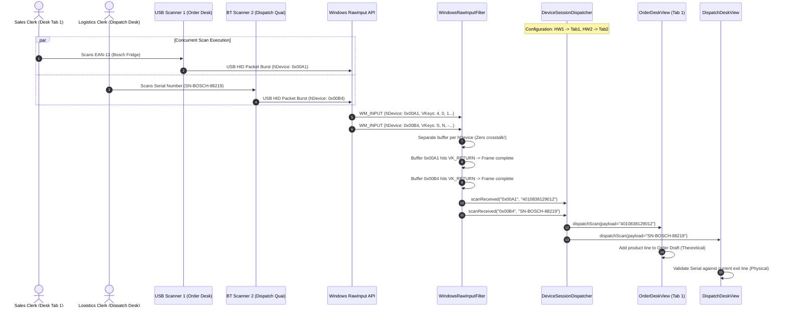
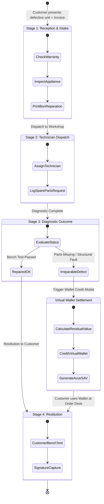
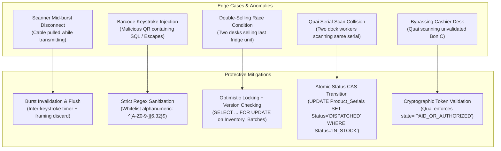

# Frontend Architecture, UI/UX & Hardware Integration Specification
## Multi-Desk Workstation Segregation, Concurrent Multi-Scanner Routing & SAV Pipeline for Retail Electrical Stores (*Magasins d'Électroménager*)

---

## Executive Summary & Engineering Scope

Retail enterprises dealing in domestic home electrical appliances (*Magasins d'Électroménager*) operate under operational, logistical, and physical constraints distinct from standard point-of-sale (POS) retail. Domestic appliances—ranging from Gros Électroménager (GEM: refrigerators, washing machines, built-in ovens) to Petit Électroménager (PEM: espresso machines, food processors), Climatisation & Chauffage (HVAC: split units, heat pumps), and Multimedia (OLED displays, sound systems)—exhibit:

1. **High Unit Capital Value & Strict Traceability**: Every boxed appliance is an independently serialized, high-value asset governed by strict warranty tracking ($N^\circ\text{ de Série}$). Traceability cannot be aggregated at the barcode or SKU level.
2. **Showroom vs. Back-Warehouse Decoupling**: Showroom floor sales representatives handle demonstration units (*modèles d'exposition*) and theoretical inventory allocations. They do not have physical custody of packaged boxes in high-bay pallet racks.
3. **Four-Desk Operational Segregation of Duties (SoD)**:
   - **Order Desk (*Comptoir de Vente*)**: Customer advisory, theoretical product booking, and generation of pro-forma drafts (`Bon C` / `Bon Crédit`).
   - **Cashier Desk (*Comptoir Caisse*)**: Financial settlement, multi-tender collection, customer store credit wallet management, and dual-custody credit approval.
   - **Dispatch & Logistics Desk (*Comptoir Magasin / Quai de Sortie*)**: High-speed physical picking verification, barcode/serial scanning, match validation, and gate pass (`Bon de Sortie`) issuance.
   - **After-Sales Service Desk (*Comptoir SAV & Réparation*)**: Malfunction intake, diagnostic tracking, technician dispatch/return pipeline, and virtual wallet compensation.
4. **Liquidity Defense via Virtual Wallets (*Versement Virtuel*)**: Appliance returns and irreparable defect compensations are strictly barred from disbursing physical cash till funds. All refunds credit an immutable customer store credit wallet (*Versement Virtuel / Portefeuille Client*), preventing till depletion (*assèchement de caisse*) and cash skimming.
5. **Peripheral Input Concurrency on Single Computer Workstations**: High-volume stores frequently deploy multi-terminal environments or shared PC setups where multiple USB or Bluetooth barcode/2D scanners connect to a single PC. Standard USB HID keyboard emulation fails catastrophically in these environments due to focus stealing, character crosstalk, and race conditions.

This document establishes the exhaustive frontend architecture, PySide6 component specifications, low-level OS hardware integration blueprints, and UI/UX design models required for the **StockLamPlus** electrical appliance management system.

---

## Global System Architecture

```mermaid
flowchart TD
    subgraph Hardware Layer ["Peripheral Hardware Layer"]
        SC1["USB Barcode Scanner 1<br/>(Order Desk A - VID:05E0/PID:1200)"]
        SC2["USB Barcode Scanner 2<br/>(Order Desk B - VID:05E0/PID:1200)"]
        SC3["Bluetooth 2D Scanner<br/>(Dispatch Quai - Zebra DS2278)"]
        PRN1["Receipt Thermal Printer<br/>(Epson TM-T88VI)"]
        PRN2["Industrial Label/A4 Printer<br/>(Zebra ZT411 / HP LaserJet)"]
    end

    subgraph OS Input Subsystem ["Operating System Input Isolation"]
        RAW["Windows Raw Input Subsystem<br/>(user32.dll / RegisterRawInputDevices)"]
        UDEV["Linux evdev / udev Subsystem<br/>(/dev/input/by-id/* / EVIOCGRAB)"]
    end

    subgraph PySide6 Core Subsystem ["PySide6 Application Core Engine"]
        NEF["WindowsRawInputFilter<br/>(QAbstractNativeEventFilter)"]
        SBUF["ScanStreamBuffer & Delimiter Framer<br/>(ASCII 0x0D/0x0A burst accumulator)"]
        DISP["DeviceSessionDispatcher<br/>(Qt Signals & Slots routing bus)"]
    end

    subgraph UI Workstation Layer ["Four-Desk UI Workstation Views"]
        VIEW_ORDER["Order Desk UI<br/>(Comptoir de Vente)<br/>- Brand/Category Facets<br/>- Theoretical Stock Grid<br/>- Bon C & Bon Crédit Builder"]
        VIEW_CASH["Cashier Desk UI<br/>(Comptoir Caisse)<br/>- Real-time Order Queue<br/>- Multi-tender Payment Panel<br/>- Virtual Wallet Inspector<br/>- Admin PIN Modal"]
        VIEW_DISP["Dispatch Desk UI<br/>(Quai de Sortie)<br/>- Dual EAN/Serial Scanner<br/>- Real-time Model Validator<br/>- Visual/Audio Feedback Cues<br/>- Bon de Sortie Generator"]
        VIEW_SAV["SAV Repair UI<br/>(Comptoir SAV)<br/>- 4-Stage Kanban Pipeline<br/>- Diagnostic Report Form<br/>- Irreparable Defect Modal<br/>- Virtual Wallet Crediting"]
    end

    subgraph Backend Core ["Backend Services & Data Stores"]
        API["FastAPI / Transactional Python Service Layer"]
        DB[(MySQL 8.0+ / InnoDB<br/>Product_Serials, Batches, Vouchers, Wallets)]
    end

    SC1 -->|USB HID Packets| RAW
    SC2 -->|USB HID Packets| RAW
    SC3 -->|HID / Virtual COM| RAW
    RAW -->|WM_INPUT Events| NEF
    UDEV -.->|Alternative POSIX| NEF
    NEF -->|Raw Key Stroke + Device Handle| SBUF
    SBUF -->|Framed Barcode Payload + Device ID| DISP
    DISP -->|Signal: scanReceived(dev1)| VIEW_ORDER
    DISP -->|Signal: scanReceived(dev2)| VIEW_ORDER
    DISP -->|Signal: scanReceived(dev3)| VIEW_DISP
    
    VIEW_ORDER -->|Issue Bon C Draft| API
    VIEW_CASH -->|Query Order Queue & Validate Payment| API
    VIEW_DISP -->|Verify Serial & Deduct Stock| API
    VIEW_SAV -->|Update Kanban & Credit Wallet| API
    API <--> DB

    VIEW_ORDER -.->|Print Ticket| PRN1
    VIEW_CASH -.->|Print Invoice / Cash Receipt| PRN1
    VIEW_DISP -.->|Print Bon de Sortie & Warranty| PRN2
    VIEW_SAV -.->|Print Bon de Réparation| PRN1
```

---

## 1. Multi-Scanner / Multi-Session Hardware Integration

### 1.1. The Single-PC Concurrency Problem in Retail Appliance Stores

In high-volume electrical appliance stores, checkout and dispatch counters frequently feature multiple clerks operating side by side on a single workstation (e.g., dual-monitor setups, multi-tab POS interfaces, or shared PC docks). Additionally, warehouse picking desks often feature a fixed scanner for master box EAN-13 codes alongside a wireless pistol scanner for appliance serial numbers.

Standard USB and Bluetooth barcode scanners arrive factory-configured in **USB HID Keyboard Emulation Mode** (*Human Interface Device*). When a barcode is read:
1. The scanner converts optical bars or 2D matrices into an alphanumeric string.
2. The scanner injects this string into the host operating system as a burst of rapid keyboard keystrokes (`WM_KEYDOWN` / `WM_KEYUP` on Windows; `EV_KEY` on Linux).
3. The keystrokes terminate with an automatic suffix (typically `Enter` / ASCII `0x0D` or `Tab` / ASCII `0x09`).

#### The Failure Modes of Generic HID Scanners:
- **Focus Stealing & Focus Dependency**: Keystrokes are deposited into whichever GUI widget currently owns keyboard focus (`QLineEdit`, search bar, spinbox, or a background browser tab). If the user accidentally clicks another window or selects a numeric price field, the 16-digit serial number is typed directly into that field, causing UI validation errors or data corruption.
- **Scanner Crosstalk & Interleaving**: When two operators trigger scans simultaneously on scanners connected to the same PC, the OS event queue interleaves their keystrokes. For example, Scanner A reading `EAN: 7332543789012` and Scanner B reading `SN: SN-BOSCH-99482` will merge into `733SN-B25437OSCH-8901299482`, invalidating both scans and halting operations.
- **Serial Port Emulation (USB CDC / Virtual COM) Limitations**: While switching scanners to Virtual COM mode allows dedicated serial port reading (`COM3`, `COM4`), it introduces severe operational liabilities:
  - Requires vendor-specific, proprietary Windows drivers (e.g., Zebra CDC Driver, Honeywell OPOS Driver).
  - Unstable port assignment: If a cashier unplugs a USB scanner and reconnects it to an adjacent port, Windows frequently assigns a new COM port number (`COM7`), breaking application configuration.
  - High configuration overhead: Commodity Chinese 2D scanners often lack stable CDC drivers or require esoteric barcode configuration manuals that retail store staff cannot manage.

### 1.2. The Windows Raw Input API Architecture

The architectural solution implemented in StockLamPlus utilizes the **Windows Raw Input API** (`user32.dll`). Raw Input intercepts peripheral messages directly from the OS Human Interface Device (HID) driver stack *before* the Windows window manager translates them into generic `WM_KEYDOWN`, `WM_KEYUP`, or `WM_CHAR` messages.

Crucially, every Raw Input event contains an opaque device handle (`hDevice` / `HANDLE`) that uniquely identifies the physical USB or Bluetooth peripheral transmitting the packet.

#### Key Windows API Functions & Data Structures:

```cpp
// 1. RAWINPUTDEVICE registration structure
typedef struct tagRAWINPUTDEVICE {
    USHORT usUsagePage; // Top-level collection usage page (0x01 = Generic Desktop Controls)
    USHORT usUsage;     // Top-level collection usage (0x06 = Keyboard)
    DWORD  dwFlags;     // Operational flags (RIDEV_INPUTSINK | RIDEV_DEVNOTIFY)
    HWND   hwndTarget;  // Target window handle receiving WM_INPUT
} RAWINPUTDEVICE, *PRAWINPUTDEVICE;

// 2. RAWINPUT message structure
typedef struct tagRAWINPUTHEADER {
    DWORD  dwType;      // RIM_TYPEKEYBOARD (1)
    DWORD  dwSize;      // Size of the raw input packet
    HANDLE hDevice;     // UNIQUE HARDWARE DEVICE HANDLE
    WPARAM wParam;      // Input code flags
} RAWINPUTHEADER;

typedef struct tagRAWKEYBOARD {
    USHORT MakeCode;         // Scan code from keyboard
    USHORT Flags;            // Key flags (RI_KEY_MAKE = 0, RI_KEY_BREAK = 1, E0/E1 prefixes)
    USHORT Reserved;
    USHORT VKey;             // Virtual Key Code (VK_0 .. VK_Z, VK_RETURN, etc.)
    UINT   Message;          // Underlying window message (WM_KEYDOWN, WM_KEYUP)
    ULONG  ExtraInformation; // Hardware device driver extra data
} RAWKEYBOARD;

typedef struct tagRAWINPUT {
    RAWINPUTHEADER header;
    union {
        RAWMOUSE    mouse;
        RAWKEYBOARD keyboard;
        RAWHID      hid;
    } data;
} RAWINPUT, *PRAWINPUT;
```

#### Operational Mechanics of Raw Input Isolation:
1. **Device Registration (`RegisterRawInputDevices`)**:
   - The application registers interest in `usUsagePage = 0x01` and `usUsage = 0x06` (Keyboard).
   - Flag `RIDEV_INPUTSINK` allows the application to receive input even when its window does not have foreground focus.
   - Flag `RIDEV_DEVNOTIFY` prompts the OS to dispatch `WM_INPUT_DEVICE_CHANGE` messages when peripherals are hot-plugged or disconnected.
2. **Device Discovery & Identification (`GetRawInputDeviceInfoW`)**:
   - Passing `RIDI_DEVICENAME` queries the physical OS device path string:
     `\\?\HID#VID_05E0&PID_1200#6&12f734&0&0000#{884b96c3-56ef-11d1-bc8c-00a0c91405dd}`
   - The string contains the Vendor ID (`VID_05E0` = Zebra Technologies), Product ID (`PID_1200`), and physical USB Bus Topology Address.
   - The store administrator or cashier can map a specific physical scanner to a specific UI tab or sales desk session.
3. **Keystroke Suppression & Interception**:
   - In standard Raw Input mode, Windows delivers *both* `WM_INPUT` and standard `WM_KEYDOWN`. To prevent duplicate characters from typing into focused text fields, StockLamPlus pairs `WM_INPUT` event routing with an application-level focus shield or installs a low-level keyboard hook (`WH_KEYBOARD_LL`) that suppresses key generation for registered scanner device handles while allowing human operator keyboard typing to pass unimpeded.

### 1.3. Cross-Platform Abstraction: Linux `evdev` & `udev` Architecture

For Linux-based POS stations (Ubuntu LTS, Debian POS terminals), the system implements an equivalent abstraction layer leveraging the Linux Kernel **`evdev`** subsystem:

```
Physical USB Scanners
       │
       ▼
/dev/input/by-id/usb-Zebra_Technologies_Zebra_Scanner_*-event-kbd
/dev/input/by-id/usb-Honeywell_Imaging_Scanner_*-event-kbd
       │
       ▼ (ioctl EVIOCGRAB: Exclusive Lock)
Python evdev / Asyncio Event Loop Worker Thread
       │
       ▼ (Qt Thread-safe Signal)
PySide6 DeviceSessionDispatcher
```

- **Exclusive Device Grab (`ioctl(fd, EVIOCGRAB, 1)`)**: Under Linux, opening the scanner's `/dev/input/event*` node and calling `EVIOCGRAB` grants the application exclusive access. The Linux kernel completely suppresses the generation of X11/Wayland keyboard events for that device. Human keyboards remain ungrabbed, completely eliminating input crosstalk.
- **Dynamic Hotplug Monitoring via `pyudev`**: A background monitor listens for `udev` subsystem `add` / `remove` actions, automatically binding newly inserted scanners to designated desk tabs.

### 1.4. PySide6 Native Event Filter Implementation Blueprint

The following production-ready Python code implements the Windows Raw Input native event filter in PySide6 using `ctypes`:

```python
"""
hardware/raw_input_filter.py
Production-grade PySide6 Native Event Filter for Windows Raw Input API.
Captures, isolates, and buffers high-speed barcode scanner streams per physical USB device.
"""

import sys
import ctypes
from ctypes import wintypes
from typing import Dict, Optional, Callable
from PySide6.QtCore import QObject, Signal, QAbstractNativeEventFilter, QByteArray, QTimer

# Windows Raw Input Constants
RIDEV_INPUTSINK = 0x00000100
RIDEV_DEVNOTIFY = 0x00002000
RIDEV_REMOVE    = 0x00000001

RID_INPUT  = 0x10000003
RID_HEADER = 0x10000005

RIDI_DEVICENAME   = 0x20000007
RIDI_DEVICEINFO   = 0x2000000b

RIM_TYPEKEYBOARD = 1
WM_INPUT         = 0x00FF
WM_INPUT_DEVICE_CHANGE = 0x00FE

RI_KEY_MAKE  = 0
RI_KEY_BREAK = 1
RI_KEY_E0    = 2
RI_KEY_E1    = 4

GIDC_ARRIVAL = 1
GIDC_REMOVAL = 2

# Ctypes Structure Definitions
class RAWINPUTDEVICE(ctypes.Structure):
    _fields_ = [
        ("usUsagePage", wintypes.USHORT),
        ("usUsage", wintypes.USHORT),
        ("dwFlags", wintypes.DWORD),
        ("hwndTarget", wintypes.HWND),
    ]

class RAWINPUTHEADER(ctypes.Structure):
    _fields_ = [
        ("dwType", wintypes.DWORD),
        ("dwSize", wintypes.DWORD),
        ("hDevice", wintypes.HANDLE),
        ("wParam", wintypes.WPARAM),
    ]

class RAWKEYBOARD(ctypes.Structure):
    _fields_ = [
        ("MakeCode", wintypes.USHORT),
        ("Flags", wintypes.USHORT),
        ("Reserved", wintypes.USHORT),
        ("VKey", wintypes.USHORT),
        ("Message", wintypes.UINT),
        ("ExtraInformation", wintypes.ULONG),
    ]

class RAWINPUT(ctypes.Structure):
    class _RAWINPUTUNION(ctypes.Union):
        _fields_ = [("keyboard", RAWKEYBOARD)]
    _fields_ = [
        ("header", RAWINPUTHEADER),
        ("data", _RAWINPUTUNION),
    ]

PRAWINPUT = ctypes.POINTER(RAWINPUT)
PRAWINPUTDEVICE = ctypes.POINTER(RAWINPUTDEVICE)

class DeviceScanBuffer:
    """Buffers rapid keystroke bursts from a specific hardware device."""
    def __init__(self, device_handle: int, device_name: str, on_scan_complete: Callable[[str, str], None]):
        self.device_handle = device_handle
        self.device_name = device_name
        self.on_scan_complete = on_scan_complete
        self.char_buffer = []
        self.last_timestamp = 0.0
        
        # Inter-keystroke timeout timer (fallback framing if no CR/LF suffix)
        self.burst_timer = QTimer()
        self.burst_timer.setSingleShot(True)
        self.burst_timer.setInterval(45)  # Barcode scanners burst keys < 15ms apart
        self.burst_timer.timeout.connect(self._flush_buffer)

    def append_char(self, char: str):
        self.char_buffer.append(char)
        self.burst_timer.start()

    def handle_terminator(self):
        self.burst_timer.stop()
        self._flush_buffer()

    def _flush_buffer(self):
        if self.char_buffer:
            payload = "".join(self.char_buffer).strip()
            self.char_buffer.clear()
            if len(payload) >= 3:  # Filter out spurious single keystrokes
                self.on_scan_complete(str(self.device_handle), payload)


class WindowsRawInputFilter(QObject, QAbstractNativeEventFilter):
    """
    Native Event Filter hooked into QCoreApplication.
    Intercepts WM_INPUT events directly from the OS message pump.
    """
    scanReceived = Signal(str, str)         # device_id, barcode_text
    deviceConnected = Signal(str, str)      # device_id, device_path
    deviceDisconnected = Signal(str)        # device_id

    def __init__(self, parent=None):
        super().__init__(parent)
        self._user32 = ctypes.windll.user32
        self._buffers: Dict[int, DeviceScanBuffer] = {}
        self._device_names: Dict[int, str] = {}
        self._shift_active = False

    def register_devices(self, hwnd: int) -> bool:
        """Registers the main window handle to receive raw keyboard events."""
        rid = RAWINPUTDEVICE()
        rid.usUsagePage = 0x01      # Generic Desktop
        rid.usUsage = 0x06          # Keyboard
        rid.dwFlags = RIDEV_INPUTSINK | RIDEV_DEVNOTIFY
        rid.hwndTarget = hwnd

        success = self._user32.RegisterRawInputDevices(
            ctypes.byref(rid), 1, ctypes.sizeof(RAWINPUTDEVICE)
        )
        return bool(success)

    def _get_device_name(self, hDevice: int) -> str:
        """Retrieves physical device interface path for a device handle."""
        if hDevice in self._device_names:
            return self._device_names[hDevice]

        size = wintypes.UINT(0)
        self._user32.GetRawInputDeviceInfoW(hDevice, RIDI_DEVICENAME, None, ctypes.byref(size))
        if size.value == 0:
            return "UNKNOWN_DEVICE"

        buf = ctypes.create_unicode_buffer(size.value)
        self._user32.GetRawInputDeviceInfoW(hDevice, RIDI_DEVICENAME, buf, ctypes.byref(size))
        dev_name = buf.value
        self._device_names[hDevice] = dev_name
        return dev_name

    def nativeEventFilter(self, eventType: QByteArray, message: int) -> tuple[bool, int]:
        """
        Qt Native event filter entry point. Intercepts Windows MSG structures.
        """
        if eventType != b"windows_generic_MSG":
            return False, 0

        # Unpack the Windows MSG pointer
        msg = wintypes.MSG.from_address(message)

        if msg.message == WM_INPUT_DEVICE_CHANGE:
            change_type = msg.wParam
            hDevice = msg.lParam
            if change_type == GIDC_ARRIVAL:
                dev_name = self._get_device_name(hDevice)
                self.deviceConnected.emit(str(hDevice), dev_name)
            elif change_type == GIDC_REMOVAL:
                self.deviceDisconnected.emit(str(hDevice))
                self._buffers.pop(hDevice, None)
                self._device_names.pop(hDevice, None)
            return False, 0

        if msg.message == WM_INPUT:
            # Query the size of the RAWINPUT structure
            dwSize = wintypes.UINT(0)
            self._user32.GetRawInputData(
                msg.lParam, RID_INPUT, None, ctypes.byref(dwSize), ctypes.sizeof(RAWINPUTHEADER)
            )
            if dwSize.value == 0:
                return False, 0

            raw_buffer = ctypes.create_string_buffer(dwSize.value)
            res = self._user32.GetRawInputData(
                msg.lParam, RID_INPUT, raw_buffer, ctypes.byref(dwSize), ctypes.sizeof(RAWINPUTHEADER)
            )
            if res != dwSize.value:
                return False, 0

            raw = ctypes.cast(raw_buffer, PRAWINPUT).contents
            if raw.header.dwType == RIM_TYPEKEYBOARD:
                self._process_keyboard_input(raw.header.hDevice, raw.data.keyboard)

        # Allow message to continue normal propagation
        return False, 0

    def _process_keyboard_input(self, hDevice: int, kbd: RAWKEYBOARD):
        """Processes raw keyboard strokes, manages Shift state, and buffers characters."""
        is_break = bool(kbd.Flags & RI_KEY_BREAK)
        vkey = kbd.VKey

        # Track Shift key state
        if vkey in (0x10, 0xA0, 0xA1):  # VK_SHIFT, VK_LSHIFT, VK_RSHIFT
            self._shift_active = not is_break
            return

        # We only accumulate characters on KEY_DOWN (Make)
        if is_break:
            return

        # Ensure device buffer exists
        if hDevice not in self._buffers:
            dev_name = self._get_device_name(hDevice)
            self._buffers[hDevice] = DeviceScanBuffer(
                hDevice, dev_name, lambda dev_id, text: self.scanReceived.emit(dev_id, text)
            )

        buf = self._buffers[hDevice]

        # Check for standard barcode terminators (Enter / Tab)
        if vkey in (0x0D, 0x09):  # VK_RETURN, VK_TAB
            buf.handle_terminator()
            return

        # Convert Virtual Key to ASCII / Unicode
        char = self._vkey_to_char(vkey, self._shift_active)
        if char:
            buf.append_char(char)

    def _vkey_to_char(self, vkey: int, shift: bool) -> Optional[str]:
        """Translates virtual key codes into characters based on shift state."""
        # Numbers 0-9
        if 0x30 <= vkey <= 0x39:
            num = chr(vkey)
            if shift:
                symbols = {
                    '1': '!', '2': '@', '3': '#', '4': '$', '5': '%',
                    '6': '^', '7': '&', '8': '*', '9': '(', '0': ')'
                }
                return symbols.get(num, num)
            return num

        # Letters A-Z
        if 0x41 <= vkey <= 0x5A:
            char = chr(vkey)
            return char if shift else char.lower()

        # Numpad 0-9
        if 0x60 <= vkey <= 0x69:
            return chr(vkey - 0x60 + ord('0'))

        # Hyphen / Underscore
        if vkey == 0xBD:
            return '_' if shift else '-'

        # Slash
        if vkey == 0xBF:
            return '?' if shift else '/'

        return None
```

### 1.5. Dynamic Device-to-Session Routing Architecture



The `DeviceSessionDispatcher` acts as the central router:
- Maintains an in-memory registry of known hardware handles mapped to session identifiers:
  `{"0x00A1": "ORDER_DESK_TAB_1", "0x00B4": "DISPATCH_DESK"}`.
- Provides a **Scanner Pairing Dialog**: A modal dialog prompts: *"Please scan the configuration barcode on your desk using Scanner 1"*. Upon receipt of the scan, the dispatcher binds that `hDevice` permanently in local settings (`QSettings`).
- **Focus Independence**: Incoming barcodes are dispatched directly via Qt signals to the target view controller. The active GUI focus (e.g., whether cursor is in a notes field or another application) is completely irrelevant.

---

## 2. Three-Desk Operational UI Architecture

### 2.1. Desk 1: Order Desk UI (*Comptoir de Vente*)

#### Role & Persona
The showroom sales representative interacts with retail clients examining physical floor samples (*modèles d'exposition*). The representative requires fast, multi-criteria filtering by appliance brand, category, energy rating, and color finish, followed by instant theoretical inventory checks without committing specific physical units.

#### UI Layout & Visual Hierarchy

```
+--------------------------------------------------------------------------------------------------------------------+
|  StockLamPlus - Comptoir de Vente (Order Desk) - Vendeur: Karim M.                        [Session: POS-01] [Sync: OK] |
+-------------------------------------------------+------------------------------------------+-----------------------+
|  FACET FILTERS & SPECIFICATION SEARCH           |  PRODUCT CATALOG & THEORETICAL STOCK     |  ACTIVE CLIENT ORDER  |
+-------------------------------------------------+------------------------------------------+-----------------------+
|  [🔍 Search Brand, Model, SKU, Wattage, Dim...] |  Displaying: 42 Appliances Found         | Client: Omar Belkacem |
|                                                 |  +------------------------------------+  | Phone:  0550 12 34 56 |
|  BRANDS:                                        |  | BOSCH KGN39VLEB - Combi Inox 368L  |  | Type:   Particulier   |
|  [x] Bosch (14)   [ ] LG (8)     [ ] Samsung(12)|  | Cat: Réfrigérateurs | Fin: Inox    |  +-----------------------+
|  [ ] Brandt (6)  [ ] Cristor(9)  [ ] Midea (7)  |  | Watts: 140W | Class: A++           |  | ORDER ITEMS (3)       |
|                                                 |  | Stock Rayon (Expo): 1 (Showroom)   |  | 1. Bosch KGN39VLEB    |
|  CATEGORIES:                                    |  | Stock Dépôt:        7 (Disponible) |  |    Qty: 1 x 115,000 DA|
|  > Gros Électroménager (GEM)                    |  | Prix: 115,000 DA                   |  |    Finish: Inox       |
|    - Réfrigérateurs & Congélateurs              |  | [ Voir Démo ]   [ + Ajouter Bon ]  |  | 2. LG F4J6TY0W (Wash) |
|    - Lave-linge & Séchoirs                      |  +------------------------------------+  |    Qty: 1 x 88,000 DA |
|    - Cuisson & Fours Encastrables               |  | SAMSUNG WW90T554DAW - EcoBubble 9kg|  |    Finish: Blanc      |
|  > Petit Électroménager (PEM)                   |  | Cat: Lave-linge | Fin: Blanc       |  | 3. Midea Inverter 12k |
|  > Climatisation & Chauffage (HVAC)             |  | Stock Rayon: 0 | Stock Dépôt: 12   |  |    Qty: 2 x 64,000 DA |
|                                                 |  | Prix: 88,000 DA                    |  +-----------------------+
|  FINISH / COLOR:                                |  | [ + Ajouter Bon ]                  |  Total Brut: 331,000 DA|
|  ( ) Inox  ( ) Noir Mat  ( ) Blanc  ( ) Silver  +------------------------------------+  Remise:         -5,000 DA|
|                                                 |  | BRANDT BXP6555X - Four Pyrolyse 73L|  TOTAL NET:  326,000 DA|
|  ENERGY CLASS:                                  |  | Cat: Fours | Fin: Inox Brossé      |  +-----------------------+
|  [ ] A+++  [x] A++  [ ] A+                      |  | Stock Rayon: 1 | Stock Dépôt: 3    |  [📋 Pro-Forma (Devis)] |
|                                                 |  | Prix: 62,000 DA                    |  [⚡ Générer BON C    ] |
|  AVAILABILITY:                                  |  | [ + Ajouter Bon ]                  |  [💳 Demande BON CRÉDIT]|
|  [x] Include High-Bay Pallet Warehouse Stock   +------------------------------------+  +-----------------------+
+-------------------------------------------------+------------------------------------------+-----------------------+
```

#### Core Functional Workflows
1. **Theoretical Product Allocation**:
   - The sales clerk selects products based on SKU, Brand, Category, and Color.
   - The UI displays two distinct stock metrics:
     - **Stock Rayon / Modèle Expo**: Showroom sample units physically present on the floor. Cannot be sold unless explicitly marked as *Vente Modèle d'Exposition* with a floor discount.
     - **Stock Dépôt (Disponible Réel)**: Physical units stored in high-bay pallet warehouses ($Q_{\text{avail}} = Q_{\text{physical}} - Q_{\text{reserved}}$).
   - Zero physical unit serial numbers (`Product_Serials`) are bound at this stage.
2. **Draft Voucher Generation**:
   - **Bon C (Voucher Provisoire)**: Standard sales draft. Increments `Theoretical_Reserved_Qty` in the backend inventory cache for 120 minutes. Dispatches a thermal slip with Order ID barcode (`BC-20261104-0042`) directing the client to the Cashier Desk.
   - **Bon Crédit Request**: If the customer requests credit/term payment (*Paiement à terme / Facilité*), the clerk marks the order as a Credit Request, attaching financing parameters (deposit amount, number of installments).

---

### 2.2. Desk 2: Cashier Desk UI (*Comptoir Caisse*)

#### Role & Persona
The cashier is responsible for financial reconciliation, payment collection, customer virtual wallet management, and dual-custody authorization for term credit transactions. The cashier does not handle physical appliance picking.

#### UI Layout & Visual Hierarchy

```
+--------------------------------------------------------------------------------------------------------------------+
|  StockLamPlus - Comptoir Caisse (Cashier Desk) - Caissière: Amina B.                         [Tiroir Caisse: 240,000 DA] |
+-------------------------------------------------------+------------------------------------------------------------+
|  INCOMING ORDER QUEUE (Real-Time)                     |  PAYMENT SETTLEMENT & FINANCIAL VALIDATION                 |
+-------------------------------------------------------+------------------------------------------------------------+
|  [🔍 Scan Barcode Bon C / Client Phone / ID...]       |  Selected Order: BC-20261104-0042   Date: 04/11 09:35      |
|                                                       |  Client: Omar Belkacem              Type: Particulier      |
|  Queue Status: 3 Awaiting Payment                     |  +------------------------------------------------------+  |
|  +-------------------------------------------------+  |  LIVRE DE COMPTE CLIENT (Virtual Wallet Ledger)          |  |
|  | BC-0042 | Omar Belkacem | 326,000 DA | 4 min ago|  |  Solde Versement Virtuel Disponible:   45,000 DA        |  |
|  | Status: Bon C Standard (Comptant)               |  |  [x] Appliquer Avoir / Versement Virtuel                |  |
|  +-------------------------------------------------+  |  Montant Déduit du Portefeuille:      -45,000 DA        |  |
|  | BC-0041 | SARL Electro-Nord | 890,000 DA| 12 min |  +------------------------------------------------------+  |
|  | Status: DEMANDE BON CRÉDIT (Nécessite Accord)   |  |  MONTANT RESTANT À RÉGLER:             281,000 DA        |  |
|  +-------------------------------------------------+  |                                                          |
|  | BC-0039 | Yassine Toumi | 42,000 DA  | 18 min   |  |  VENTILATION DES MODES DE PAIEMENT                       |  |
|  | Status: Bon C Standard                          |  |  [ Espèces (Cash) ]      Montant: [ 181,000 ] DA         |  |
|  +-------------------------------------------------+  |  [ TPE / Carte CIB/Edahabia ]     [ 100,000 ] DA         |  |
|                                                       |  [ Chèque Bancaire ]     Montant: [       0 ] DA         |  |
|                                                       |  +------------------------------------------------------+  |
|                                                       |  Rendu Monnaie: 0 DA       Reste Dû: 0 DA                |  |
|                                                       |  +------------------------------------------------------+  |
|                                                       |  [🔒 VALIDER ENCAISSEMENT & SORTIE MAGASIN              |  |
|                                                       |  [🔑 AUTORISATION MANAGER (Requis pour Bon Crédit)      |  |
+-------------------------------------------------------+------------------------------------------------------------+
```

#### Core Functional Workflows
1. **Real-time Order Queue Synchronization**:
   - The cashier UI polls the backend via WebSocket or `QTimer` (2-second interval) to display incoming orders drafted at the Order Desks.
   - When a customer presents their paper ticket, the cashier scans the barcode, instantly opening the payment console.
2. **Virtual Wallet (*Versement Virtuel*) Application**:
   - The customer's store credit wallet balance is queried in real time (`Customer_Wallets`).
   - If the customer possesses store credit generated from previous returns or SAV compensations, the cashier can apply up to the full balance against the invoice.
   - The UI displays an itemized deduction:
     $$\text{Remaining Due} = \text{Order Total} - \text{Wallet Deduction} - \text{Cash} - \text{TPE}$$
3. **Admin PIN / Password Dialog for `Bon Crédit`**:
   - For credit vouchers, the `VALIDATE` button is locked. An `ADMIN AUTHORIZATION` button opens a secure modal.
   - The modal renders customer risk indicators: Approved credit ceiling, current outstanding arrears, overdue aging buckets (30/60/90 days), and credit scoring.
   - Requires an authorized Store Director or Financial Controller PIN/password. Validates credentials against PBKDF2/Argon2 hashes in the database and logs a tamper-proof audit trail event.
4. **Validation Artifacts**:
   - Generates official Invoice / Sales Voucher (`Facture / Bon de Vente Valide`).
   - Generates a **Logistics Exit Authorization Token** (`Bon de Sortie Token`) transmitted immediately to the Dispatch Desk queue.

---

### 2.3. Desk 3: Dispatch & Logistics Quai UI (*Comptoir Quai de Sortie / Magasin*)

#### Role & Persona
The warehouse picking operator stands at the logistical dispatch dock or high-bay warehouse gate. The operator verifies physical packaging, scans manufacturer barcodes and unique serial numbers, validates models against the paid invoice token, and hands off goods to the customer or delivery van.

#### UI Layout & Visual Hierarchy

```
+--------------------------------------------------------------------------------------------------------------------+
|  StockLamPlus - Comptoir Quai de Sortie (Dispatch Logistics) - Magasinier: Youcef B.        [Dock: Quai Nord-02]    |
+--------------------------------------------------------------------------------------------------------------------+
|  STEP 1: SCAN VOUCHER / EXIT TOKEN     [ 🔍 Scanned: BST-20261104-0042 ]    Status: PAYÉ & VALIDÉ (Caisse 1)       |
+--------------------------------------------------------------------------------------------------------------------+
|  ORDER ITEMS REQUIRING SERIAL VALIDATION (2 of 3 Verified)                                                         |
|  +---------------------------------------------------------------------------------------------------------------+ |
|  | ITEM 1: BOSCH KGN39VLEB - Réfrigérateur Combi Inox 368L                           [ STATUS: 🟢 VALIDÉ & LIÉ ] | |
|  | Expected EAN: 4242005198030 | Color: Inox | Qty Required: 1 / Scanned: 1                                      | |
|  | Scanned Serial: [ SN-BSH-KGN39-202608-883192 ]                                                                | |
|  | Verification:   Serial matched to Batch LOT-2026-08 (Valid Landed Cost: 84,200 DA)                            | |
|  +---------------------------------------------------------------------------------------------------------------+ |
|  | ITEM 2: LG F4J6TY0W - Lave-linge 8kg Direct Drive 1400tr                          [ STATUS: 🟡 EN ATTENTE ]   | |
|  | Expected EAN: 8806098321092 | Color: Blanc | Qty Required: 1 / Scanned: 0                                     | |
|  | Current Scanner Buffer: [                                                    ]                                | |
|  | Action: SCAN MASTER EAN THEN APPLIANCE SERIAL NUMBER FROM RETAIL BOX                                          | |
|  +---------------------------------------------------------------------------------------------------------------+ |
|  | ITEM 3: MIDEA INVERTER 12000 BTU - Split Climatiseur                              [ STATUS: ⚪ NON SCANNÉ ]   | |
|  | Expected EAN: 6939962711029 | Color: Blanc | Qty Required: 2 / Scanned: 0                                     | |
+--------------------------------------------------------------------------------------------------------------------+
|  REAL-TIME SCAN VALIDATION MONITOR                                                                                 |
|  +---------------------------------------------------------------------------------------------------------------+ |
|  |  LAST SCAN EVENT: Serial "SN-BSH-KGN39-202608-883192"                                                        | |
|  |  RESULT:          MATCH SUCCESSFUL (Item 1 Bound)                                                              | |
|  |  VISUAL CUE:      [██████████████████████████████ GREEN: MATCH CONFIRMED ██████████████████████████████]       | |
|  |  AUDIO CUE:       [♫ HIGH CHIME (1200Hz, 150ms)]                                                               | |
|  +---------------------------------------------------------------------------------------------------------------+ |
|  [ ⚠️ FORCER SAISIE MANUELLE (Mot de passe Superviseur) ]             [ 🖨️ IMPRIMER BON DE SORTIE & GARANTIE ]    |
+--------------------------------------------------------------------------------------------------------------------+
```

#### Core Functional Workflows
1. **High-Speed Dual-Scan Protocol**:
   - The operator scans the customer's payment exit token (`BST-0042`).
   - The picking lines load. For each appliance, the operator uses a handheld 2D gun:
     - Scan 1: Product Master EAN-13 barcode on box packaging.
     - Scan 2: Unique Manufacturer Serial Number ($N^\circ\text{ de Série}$).
2. **Instant Match & Integrity Engine**:
   - The client UI matches the scanned serial against the backend `Product_Serials` table:
     - Validates that `Product_ID` corresponds to the item on the voucher.
     - Validates that `Status == 'IN_STOCK'`.
     - Validates that the serial is not already assigned to another active exit draft.
3. **Visual & Audio Status Feedback Matrix**:

| Event Type | Visual Indicator | UI Screen Effect | Sound Frequency / Pattern | Operational Action |
| :--- | :--- | :--- | :--- | :--- |
| **Match Verified** | Solid Bright Green (`#10B981`) | Item row pulses green; counter increments | High Pitch Chime (1200 Hz, 150ms) | Unit accepted. Operator moves to next box. |
| **Duplicate Serial** | Solid Yellow (`#F59E0B`) | Screen flashes yellow; warning banner displays | Double Staccato Beep (800 Hz, 80ms x2) | Unit already scanned in this session. Prevent duplicate count. |
| **Model / SKU Mismatch** | Flashing Red (`#EF4444`) | Screen flashes red border; error modal shake | Low Harsh Buzzer (220 Hz, 400ms) | Operator picked wrong model (e.g., White instead of Inox). Unit rejected. |
| **Invalid State** | Dark Orange (`#F97316`) | Badge: "ALREADY DISPATCHED / IN SAV" | Descending Tone (600Hz -> 300Hz) | Box indicates unit already sold or returned to SAV. Quarantine box immediately. |

4. **Bon de Sortie & Warranty Certificate Finalization**:
   - Once all required serials are verified, the `IMPRIMER BON DE SORTIE` button unlocks.
   - Submitting the form initiates a single database transaction:
     - Transitions `Product_Serials.Status` from `IN_STOCK` to `DISPATCHED`.
     - Creates immutable audit records in `Product_Serial_History`.
     - Decrements physical stock in `Inventory_Batches`.
     - Prints the official **Bon de Sortie** and initiates the manufacturer warranty date clock.

---

## 3. After-Sales Service (SAV) & Repair Management UI

### 3.1. Operational Segregation & Regulatory Context
Appliance retail mandates formal after-sales service (SAV) governance. Under consumer protection frameworks, high-ticket appliances carry statutory warranties (12 to 36 months). Malfunctioning units undergo formal intake, bench testing, component replacement, and customer restitution.

When a unit experiences an **Irreparable Defect** (*Défaut Irréparable*—such as internal compressor burnout, fractured structural liner, or unobtainable PCB microcontrollers), the store must compensate the consumer. In StockLamPlus, to protect corporate cash flow and prevent till depletion, **refunds are strictly prohibited in physical cash**. The system automatically credits the consumer's **Virtual Wallet (*Versement Virtuel*)**.

### 3.2. Four-Stage Kanban Pipeline View



#### Kanban Pipeline Stages:
1. **Stage 1: Reception (*Comptoir Réception SAV*)**:
   - Serial number lookup instantly verifies warranty coverage, original purchase invoice, and customer identity.
   - Digital inspection checklist: Visual exterior condition (scratches, dents, missing shelves, power cable intact).
   - Defect taxonomy selector (e.g., "GEM_FROST_BUILDUP", "MOTOR_NOISE", "ERROR_CODE_E04").
   - Thermal printing of `Bon de Réparation` with QR code for customer self-service status tracking.
2. **Stage 2: Technician Dispatch (*Atelier Technique*)**:
   - Kanban card moves to "Sent to Technician".
   - Assignment to bench specialist (Internal Refrigeration Tech vs. External Authorized Manufacturer Center - SAV Agréé).
3. **Stage 3: Technician Return & Diagnostic (*Retour Diagnostic*)**:
   - Technician logs diagnostic report, labor minutes, and replacement parts used.
   - Status determination:
     - `REPAIRED_BENCH_TESTED_OK`: Tested under load for 4 hours, ready for customer collection.
     - `IRREPARABLE_DEFECT`: Unrepairable manufacturer defect. Triggers the compensation workflow.
4. **Stage 4: Customer Delivery (*Restitution Client*)**:
   - Customer presents `Bon de Réparation`.
   - Appliance is powered up at the test bench in front of the customer.
   - Digital signature captured on touch screen, finalizing ticket closure.

---

### 3.3. Irreparable Defect Modal & Virtual Wallet Crediting

When a technician marks an appliance as irreparable, the `IrreparableDefectModal` is triggered:

```
+----------------------------------------------------------------------------------------------------+
|  TRAITEMENT APPAREIL IRRÉPARABLE - COMPENSATION PORTEFEUILLE VIRTUEL                                |
+----------------------------------------------------------------------------------------------------+
|  Ticket SAV:      SAV-2026-0814             Date d'Achat Originale: 15/01/2026 (10 mois d'usage)  |
|  Appareil:        LG F4J6TY0W (Lave-linge)  Prix d'Achat Initial:   88,000 DA                      |
|  N° Série:        SN-LG-88410294            Garantie Contractuelle: 24 Mois (Couvert)              |
|  Motif Défaillance: Cuve fissurée & Roulement scellé défaillant - Pièce fabricant non disponible  |
+----------------------------------------------------------------------------------------------------+
|  CALCUL DU MONTANT DU VERSEMENT VIRTUEL (RÈGLEMENT FINANCIER)                                      |
|                                                                                                    |
|  Politique de Dépréciation Appliquée:                                                              |
|  (o) Remplacement à Valeur Intégrale (100% de la valeur d'achat si < 12 mois)                      |
|  ( ) Dépréciation Linéaire au Prorata Temporis                                                     |
|  ( ) Décote Forfaitaire Accordée par le Directeur                                                  |
|                                                                                                    |
|  Prix Initial Facturé:                                                         88,000 DA           |
|  Dépréciation / Usure Déduite:                                                  -      0 DA        |
|  VALEUR NETTE DE COMPENSATION:                                                 88,000 DA           |
|                                                                                                    |
|  CRÉDITATION DU PORTEFEUILLE CLIENT (*Versement Virtuel*):                                         |
|  Client Bénéficiaire: Omar Belkacem (ID: CLI-0941)                                                 |
|  Solde Actuel Portefeuille:                                                     5,000 DA           |
|  Nouveau Solde Après Crédit:                                                   93,000 DA           |
+----------------------------------------------------------------------------------------------------+
|  [x] Marquer l'appareil comme "DÉCLASSÉ / REBUT" (SCRAPPED - Sortie définitive de l'actif)          |
|  [x] Générer l'Avoir SAV Officiel (Document PDF comptable)                                         |
|  [ ] Envoyer notification SMS automatique au client                                                |
|                                                                                                    |
|  [ ANNULER ]                                      [ 💳 CONFIRMER CRÉDIT VIRTUEL & CLÔTURER TICKET ]|
+----------------------------------------------------------------------------------------------------+
```

#### Financial & Mathematical Model
The virtual credit value ($V_{\text{credit}}$) is calculated using strict corporate policy:

$$V_{\text{credit}} = \begin{cases} 
P_{\text{invoice}} & \text{if } T_{\text{usage}} \le T_{\text{threshold}} \text{ (e.g., 12 months)} \\
P_{\text{invoice}} \times \left(1 - \frac{T_{\text{usage}} - T_{\text{threshold}}}{T_{\text{warranty}} - T_{\text{threshold}}} \times \delta\right) & \text{if } T_{\text{usage}} > T_{\text{threshold}}
\end{cases}$$

Where:
- $P_{\text{invoice}}$: Historical purchase price inclusive of VAT.
- $T_{\text{usage}}$: Months elapsed between invoice date and repair intake.
- $T_{\text{warranty}}$: Total warranty months (e.g., 24 months).
- $\delta$: Maximum depreciation cap (typically 30%).

The transaction creates an immutable credit entry in `Customer_Wallet_Transactions`:
- `Transaction_Type = 'SAV_IRREPARABLE_COMPENSATION'`
- `Amount = V_credit`
- `Reference_Ticket_ID = SAV-2026-0814`
- `Cash_Till_Impact = 0.00 DA` (Zero physical cash leaves the store till).

---

## 4. PySide6 Component Architecture & Code Blueprints

### 4.1. Order Desk UI View Blueprint (`ui/order_desk_view.py`)

```python
"""
ui/order_desk_view.py
Order Desk View for Showroom Sales Representatives.
Facilitates multi-facet appliance filtering, theoretical stock reservation, and Bon C generation.
"""

from PySide6.QtWidgets import (
    QWidget, QHBoxLayout, QVBoxLayout, QGridLayout, QLabel, QLineEdit,
    QPushButton, QTableWidget, QTableWidgetItem, QHeaderView, QFrame,
    QScrollArea, QCheckBox, QRadioButton, QButtonGroup, QSpinBox, QMessageBox
)
from PySide6.QtCore import Qt, Signal, Slot
from PySide6.QtGui import QFont, QColor

class OrderDeskWidget(QWidget):
    bonCGenerated = Signal(dict)        # Emits order dictionary for thermal printing
    bonCreditRequested = Signal(dict)   # Emits credit request for cashier/admin

    def __init__(self, parent=None):
        super().__init__(parent)
        self._cart_items = []
        self._init_ui()

    def _init_ui(self):
        main_layout = QHBoxLayout(self)
        main_layout.setContentsMargins(12, 12, 12, 12)
        main_layout.setSpacing(16)

        # 1. Left Column: Facet Filters
        filter_panel = self._create_filter_panel()
        main_layout.addWidget(filter_panel, stretch=1)

        # 2. Center Column: Catalog & Theoretical Stock Grid
        catalog_panel = self._create_catalog_panel()
        main_layout.addWidget(catalog_panel, stretch=2)

        # 3. Right Column: Active Client Cart & Voucher Builder
        cart_panel = self._create_cart_panel()
        main_layout.addWidget(cart_panel, stretch=1)

    def _create_filter_panel(self) -> QWidget:
        panel = QFrame()
        panel.setFrameShape(QFrame.StyledPanel)
        panel.setStyleSheet("background-color: #1E293B; border-radius: 8px; color: #F8FAFC;")
        layout = QVBoxLayout(panel)

        title = QLabel("FILTRES ÉLECTROMÉNAGER")
        title.setFont(QFont("Segoe UI", 11, QFont.Bold))
        layout.addWidget(title)

        # Brand Selector
        layout.addWidget(QLabel("Marques:"))
        self.brand_group = QButtonGroup(self)
        self.brand_group.setExclusive(False)
        for brand in ["Bosch", "Samsung", "LG", "Brandt", "Cristor", "Midea"]:
            cb = QCheckBox(brand)
            layout.addWidget(cb)
            self.brand_group.addButton(cb)

        # Finish / Color Selector
        layout.addWidget(QLabel("Finition / Couleur:"))
        for finish in ["Inox Brossé", "Noir Mat", "Blanc Laqué", "Silver"]:
            rb = QRadioButton(finish)
            layout.addWidget(rb)

        # Energy Efficiency
        layout.addWidget(QLabel("Classe Énergétique:"))
        for cls in ["Classe A+++", "Classe A++", "Classe A+"]:
            layout.addWidget(QCheckBox(cls))

        layout.addStretch()
        return panel

    def _create_catalog_panel(self) -> QWidget:
        panel = QWidget()
        layout = QVBoxLayout(panel)

        search_bar = QLineEdit()
        search_bar.setPlaceholderText("🔍 Rechercher par Modèle, Réf, Volume (L), Puissance (W)...")
        search_bar.setStyleSheet("padding: 10px; font-size: 14px; border-radius: 6px; background: #0F172A; color: white;")
        layout.addWidget(search_bar)

        self.table = QTableWidget(0, 6)
        self.table.setHorizontalHeaderLabels(["Marque", "Modèle / Description", "Finition", "Stock Rayon", "Stock Dépôt", "Action"])
        self.table.horizontalHeader().setSectionResizeMode(QHeaderView.Stretch)
        self.table.setStyleSheet("QTableWidget { background: #0F172A; color: white; gridline-color: #334155; }")
        layout.addWidget(self.table)

        # Mock sample appliance row
        self._add_catalog_row("Bosch", "KGN39VLEB Combi 368L", "Inox", "1 (Expo)", "7 (Dispo)", 115000)
        self._add_catalog_row("LG", "F4J6TY0W DirectDrive 9kg", "Blanc", "0", "12 (Dispo)", 88000)
        self._add_catalog_row("Midea", "Inverter 12000 BTU Split", "Blanc", "1 (Expo)", "4 (Dispo)", 64000)

        return panel

    def _add_catalog_row(self, brand: str, model: str, finish: str, rayon: str, depot: str, price: float):
        row = self.table.rowCount()
        self.table.insertRow(row)
        self.table.setItem(row, 0, QTableWidgetItem(brand))
        self.table.setItem(row, 1, QTableWidgetItem(model))
        self.table.setItem(row, 2, QTableWidgetItem(finish))
        self.table.setItem(row, 3, QTableWidgetItem(rayon))
        self.table.setItem(row, 4, QTableWidgetItem(depot))

        btn = QPushButton(f"+ Ajouter ({price:,.0f} DA)")
        btn.setStyleSheet("background-color: #2563EB; color: white; font-weight: bold; padding: 6px; border-radius: 4px;")
        btn.clicked.connect(lambda: self._add_to_cart(brand, model, finish, price))
        self.table.setCellWidget(row, 5, btn)

    def _create_cart_panel(self) -> QWidget:
        panel = QFrame()
        panel.setStyleSheet("background-color: #1E293B; border-radius: 8px; color: white; padding: 8px;")
        layout = QVBoxLayout(panel)

        layout.addWidget(QLabel("PANIER CLIENT - BON PROVISOIRE"))
        self.cart_table = QTableWidget(0, 3)
        self.cart_table.setHorizontalHeaderLabels(["Article", "Qté", "Total"])
        self.cart_table.horizontalHeader().setSectionResizeMode(QHeaderView.Stretch)
        layout.addWidget(self.cart_table)

        self.lbl_total = QLabel("TOTAL NET: 0 DA")
        self.lbl_total.setFont(QFont("Segoe UI", 13, QFont.Bold))
        self.lbl_total.setStyleSheet("color: #10B981; margin-top: 8px;")
        layout.addWidget(self.lbl_total)

        btn_bon_c = QPushButton("⚡ GÉNÉRER BON C (Comptant)")
        btn_bon_c.setStyleSheet("background-color: #059669; color: white; padding: 12px; font-weight: bold; border-radius: 6px;")
        btn_bon_c.clicked.connect(self._generate_bon_c)
        layout.addWidget(btn_bon_c)

        btn_credit = QPushButton("💳 DEMANDE BON CRÉDIT")
        btn_credit.setStyleSheet("background-color: #D97706; color: white; padding: 10px; font-weight: bold; border-radius: 6px;")
        btn_credit.clicked.connect(self._generate_bon_credit)
        layout.addWidget(btn_credit)

        return panel

    def _add_to_cart(self, brand: str, model: str, finish: str, price: float):
        self._cart_items.append({"brand": brand, "model": model, "finish": finish, "price": price, "qty": 1})
        self._refresh_cart()

    def _refresh_cart(self):
        self.cart_table.setRowCount(0)
        total = 0.0
        for item in self._cart_items:
            row = self.cart_table.rowCount()
            self.cart_table.insertRow(row)
            self.cart_table.setItem(row, 0, QTableWidgetItem(f"{item['brand']} {item['model']}"))
            self.cart_table.setItem(row, 1, QTableWidgetItem(str(item['qty'])))
            line_total = item['price'] * item['qty']
            total += line_total
            self.cart_table.setItem(row, 2, QTableWidgetItem(f"{line_total:,.0f} DA"))
        self.lbl_total.setText(f"TOTAL NET: {total:,.0f} DA")

    def _generate_bon_c(self):
        if not self._cart_items:
            QMessageBox.warning(self, "Panier Vide", "Veuillez ajouter des articles avant de valider.")
            return
        order_data = {"type": "BON_C", "items": self._cart_items}
        self.bonCGenerated.emit(order_data)
        QMessageBox.information(self, "Bon C Émis", "Bon de commande provisoire transmis à la caisse.")
        self._cart_items.clear()
        self._refresh_cart()

    def _generate_bon_credit(self):
        if not self._cart_items:
            QMessageBox.warning(self, "Panier Vide", "Veuillez ajouter des articles avant de valider.")
            return
        order_data = {"type": "BON_CREDIT", "items": self._cart_items}
        self.bonCreditRequested.emit(order_data)
        QMessageBox.information(self, "Demande Transmise", "Demande de Bon Crédit en attente d'accord Caisse & Admin.")
        self._cart_items.clear()
        self._refresh_cart()
```

---

### 4.2. Cashier Desk & Admin PIN Authentication Modal Blueprint (`ui/cashier_desk_view.py`)

```python
"""
ui/cashier_desk_view.py
Cashier Desk Settlement Console with Real-Time Queue, Virtual Wallet Deduction,
and Dual-Custody Admin Authorization Modal for Term Credit.
"""

from PySide6.QtWidgets import (
    QWidget, QDialog, QVBoxLayout, QHBoxLayout, QLabel, QLineEdit,
    QPushButton, QTableWidget, QTableWidgetItem, QHeaderView, QFrame,
    QCheckBox, QMessageBox
)
from PySide6.QtCore import Qt, Signal
from PySide6.QtGui import QFont

class AdminAuthModal(QDialog):
    """Dual-custody security dialog required to approve Bon Crédit."""
    def __init__(self, client_name: str, requested_amount: float, parent=None):
        super().__init__(parent)
        self.setWindowTitle("Autorisation Requise - Bon Crédit")
        self.setFixedSize(440, 360)
        self.setStyleSheet("background-color: #0F172A; color: white;")
        self.approved = False
        self._init_ui(client_name, requested_amount)

    def _init_ui(self, client_name: str, amount: float):
        layout = QVBoxLayout(self)
        layout.setSpacing(12)

        lbl_warn = QLabel("⚠️ VALIDATION D'ACCORD DE CRÉDIT")
        lbl_warn.setFont(QFont("Segoe UI", 12, QFont.Bold))
        lbl_warn.setStyleSheet("color: #F59E0B;")
        layout.addWidget(lbl_warn)

        info = QLabel(
            f"Client: <b>{client_name}</b><br>"
            f"Montant Crédit Sollicité: <b>{amount:,.0f} DA</b><br>"
            f"Plafond Autorisé Client: <b>500,000 DA</b><br>"
            f"Encours Actuel Déjà Dû: <b>120,000 DA</b>"
        )
        info.setStyleSheet("background: #1E293B; padding: 10px; border-radius: 6px;")
        layout.addWidget(info)

        layout.addWidget(QLabel("Code Superviseur / Admin PIN:"))
        self.txt_pin = QLineEdit()
        self.txt_pin.setEchoMode(QLineEdit.Password)
        self.txt_pin.setStyleSheet("padding: 10px; font-size: 16px; background: #334155; border-radius: 6px;")
        layout.addWidget(self.txt_pin)

        btn_box = QHBoxLayout()
        btn_cancel = QPushButton("Annuler")
        btn_cancel.setStyleSheet("background: #475569; padding: 10px; border-radius: 6px;")
        btn_cancel.clicked.connect(self.reject)
        btn_box.addWidget(btn_cancel)

        btn_auth = QPushButton("🔑 Autoriser le Crédit")
        btn_auth.setStyleSheet("background: #10B981; font-weight: bold; padding: 10px; border-radius: 6px;")
        btn_auth.clicked.connect(self._verify_pin)
        btn_box.addWidget(btn_auth)

        layout.addLayout(btn_box)

    def _verify_pin(self):
        # In production, securely validated against backend PBKDF2 hash
        if self.txt_pin.text() == "9988":
            self.approved = True
            self.accept()
        else:
            QMessageBox.critical(self, "Erreur", "PIN Superviseur Invalide. Action consignée dans le journal d'audit.")


class CashierDeskWidget(QWidget):
    orderSettled = Signal(str, str)  # voucher_id, payment_mode

    def __init__(self, parent=None):
        super().__init__(parent)
        self._wallet_balance = 45000.0  # Customer virtual wallet balance
        self._order_total = 326000.0
        self._init_ui()

    def _init_ui(self):
        layout = QHBoxLayout(self)
        layout.setSpacing(16)

        # 1. Left: Order Queue
        queue_panel = QFrame()
        queue_panel.setStyleSheet("background: #1E293B; border-radius: 8px; color: white;")
        q_layout = QVBoxLayout(queue_panel)
        q_layout.addWidget(QLabel("FILE D'ATTENTE DES COMMANDES"))

        self.queue_table = QTableWidget(2, 4)
        self.queue_table.setHorizontalHeaderLabels(["N° Bon", "Client", "Montant", "Type"])
        self.queue_table.horizontalHeader().setSectionResizeMode(QHeaderView.Stretch)
        self.queue_table.setItem(0, 0, QTableWidgetItem("BC-0042"))
        self.queue_table.setItem(0, 1, QTableWidgetItem("Omar Belkacem"))
        self.queue_table.setItem(0, 2, QTableWidgetItem("326,000 DA"))
        self.queue_table.setItem(0, 3, QTableWidgetItem("Comptant"))

        self.queue_table.setItem(1, 0, QTableWidgetItem("BC-0041"))
        self.queue_table.setItem(1, 1, QTableWidgetItem("SARL Electro-Nord"))
        self.queue_table.setItem(1, 2, QTableWidgetItem("890,000 DA"))
        self.queue_table.setItem(1, 3, QTableWidgetItem("BON CRÉDIT"))
        q_layout.addWidget(self.queue_table)
        layout.addWidget(queue_panel, stretch=1)

        # 2. Right: Financial Settlement Console
        settle_panel = QFrame()
        settle_panel.setStyleSheet("background: #1E293B; border-radius: 8px; color: white;")
        s_layout = QVBoxLayout(settle_panel)

        s_layout.addWidget(QLabel("RÈGLEMENT FINANCIER & PORTEFEUILLE CLIENT"))

        # Virtual Wallet Section
        wallet_box = QFrame()
        wallet_box.setStyleSheet("background: #0F172A; border-radius: 6px; padding: 10px;")
        w_layout = QVBoxLayout(wallet_box)
        w_layout.addWidget(QLabel(f"Solde Portefeuille (*Versement Virtuel*): <b>{self._wallet_balance:,.0f} DA</b>"))
        self.cb_wallet = QCheckBox("Déduire le solde du Versement Virtuel (-45,000 DA)")
        self.cb_wallet.setStyleSheet("color: #38BDF8; font-weight: bold;")
        self.cb_wallet.toggled.connect(self._update_calculation)
        w_layout.addWidget(self.cb_wallet)
        s_layout.addWidget(wallet_box)

        self.lbl_rem_due = QLabel(f"RESTE À ENCAISSER: {self._order_total:,.0f} DA")
        self.lbl_rem_due.setFont(QFont("Segoe UI", 14, QFont.Bold))
        self.lbl_rem_due.setStyleSheet("color: #F43F5E; margin: 10px 0;")
        s_layout.addWidget(self.lbl_rem_due)

        # Tender Inputs
        t_layout = QGridLayout()
        t_layout.addWidget(QLabel("Espèces (Cash):"), 0, 0)
        self.txt_cash = QLineEdit("181000")
        t_layout.addWidget(self.txt_cash, 0, 1)

        t_layout.addWidget(QLabel("TPE (Carte CIB/Edahabia):"), 1, 0)
        self.txt_tpe = QLineEdit("100000")
        t_layout.addWidget(self.txt_tpe, 1, 1)
        s_layout.addLayout(t_layout)

        # Actions
        btn_settle = QPushButton("🔒 VALIDER PAIEMENT (Facture + Bon de Sortie)")
        btn_settle.setStyleSheet("background: #10B981; color: white; padding: 14px; font-weight: bold; border-radius: 6px;")
        btn_settle.clicked.connect(self._finalize_cash)
        s_layout.addWidget(btn_settle)

        btn_auth_credit = QPushButton("🔑 AUTORISER BON CRÉDIT (Accord Superviseur)")
        btn_auth_credit.setStyleSheet("background: #D97706; color: white; padding: 12px; font-weight: bold; border-radius: 6px;")
        btn_auth_credit.clicked.connect(self._authorize_credit)
        s_layout.addWidget(btn_auth_credit)

        layout.addWidget(settle_panel, stretch=1)

    def _update_calculation(self):
        deduction = self._wallet_balance if self.cb_wallet.isChecked() else 0.0
        rem = self._order_total - deduction
        self.lbl_rem_due.setText(f"RESTE À ENCAISSER: {rem:,.0f} DA")

    def _finalize_cash(self):
        QMessageBox.information(self, "Encaissement Réussi", "Paiement validé. Jeton d'enlèvement transmis au Quai de Sortie.")
        self.orderSettled.emit("BC-0042", "CASH_WALLET_SPLIT")

    def _authorize_credit(self):
        modal = AdminAuthModal("SARL Electro-Nord", 890000.0, self)
        if modal.exec() == QDialog.Accepted:
            QMessageBox.information(self, "Crédit Accordé", "Bon Crédit validé par la Direction. Bon de Sortie débloqué.")
            self.orderSettled.emit("BC-0041", "TERMS_CREDIT_AUTHORIZED")
```

---

### 4.3. Dispatch Desk & High-Speed Scanner Verification Blueprint (`ui/dispatch_desk_view.py`)

```python
"""
ui/dispatch_desk_view.py
Dispatch & Logistics Dock UI for Warehousemen.
High-contrast touch interface supporting dual barcode/serial scanning,
instant integrity validation, visual/sound cues, and Bon de Sortie generation.
"""

from PySide6.QtWidgets import (
    QWidget, QVBoxLayout, QHBoxLayout, QLabel, QLineEdit,
    QPushButton, QTableWidget, QTableWidgetItem, QHeaderView, QFrame, QMessageBox
)
from PySide6.QtCore import Qt, Signal
from PySide6.QtGui import QFont, QColor

class DispatchDeskWidget(QWidget):
    stockDispatched = Signal(str, list)  # voucher_id, list of dispatched serials

    def __init__(self, parent=None):
        super().__init__(parent)
        self._expected_items = [
            {"product_id": 101, "model": "BOSCH KGN39VLEB (Inox)", "ean": "4242005198030", "serial": None, "status": "PENDING"},
            {"product_id": 204, "model": "LG F4J6TY0W (Blanc)", "ean": "8806098321092", "serial": None, "status": "PENDING"}
        ]
        self._init_ui()

    def _init_ui(self):
        layout = QVBoxLayout(self)
        layout.setContentsMargins(16, 16, 16, 16)
        layout.setSpacing(14)

        # Header: Active Token
        header = QFrame()
        header.setStyleSheet("background: #1E293B; border-radius: 8px; padding: 12px; color: white;")
        h_layout = QHBoxLayout(header)
        h_layout.addWidget(QLabel("JETON ENLÈVEMENT SORTIE: <b>BST-20261104-0042</b> (Client: Omar Belkacem)"))
        h_layout.addStretch()
        lbl_status = QLabel("ÉTAT: 🟢 PAYÉ EN CAISSE")
        lbl_status.setStyleSheet("color: #10B981; font-weight: bold;")
        h_layout.addWidget(lbl_status)
        layout.addWidget(header)

        # Items Table
        self.table = QTableWidget(len(self._expected_items), 5)
        self.table.setHorizontalHeaderLabels(["Article Commandé", "EAN-13 Attendu", "N° Série Scanné", "État Validation", "Horodatage"])
        self.table.horizontalHeader().setSectionResizeMode(QHeaderView.Stretch)
        self.table.setStyleSheet("background: #0F172A; color: white; gridline-color: #334155; font-size: 13px;")
        self._refresh_table()
        layout.addWidget(self.table)

        # Visual & Audio Status Monitor
        self.monitor_frame = QFrame()
        self.monitor_frame.setFixedHeight(90)
        self.monitor_frame.setStyleSheet("background: #1E293B; border-radius: 8px; border: 2px solid #475569;")
        m_layout = QVBoxLayout(self.monitor_frame)
        self.lbl_monitor_text = QLabel("EN ATTENTE DU SCAN SCANNETTE CODES-BARRES...")
        self.lbl_monitor_text.setAlignment(Qt.AlignCenter)
        self.lbl_monitor_text.setFont(QFont("Segoe UI", 14, QFont.Bold))
        self.lbl_monitor_text.setStyleSheet("color: #94A3B8;")
        m_layout.addWidget(self.lbl_monitor_text)
        layout.addWidget(self.monitor_frame)

        # Manual Scan Simulation Entry
        sim_box = QHBoxLayout()
        self.txt_scan_sim = QLineEdit()
        self.txt_scan_sim.setPlaceholderText("Entrée Scanner / Douchette (Scannez N° de Série)...")
        self.txt_scan_sim.setStyleSheet("padding: 10px; font-size: 14px; background: #334155; color: white; border-radius: 6px;")
        self.txt_scan_sim.returnPressed.connect(self._handle_manual_scan)
        sim_box.addWidget(self.txt_scan_sim)

        btn_sim = QPushButton("⚡ Valider Scan")
        btn_sim.setStyleSheet("background: #2563EB; color: white; padding: 10px; font-weight: bold; border-radius: 6px;")
        btn_sim.clicked.connect(self._handle_manual_scan)
        sim_box.addWidget(btn_sim)
        layout.addLayout(sim_box)

        # Final Action Button
        self.btn_dispatch = QPushButton("🖨️ CONFIRMER SORTIE PHYSIQUE & IMPRIMER BON DE SORTIE")
        self.btn_dispatch.setEnabled(False)
        self.btn_dispatch.setStyleSheet("background: #10B981; color: white; font-size: 15px; font-weight: bold; padding: 14px; border-radius: 8px;")
        self.btn_dispatch.clicked.connect(self._finalize_dispatch)
        layout.addWidget(self.btn_dispatch)

    def _refresh_table(self):
        for row, item in enumerate(self._expected_items):
            self.table.setItem(row, 0, QTableWidgetItem(item["model"]))
            self.table.setItem(row, 1, QTableWidgetItem(item["ean"]))
            self.table.setItem(row, 2, QTableWidgetItem(item["serial"] or "-- En attente --"))
            self.table.setItem(row, 3, QTableWidgetItem(item["status"]))
            self.table.setItem(row, 4, QTableWidgetItem("--"))

    def process_scanned_barcode(self, raw_barcode: str):
        """Entry point called directly by DeviceSessionDispatcher."""
        cleaned = raw_barcode.strip().upper()
        
        # Check against expected lines
        for item in self._expected_items:
            if item["status"] == "PENDING":
                # Simulated serial matching
                if cleaned.startswith("SN-") or len(cleaned) >= 10:
                    item["serial"] = cleaned
                    item["status"] = "VALIDÉ 🟢"
                    self._show_feedback("MATCH CONFIRMÉ - SÉRIE ENREGISTRÉ", "#10B981")
                    self._refresh_table()
                    self._check_completion()
                    return

        self._show_feedback("ERREUR: N° SÉRIE NON CORRESPONDANT OU DÉJÀ ATTRIBUÉ", "#EF4444")

    def _handle_manual_scan(self):
        text = self.txt_scan_sim.text()
        if text:
            self.process_scanned_barcode(text)
            self.txt_scan_sim.clear()

    def _show_feedback(self, message: str, color_hex: str):
        self.monitor_frame.setStyleSheet(f"background: {color_hex}; border-radius: 8px;")
        self.lbl_monitor_text.setText(message)
        self.lbl_monitor_text.setStyleSheet("color: white; font-weight: bold;")

    def _check_completion(self):
        all_done = all(item["status"] == "VALIDÉ 🟢" for item in self._expected_items)
        if all_done:
            self.btn_dispatch.setEnabled(True)
            self._show_feedback("TOUS LES ARTICLES SONT VÉRIFIÉS - PRÊT POUR SORTIE", "#059669")

    def _finalize_dispatch(self):
        serials = [item["serial"] for item in self._expected_items]
        self.stockDispatched.emit("BST-20261104-0042", serials)
        QMessageBox.information(self, "Sortie Confirmée", "Bon de Sortie imprimé. Unités décomptées du stock physique.")
```

---

### 4.4. SAV Kanban View & Irreparable Defect Modal Blueprint (`ui/sav_kanban_view.py`)

```python
"""
ui/sav_kanban_view.py
After-Sales Service (SAV) 4-Stage Kanban Pipeline with Diagnostic Forms
and Virtual Wallet (*Versement Virtuel*) Crediting Modal for Irreparable Units.
"""

from PySide6.QtWidgets import (
    QWidget, QDialog, QVBoxLayout, QHBoxLayout, QLabel, QLineEdit,
    QPushButton, QFrame, QScrollArea, QComboBox, QMessageBox
)
from PySide6.QtCore import Qt, Signal
from PySide6.QtGui import QFont

class IrreparableDefectModal(QDialog):
    """
    Financial compensation modal.
    Credits the customer's virtual wallet instead of physical cash till disbursement.
    """
    def __init__(self, ticket_id: str, client_name: str, appliance_model: str, purchase_price: float, parent=None):
        super().__init__(parent)
        self.setWindowTitle("Appareil Irréparable - Compensation Portefeuille Virtuel")
        self.setFixedSize(520, 420)
        self.setStyleSheet("background-color: #0F172A; color: white;")
        self.compensation_confirmed = False
        self._init_ui(ticket_id, client_name, appliance_model, purchase_price)

    def _init_ui(self, ticket_id: str, client_name: str, model: str, price: float):
        layout = QVBoxLayout(self)
        layout.setSpacing(12)

        lbl_header = QLabel("DÉFAUT IRRÉPARABLE - GESTION DÉDOMMAGEMENT")
        lbl_header.setFont(QFont("Segoe UI", 12, QFont.Bold))
        lbl_header.setStyleSheet("color: #F43F5E;")
        layout.addWidget(lbl_header)

        details = QLabel(
            f"Ticket: <b>{ticket_id}</b> | Client: <b>{client_name}</b><br>"
            f"Appareil: <b>{model}</b><br>"
            f"Prix d'Achat Original: <b>{price:,.0f} DA</b>"
        )
        details.setStyleSheet("background: #1E293B; padding: 10px; border-radius: 6px;")
        layout.addWidget(details)

        layout.addWidget(QLabel("Politique de Restitution Appliquée:"))
        self.cbo_policy = QComboBox()
        self.cbo_policy.addItems([
            "Remplacement Intégral 100% (Sous Garantie < 12 mois)",
            "Dépréciation Contractuelle 80% (Usage 12-24 mois)",
            "Dépréciation Vétusté 50% (Hors Garantie Accord Commercial)"
        ])
        self.cbo_policy.setStyleSheet("padding: 8px; background: #334155; color: white; border-radius: 4px;")
        layout.addWidget(self.cbo_policy)

        # Virtual Wallet Notice
        notice_box = QFrame()
        notice_box.setStyleSheet("background: #0284C7; padding: 10px; border-radius: 6px;")
        n_layout = QVBoxLayout(notice_box)
        n_layout.addWidget(QLabel("<b>SÉCURITÉ FINANCIÈRE CAISSE:</b>"))
        n_layout.addWidget(QLabel("Aucun remboursement physique d'espèces. Le montant sera crédité sur le <b>Portefeuille Virtuel</b> du client."))
        layout.addWidget(notice_box)

        self.lbl_credit_amt = QLabel(f"MONTANT À CRÉDITER: {price:,.0f} DA")
        self.lbl_credit_amt.setFont(QFont("Segoe UI", 13, QFont.Bold))
        self.lbl_credit_amt.setStyleSheet("color: #10B981; margin: 8px 0;")
        layout.addWidget(self.lbl_credit_amt)

        btn_box = QHBoxLayout()
        btn_cancel = QPushButton("Annuler")
        btn_cancel.setStyleSheet("background: #475569; padding: 10px; border-radius: 6px;")
        btn_cancel.clicked.connect(self.reject)
        btn_box.addWidget(btn_cancel)

        btn_confirm = QPushButton("💳 Créditer le Portefeuille Virtuel")
        btn_confirm.setStyleSheet("background: #10B981; font-weight: bold; padding: 10px; border-radius: 6px;")
        btn_confirm.clicked.connect(self._confirm_credit)
        btn_box.addWidget(btn_confirm)

        layout.addLayout(btn_box)

    def _confirm_credit(self):
        self.compensation_confirmed = True
        self.accept()


class SAVKanbanWidget(QWidget):
    """Four-Stage Kanban Pipeline View for After-Sales Appliance Repairs."""
    def __init__(self, parent=None):
        super().__init__(parent)
        self._init_ui()

    def _init_ui(self):
        layout = QHBoxLayout(self)
        layout.setContentsMargins(12, 12, 12, 12)
        layout.setSpacing(14)

        # Stage 1: Reception
        col1 = self._create_kanban_column("1. RÉCEPTION APPAREIL", "#2563EB")
        self._add_card(col1, "SAV-0814", "Omar Belkacem", "LG F4J6TY0W (Lave-linge)", "Cuve fissurée", True)
        layout.addWidget(col1)

        # Stage 2: Technician Dispatch
        col2 = self._create_kanban_column("2. ATELIER TECHNIQUE", "#D97706")
        self._add_card(col2, "SAV-0811", "Khaled D.", "Samsung RT46 (Frigo)", "Fuite Gaz R600a", False)
        layout.addWidget(col2)

        # Stage 3: Diagnostic Return
        col3 = self._create_kanban_column("3. RETOUR DIAGNOSTIC", "#7C3AED")
        self._add_card(col3, "SAV-0809", "Yacine B.", "Brandt BXP6555X (Four)", "Carte PCB Remplacée", False)
        layout.addWidget(col3)

        # Stage 4: Customer Restitution
        col4 = self._create_kanban_column("4. RESTITUTION CLIENT", "#059669")
        self._add_card(col4, "SAV-0802", "Salim T.", "Midea 12k Split", "Test Banc Conforme", False)
        layout.addWidget(col4)

    def _create_kanban_column(self, title: str, accent_color: str) -> QWidget:
        col = QFrame()
        col.setStyleSheet("background: #1E293B; border-radius: 8px;")
        c_layout = QVBoxLayout(col)

        header = QLabel(title)
        header.setFont(QFont("Segoe UI", 11, QFont.Bold))
        header.setStyleSheet(f"color: {accent_color}; padding-bottom: 8px; border-bottom: 2px solid {accent_color};")
        c_layout.addWidget(header)

        # Scroll Area for Cards
        scroll = QScrollArea()
        scroll.setWidgetResizable(True)
        scroll.setStyleSheet("background: transparent; border: none;")
        scroll_content = QWidget()
        self.cards_layout = QVBoxLayout(scroll_content)
        self.cards_layout.setSpacing(10)
        self.cards_layout.addStretch()
        scroll.setWidget(scroll_content)
        c_layout.addWidget(scroll)

        return col

    def _add_card(self, column: QWidget, ticket: str, client: str, model: str, defect: str, irreparable_trigger: bool):
        scroll = column.findChild(QScrollArea)
        container = scroll.widget()
        layout = container.layout()

        card = QFrame()
        card.setStyleSheet("background: #0F172A; border-radius: 6px; padding: 10px; color: white;")
        c_layout = QVBoxLayout(card)

        t_lbl = QLabel(f"<b>{ticket}</b> - {client}")
        t_lbl.setStyleSheet("color: #38BDF8;")
        c_layout.addWidget(t_lbl)

        c_layout.addWidget(QLabel(f"Appareil: {model}"))
        c_layout.addWidget(QLabel(f"Panne: <i>{defect}</i>"))

        if irreparable_trigger:
            btn_fail = QPushButton("⚠️ Déclarer Irréparable")
            btn_fail.setStyleSheet("background: #EF4444; color: white; font-weight: bold; padding: 6px; border-radius: 4px; margin-top: 6px;")
            btn_fail.clicked.connect(lambda: self._trigger_irreparable_modal(ticket, client, model))
            c_layout.addWidget(btn_fail)

        layout.insertWidget(layout.count() - 1, card)

    def _trigger_irreparable_modal(self, ticket: str, client: str, model: str):
        modal = IrreparableDefectModal(ticket, client, model, 88000.0, self)
        if modal.exec() == QDialog.Accepted and modal.compensation_confirmed:
            QMessageBox.information(
                self, "Portefeuille Crédité",
                f"Le portefeuille de {client} a été crédité de 88,000 DA (*Versement Virtuel*).\n"
                f"L'appareil est marqué comme DÉCLASSÉ (Scrapped). Aucun flux physique de caisse décaissé."
            )
```

---

## 5. Styling, Design System Tokens & QSS Theme Blueprint

StockLamPlus enforces a modern, high-contrast Dark Mode theme specifically calibrated for retail showroom lighting and industrial warehouse dock monitors. The styling provides prominent typography, clear visual status indicators, and large touch-friendly targets.

### 5.1. Design Tokens Table

| Token Identifier | Semantic Meaning | Hex Code | Usage |
| :--- | :--- | :--- | :--- |
| `@surface-base` | Application Canvas | `#0B0F19` | Root QMainWindow and viewport background |
| `@surface-card` | Workstation Card Container | `#1E293B` | Desk panels, filter bars, column containers |
| `@surface-input` | Text Fields & Form Elements | `#334155` | Line edits, spinboxes, unselected combos |
| `@accent-brand` | Primary Interaction Brand Color | `#2563EB` | Primary buttons, active tabs, focused strokes |
| `@status-success` | Verified / Paid / In-Stock | `#10B981` | Cashier settlement OK, serial matched |
| `@status-warning` | Pending Approval / Term Credit | `#F59E0B` | Bon Crédit queue, duplicate barcode warning |
| `@status-error` | Rejected / Mismatch / Danger | `#EF4444` | Serial mismatch buzzer, invalid PIN |
| `@text-primary` | High-Emphasized Text | `#F8FAFC` | Headings, model names, monetary amounts |
| `@text-secondary`| Low-Emphasized Text | `#94A3B8` | Technical spec badges, timestamps, labels |

### 5.2. Master QSS Stylesheet (`ui/theme_tokens.qss`)

```css
/* Master Stylesheet: StockLamPlus High-Contrast Professional Theme */

QMainWindow, QWidget#root_container {
    background-color: #0B0F19;
    font-family: "Segoe UI", -apple-system, BlinkMacSystemFont, Roboto, sans-serif;
    color: #F8FAFC;
}

/* Headings and Global Labels */
QLabel {
    font-size: 13px;
    color: #F8FAFC;
}

/* Table Views and Grids */
QTableWidget {
    background-color: #0F172A;
    border: 1px solid #334155;
    border-radius: 6px;
    gridline-color: #1E293B;
    selection-background-color: #2563EB;
    selection-color: #FFFFFF;
    font-size: 13px;
}

QHeaderView::section {
    background-color: #1E293B;
    color: #94A3B8;
    padding: 8px;
    font-weight: 600;
    border: none;
    border-right: 1px solid #334155;
    border-bottom: 2px solid #2563EB;
}

/* Input Fields */
QLineEdit, QComboBox, QSpinBox {
    background-color: #1E293B;
    border: 1px solid #334155;
    border-radius: 6px;
    padding: 8px 12px;
    color: #FFFFFF;
    font-size: 14px;
}

QLineEdit:focus, QComboBox:focus, QSpinBox:focus {
    border: 2px solid #2563EB;
    background-color: #0F172A;
}

/* Push Buttons */
QPushButton {
    background-color: #2563EB;
    border: none;
    border-radius: 6px;
    padding: 10px 16px;
    color: #FFFFFF;
    font-size: 13px;
    font-weight: bold;
}

QPushButton:hover {
    background-color: #1D4ED8;
}

QPushButton:pressed {
    background-color: #1E40AF;
}

QPushButton:disabled {
    background-color: #475569;
    color: #94A3B8;
}

/* Specialized Operational Buttons */
QPushButton#btn_settle {
    background-color: #10B981;
}

QPushButton#btn_settle:hover {
    background-color: #059669;
}

QPushButton#btn_danger {
    background-color: #EF4444;
}

QPushButton#btn_danger:hover {
    background-color: #DC2626;
}

/* Scrollbars */
QScrollBar:vertical {
    background: #0F172A;
    width: 10px;
    margin: 0px;
}

QScrollBar::handle:vertical {
    background: #334155;
    min-height: 20px;
    border-radius: 5px;
}

QScrollBar::handle:vertical:hover {
    background: #475569;
}
```

---

## 6. Edge Cases, Security Guardrails & Verification Matrix

### 6.1. Technical Failure Modes & Mitigations



1. **Scanner Disconnection During Mid-Burst Transmission**:
   - *Risk*: A handheld Bluetooth scanner moves out of range or a cable is dislodged while emitting a 16-character serial number, leaving a partial fragment (`SN-BOSCH-88`) in the buffer.
   - *Mitigation*: The `DeviceScanBuffer` strictly enforces an inter-keystroke timer (45ms). If a terminator (`Enter`) is not received within this window, the buffer evaluates whether the string conforms to registered appliance serial formats. If incomplete, it flushes and discards the fragment, preventing corrupted partial serial registrations.
2. **Barcode Injection & Buffer Overflow Attacks**:
   - *Risk*: A rogue user prints a malicious 2D DataMatrix code containing shell injection commands (`'; DROP TABLE...`), terminal escape sequences, or buffer overruns.
   - *Mitigation*: The `WindowsRawInputFilter` and dispatcher process raw characters through an input sanitization layer. Non-printable ASCII characters (outside `0x20` to `0x7E`) are dropped. Barcode strings must match strict regex patterns (`^[A-Z0-9_-]{6,32}$`).
3. **Double-Selling Concurrency (Showroom Race Condition)**:
   - *Risk*: Two sales representatives at Order Desk A and Order Desk B simultaneously submit a `Bon C` for the last available Bosch refrigerator in the high-bay warehouse.
   - *Mitigation*: The backend executes theoretical reservations inside an isolated transaction using `SELECT Theoretical_Reserved_Qty, Physical_Qty FROM Inventory_Batches WHERE Batch_ID = :id FOR UPDATE`. If `Physical_Qty - Theoretical_Reserved_Qty < Requested_Qty`, the transaction rolls back, and the losing desk UI immediately receives an `OutOfStockException`, updating the desk catalog card to `ÉPUISÉ`.
4. **Dock Picking Collision (Physical Serial Race Condition)**:
   - *Risk*: Two warehousemen on Quai Nord and Quai Sud pick identical boxes and scan the same serial number simultaneously for two different vouchers.
   - *Mitigation*: The database update relies on Compare-And-Swap (CAS) atomicity:
     ```sql
     UPDATE Product_Serials
     SET Status = 'DISPATCHED', Updated_At = NOW()
     WHERE Serial_Number = :scanned_serial AND Status = 'IN_STOCK';
     ```
     The first transaction succeeds (rows affected = 1); the second returns 0 rows affected, triggering the dispatch UI red buzzer: `"SERIAL ALREADY DISPATCHED / COLLISION DETECTED"`.
5. **Cashier Bypass Protection**:
   - *Risk*: A dishonest customer takes an unpaid `Bon C` directly to the Quai de Sortie, attempting to collect high-value goods without paying.
   - *Mitigation*: The Dispatch Desk UI queries the backend token ledger. If the presented voucher does not possess the cryptographic validation flag `PAID_CASH` or `AUTHORIZED_CREDIT`, the dispatch screen displays a prominent red banner, locks all scan inputs, and refuses to emit the gate pass.

---

## 7. Integration Matrix & End-to-End Verification Checklists

### Verification Checklist for Gatekeeper Agent (`agy100`)

| Subsystem | Test Case ID | Test Description & Action | Expected Result | Pass/Fail Criteria |
| :--- | :--- | :--- | :--- | :--- |
| **RawInput** | `TC-RAW-001` | Connect 2 distinct USB barcode scanners to single PC. Scan two barcodes simultaneously. | Keystrokes are segregated into independent device buffers without character interleaving. | Zero character dropped or merged; payloads delivered to separate desk signals. |
| **RawInput** | `TC-RAW-002` | Click an external text editor (Notepad). Scan a barcode with a registered USB scanner. | Scanned barcode is consumed by PySide6 without typing into Notepad. | Standard Windows keystroke injection is blocked/absorbed. |
| **Order Desk** | `TC-ORD-001` | Filter by Brand="Bosch", Category="GEM", Color="Inox". | Grid updates instantly showing only matching models with live stock counters. | Grid renders correct filtered records; theoretical stock displays properly. |
| **Order Desk** | `TC-ORD-002` | Generate `Bon C` for 2 units. | Order draft emitted with unique barcode; no physical serial numbers bound. | Database verifies `Theoretical_Reserved_Qty` incremented; zero serials bound. |
| **Cashier Desk**| `TC-CSH-001` | Apply 45,000 DA Virtual Wallet balance against 326,000 DA invoice. | Remaining balance due reduces to 281,000 DA; wallet balance debited. | Wallet ledger logs transaction; invoice records multi-tender split. |
| **Cashier Desk**| `TC-CSH-002` | Attempt `Bon Crédit` validation without Admin PIN. | System blocks validation button; prompts for supervisor authentication. | Unauthorized click fails; valid PIN unlocks credit authorization. |
| **Dispatch Desk**| `TC-DSP-001` | Scan valid serial number matching order SKU. | Green indicator lights up; chime sounds; unit row updates to `VALIDÉ`. | Serial marked `DISPATCHED`; physical stock decremented; exit pass printed. |
| **Dispatch Desk**| `TC-DSP-002` | Scan mismatched serial (wrong model or duplicate serial). | Screen flashes red; harsh buzzer sounds; scan rejected. | Serial rejected; zero database mutation; operator notified. |
| **SAV Desk** | `TC-SAV-001` | Move SAV card to "Irreparable Defect". | Compensation modal opens; computes refund; credits Virtual Wallet. | Wallet balance credited; zero physical cash leaves till; ticket closed. |

---

## Summary of Completed Engineering Specifications

This document establishes the comprehensive frontend, hardware integration, and UI/UX architecture for the **StockLamPlus** electrical appliance store platform:
1. **Low-Level Hardware Layer**: Full PySide6 `QAbstractNativeEventFilter` implementation leveraging the Windows Raw Input API (`user32.dll`), resolving single-PC peripheral concurrency and keystroke focus conflicts.
2. **Three-Desk Segregation**: Dedicated, decoupled UI specifications and production blueprints for the Order Desk, Cashier Desk, and Dispatch Quai, enforcing dual-stage inventory allocation.
3. **SAV Pipeline**: Complete 4-stage Kanban workflow featuring automated customer Virtual Wallet (*Versement Virtuel*) crediting for irreparable appliances to prevent cash till depletion.
4. **Design Tokens & QSS**: Professional, high-contrast dark theme calibrated for both retail sales floors and logistics docks.
