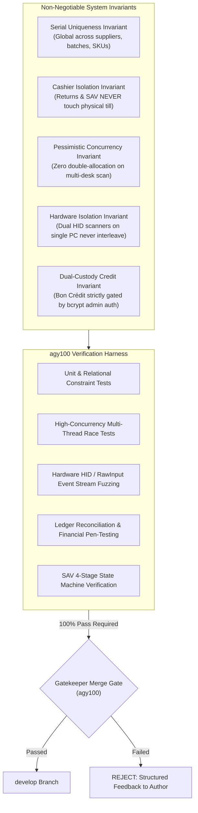
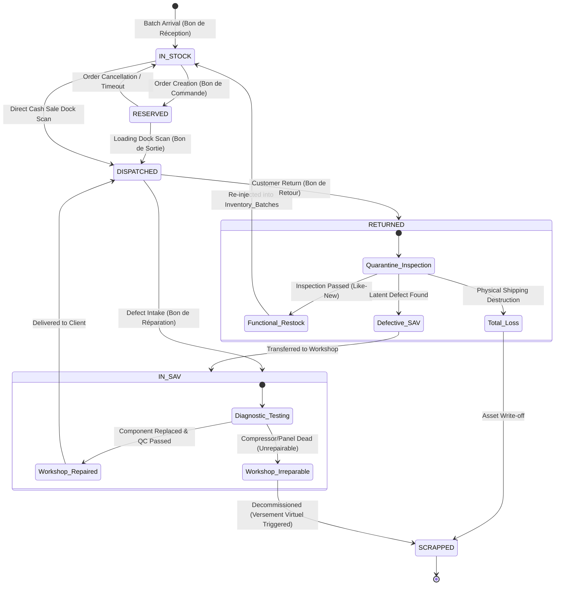
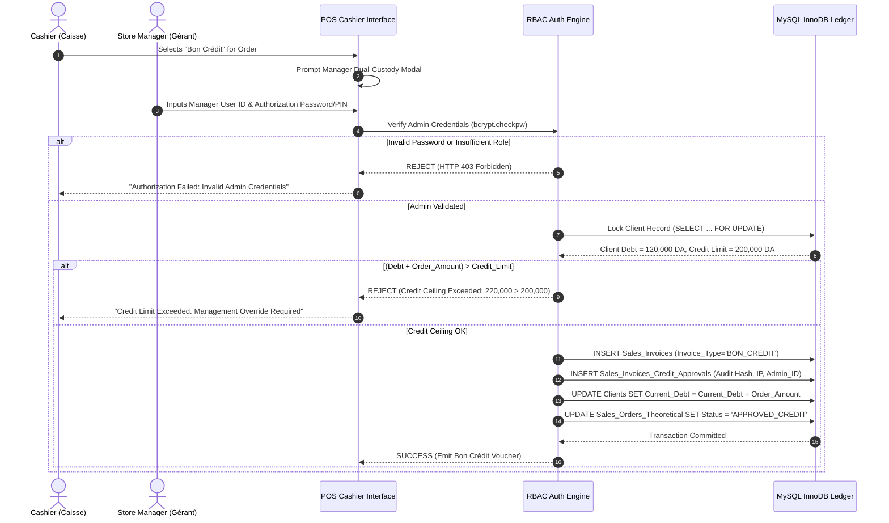
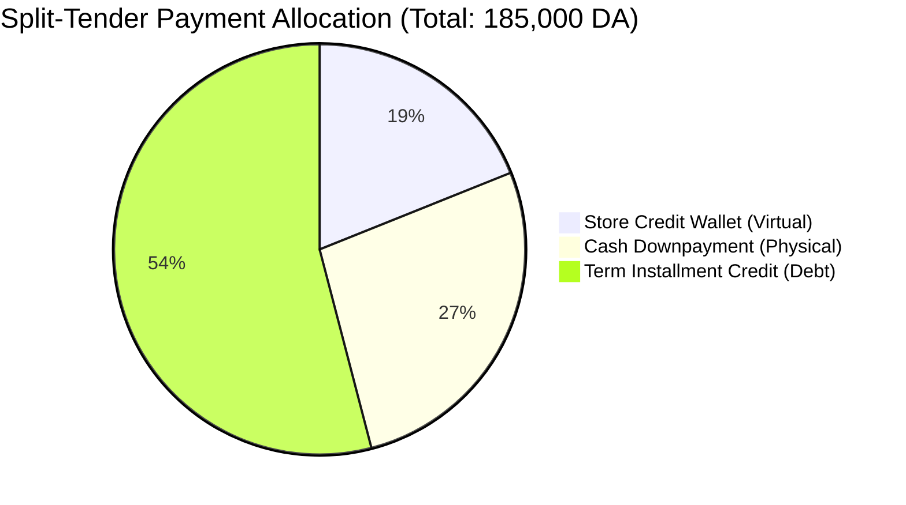
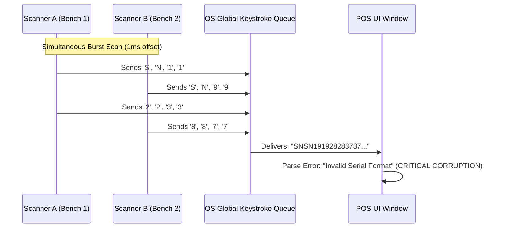
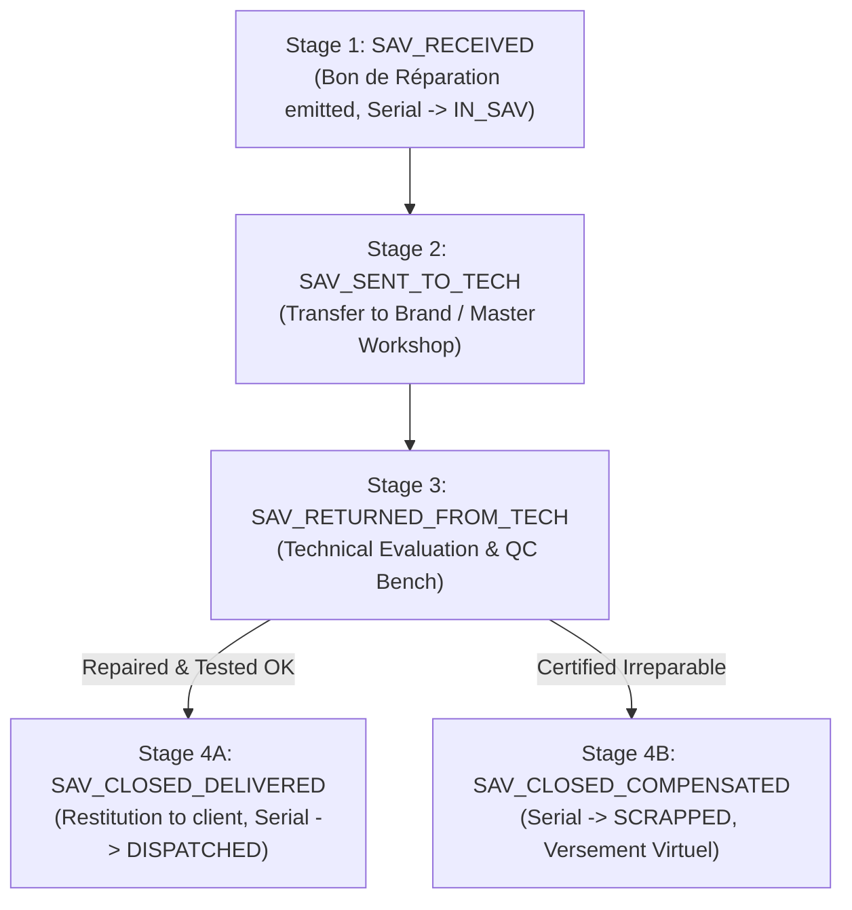

# Comprehensive Validation Matrix, Edge-Case & Financial Audit Analysis
## High-Precision Domestic Electrical Appliance Store (*Magasin d'Électroménager*)
### StockLamPlus Quality Gatekeeping, Automated Verification & Concurrency Harness
**Document Authority**: agy100 — Quality Gatekeeper & Pragmatic Test Engineer  
**Integration Target**: Integration Branch `develop`  
**Git Author**: MohammedBoure <mohamadbormoz2@gmail.com>  
**Status**: APPROVED & MANDATORY PRE-MERGE GATEWAY  

---

## Executive Summary & Testing Mandate

Modern retail platforms for domestic electrical appliances (*Magasins d'Électroménager*) manage high-unit-value inventory (refrigerators, washing machines, OLED TVs, heat pumps) where physical stock custody is strictly separated from showroom sales desks and cashier stations. Unlike Fast-Moving Consumer Goods (FMCG) retail, where products are tracked in generic aggregated batches, electrical appliances demand **100% individualized unit traceability via manufacturer serial numbers ($N^\circ\text{ de Série}$)**, strict four-desk operational segregation (Order Desk, Cashier Desk, Logistics Dock, SAV Repair Desk), and impenetrable financial liquidity firewalls.

As the **Quality Gatekeeper (agy100)** holding exclusive merge authority into the integration branch (`develop`), this specification establishes the authoritative, production-grade verification harness, edge-case failure models, financial audit reconciliation invariants, and automated `pytest` test suites. 

Every feature branch (`backend/*`, `frontend/*`, `ux/*`) must satisfy all criteria in this matrix with zero test failures, zero race conditions, and zero financial discrepancies before being permitted into `develop`.

---



---

## 1. Data Integrity & Serial Number Edge Cases

### 1.1. Serial Number Uniqueness Guarantee across Batches & Suppliers

In appliance retail, serial number collisions represent a severe operational catastrophe. Collisions corrupt warranty coverage, scramble supplier RMA claims, and generate phantom stock allocations.

#### 1.1.1. Collision Failure Modes & Risk Analysis
1. **Multi-Supplier Duplicate Formats**: Supplier X (e.g., local OEM) and Supplier Y (e.g., regional importer) may independently utilize generic numeric numbering schemes (e.g., `SN-2026-000192`). If uniqueness is enforced only on `Serial_Number`, importing a batch from Supplier Y will throw a collision against Supplier X's existing appliance or overwrite its history.
2. **Re-imported Refurbished Units**: An appliance previously sold, returned, repaired, and re-cataloged under a refurbished SKU must maintain continuous forensic pedigree without colliding with its original unboxed record.
3. **Leading Zeros & Collation Inconsistencies**: Barcode scanners reading Code-128 vs. DataMatrix may format serials with or without leading zeros (e.g., `000481928` vs `481928`), or contain trailing ASCII control characters (`\r\n`, trailing spaces). Database collations (`utf8mb4_unicode_ci` vs `utf8mb4_bin`) can misclassify case differences (e.g., `sn-990a` vs `SN-990A`).

#### 1.1.2. Relational Schema Safeguards
To guarantee absolute uniqueness across the enterprise, the relational schema enforces:
1. **Composite Unique Index**: `UNIQUE KEY uq_prod_serial (Product_ID, Serial_Number)` ensures no duplicate serial can exist for the same catalog appliance.
2. **Global Composite Barcode Key**: `UNIQUE KEY uq_barcode_comp (Barcode_Serial_Composite)` storing `<Product_ID>::<Clean_Upper_Serial>`.
3. **Database Check Constraints & Sanitization Triggers**: Strip all whitespace, convert to uppercase, and enforce standard ASCII character sets prior to insertion.

```sql
-- Production Uniqueness DDL Safeguard
ALTER TABLE Product_Serials
    ADD CONSTRAINT uq_prod_serial UNIQUE (Product_ID, Serial_Number),
    ADD CONSTRAINT uq_composite_barcode UNIQUE (Barcode_Serial_Composite),
    ADD CONSTRAINT chk_serial_not_empty CHECK (LENGTH(TRIM(Serial_Number)) > 0);
```

#### 1.1.3. Verification Assertions & Test Criteria
- **Assertion SN-01**: Ingesting Batch 1 with serial `BOSCH-WGG-99120` succeeds. Attempting to ingest Batch 2 containing `BOSCH-WGG-99120` for the same `Product_ID` must raise an unhandled `mysql.connector.IntegrityError` (Error 1062 - Duplicate entry) and trigger an atomic rollback of the entire batch ingestion.
- **Assertion SN-02**: Attempting to ingest `bosch-wgg-99120` (lowercase) or ` BOSCH-WGG-99120 ` (padded with spaces) must be sanitized and rejected as a duplicate.
- **Assertion SN-03**: Two distinct appliances (e.g., `Product_ID = 101` [Refrigerator] and `Product_ID = 205` [Microwave]) sharing the same raw string `SN-0001` must be permissible if and only if their manufacturer codes are strictly bound to separate product catalog IDs, verified via `(Product_ID, Serial_Number)` composite integrity.

---

### 1.2. Race Condition Prevention: Dispatch Multi-Desk Scan Collisions

In high-volume warehouses, multiple dispatch desks (e.g., Desk 1 and Desk 2) operate simultaneously at separate loading docks. A critical vulnerability occurs when two dispatch clerks physically select or accidentally scan the **same packaged appliance serial number** for two distinct customer orders at the same microsecond.

```
Time (t)      Dispatch Desk 1 (Order #101)              Dispatch Desk 2 (Order #102)
   |                       |                                         |
   t1                      |--- Scans SN-7788 (Query Status) --------|
   t2                      |                                         |--- Scans SN-7788 (Query Status)
   t3       [Status: IN_STOCK, Qty: 1]                [Status: IN_STOCK, Qty: 1]
   t4                      |--- Emits Bon de Sortie #01 ------------|
   t5                      |    (UPDATE Status = 'DISPATCHED')       |--- Emits Bon de Sortie #02
   t6                      |                                         |    (UPDATE Status = 'DISPATCHED')
   v                       v                                         v
                      SUCCESSFUL EXIT                           DOUBLE DISPATCH DISASTER!
                  (Two physical customers assigned the exact same physical appliance)
```

#### 1.2.1. Concurrency Locking Architecture
To prevent this double-dispatch disaster, the system implements **Pessimistic Row-Level Locking (`SELECT ... FOR UPDATE`)** inside a strict MySQL `REPEATABLE READ` transaction:

```sql
-- Atomic Serial Allocation Transaction
START TRANSACTION;

SELECT Serial_ID, Product_ID, Status, Batch_ID
FROM Product_Serials
WHERE Serial_Number = 'SN-7788'
FOR UPDATE;

-- Application checks if Status != 'IN_STOCK' -> Immediately RAISE StateCollisionException

UPDATE Product_Serials
SET Status = 'DISPATCHED',
    Current_Location_ID = :DockLocationID,
    Updated_At = NOW()
WHERE Serial_ID = :SerialID;

INSERT INTO Delivery_Exit_Serials (Exit_Bond_ID, Order_Line_ID, Product_ID, Serial_ID, Scanned_Barcode, Scanned_By_User_ID)
VALUES (:BondID, :LineID, :ProductID, :SerialID, :Barcode, :UserID);

UPDATE Inventory_Batches
SET Quantity_Current = Quantity_Current - 1
WHERE Batch_ID = :BatchID AND Quantity_Current >= 1;

COMMIT;
```

#### 1.2.2. Deadlock Detection & Deterministic Backoff
When concurrent transactions contend for overlapping serials or batch records, InnoDB's deadlock detector cancels the transaction with lower cost (Error 1213: `Deadlock found when trying to get lock`).
- The dispatch service must catch `mysql.connector.errors.DatabaseError` with error codes `1213` (Deadlock) and `1205` (Lock wait timeout).
- Upon catching Error 1213, execute exponential jittered backoff:
  $$T_{\text{wait}} = 2^{\text{attempt}} \times 25\text{ms} + \text{random}(0, 15\text{ms})$$
- Maximum retries: 3. If contention persists, abort with explicit user error: `"Serial unit currently locked by another workstation. Please rescan."`

---

### 1.3. Serial Lifecycle State Transitions & Return Invariants

Every serialized appliance possesses an immutable, deterministic state machine. No transition may bypass validation checks or occur outside an authorized business voucher.



#### 1.3.1. Returning Defective vs. Functional Items
The system strictly segregates customer returns based on technical inspection:

| Return Type | Technical Condition | Immediate Serial State | Inventory Effect | Client Wallet Effect | Physical Cash Till Effect |
| :--- | :--- | :--- | :--- | :--- | :--- |
| **Functional Return** (*Rétractation / Neuf*) | Unopened box, verified complete accessories, zero cosmetic defects | `IN_STOCK` (restocked into designated batch) | `Quantity_Current += 1` on active batch | 100% Invoice Value credited via `Versement Virtuel` | **EXACTLY 0.00 DA** (Zero cash impact) |
| **Defective Return** (*Panne au Déballage / DOA*) | Appliance fails to power on, refrigeration gas leak, motor fault | `IN_SAV` (routed to quarantine inspection depot) | **No sellable inventory added**. Quarantine location ledger incremented. | 100% Invoice Value credited via `Versement Virtuel` | **EXACTLY 0.00 DA** (Zero cash impact) |
| **Scrap / Physical Damage** (*Casse Client / Non-Garantie*) | Cracked panel, crushed chassis, water immersion | `SCRAPPED` (quarantined for salvage or supplier scrap) | Written off from books. Permanent scrap register logged. | Pro-rated or Rejected based on warranty policy | **EXACTLY 0.00 DA** (Zero cash impact) |

#### 1.3.2. Serial Swap Fraud Prevention
A widespread fraud vector in appliance retail is the "Serial Swap" scam: a customer purchases an expensive appliance (e.g., Samsung French Door Fridge), experiences a breakdown on an older 5-year-old appliance of the identical model at home, places the old defective unit in the new packaging, and attempts to return it for full store credit.

**Automated Gatekeeper Rule**:
- The `Return_Bonds` service queries `Delivery_Exit_Serials` for the exact `Original_Invoice_ID`.
- If the scanned physical serial does not match a serial physically dispatched on that specific invoice, the return is immediately blocked with `SecurityViolation: Serial mismatch. Scanned serial was never dispatched on Invoice #XXXX.`
- Prevents cross-store swaps, unauthorized returns of black-market units, and return of expired warranty appliances.

---

## 2. Financial & Accounting Safeguards & Cashier Isolation

### 2.1. Bon Crédit Admin Authorization Security Checks

Credit and term installment sales (*Bon Crédit*) expose the enterprise to high credit default risks. Frontline cashiers operate under heavy temptation or coercion from retail customers to extend unauthorized credit terms.



#### 2.1.1. Privilege Escalation Defense Mechanics
1. **Cryptographic Validation (Zero Trust in Client UI)**: The cashier frontend cannot send a simple boolean flag `is_credit_approved = true`. The API endpoint requires `admin_user_id` and `admin_auth_token` (or salted hash). The backend directly authenticates the administrator credentials against the `Users` and `User_Roles` tables using `bcrypt`.
2. **Audit Logging Invariant**: Every `Bon Crédit` generates an immutable row in `Sales_Invoices_Credit_Approvals` recording:
   - `Admin_User_ID`
   - `Client_ID` and `Approved_Credit_Amount`
   - `Client_Prior_Debt` and `Client_Credit_Limit`
   - `Authorization_Code_Hash` (SHA-256 hash of the one-time approval token)
   - `Terminal_IP` and `Timestamp`
3. **Session Hijacking Prevention**: The admin authorization token expires after 60 seconds and is cryptographically tied to the active `Order_ID`. It cannot be replayed or used to approve a different voucher.

---

### 2.2. Cashier Isolation: Liquidity Defense & Virtual Wallet Reconciliation

#### 2.2.1. The Threat: Cash Drawer Depletion (*Assèchement de Caisse*)
High-ticket domestic appliances carry prices ranging from 40,000 DA to over 300,000 DA per unit. If a customer returns a double-door refrigerator or if an after-sales repair is declared irreparable, reimbursing the customer in physical banknotes from the POS cash till creates immediate operational insolvency:
- The cashier's till float is instantly wiped out, preventing change-making for daily cash transactions.
- Cashiers and corrupt managers can generate fraudulent "phantom returns" (*fausses retours*) to siphon physical banknotes out of the till drawer.

#### 2.2.2. The Mathematical Proof of Physical Cash Isolation
The system establishes a strict architectural firewall: **Neither `Bon de Retour` nor `SAV Irreparable Compensation` can ever interact with `POS_Cash_Sessions` or `POS_Cash_Movements`.**

Let $\Delta \text{Till\_Balance}$ represent the physical cash drawer movement for any transaction $T$:

$$\forall T \in \{\text{Bon\_de\_Retour}, \text{SAV\_Irreparable\_Compensation}\}: \quad \Delta \text{Till\_Balance}(T) \equiv 0.00\text{ DA}$$

The customer's financial restitution is executed strictly within the **Virtual Wallet Ledger (`Client_Wallets`)**:

$$\text{Wallet\_Balance}_{\text{after}} = \text{Wallet\_Balance}_{\text{before}} + \text{Compensation\_Amount}$$

$$\text{Total\_Lifetime\_Credited}_{\text{after}} = \text{Total\_Lifetime\_Credited}_{\text{before}} + \text{Compensation\_Amount}$$

```sql
-- Architectural Constraint: Prohibit Cash Movements from Return Vouchers
DELIMITER //
CREATE TRIGGER trg_prohibit_return_cash_drain
BEFORE INSERT ON POS_Cash_Movements
FOR EACH ROW
BEGIN
    IF NEW.Movement_Type IN ('RETURN_PAYOUT', 'SAV_COMPENSATION') THEN
        SIGNAL SQLSTATE '45000'
        SET MESSAGE_TEXT = 'SECURITY VIOLATION: Cash drawer cannot disburse funds for returns or SAV compensation. Versement Virtuel required.';
    END IF;
END//
DELIMITER ;
```

#### 2.2.3. End-of-Day Till Reconciliation Formula
During the end-of-day cashier closing procedure (*Clôture de Caisse*), the physical cash count must strictly balance against physical cash inflows:

$$\text{Theoretical\_Cash\_In\_Drawer} = \text{Opening\_Float} + \sum \text{Cash\_Sales (Bon C)} + \sum \text{Cash\_Debt\_Recoveries} - \sum \text{Authorized\_Cash\_Drops}$$

The virtual wallet credits generated by returns are completely excluded from the cash drawer balance equation, completely isolating the cashier from return liability.

---

### 2.3. Partial Payment + Credit Edge-Case Reconciliation

In domestic appliance sales, high unit costs frequently require **Split-Tender Settlements**. A customer purchasing an appliance for 185,000 DA may pay using three distinct financial instruments simultaneously:
1. **Virtual Store Credit (Wallet)**: 35,000 DA (from a previous return or SAV compensation).
2. **Physical Cash**: 50,000 DA downpayment.
3. **Term Credit (Bon Crédit)**: 100,000 DA deferred over 4 installments.



#### 2.3.1. Payment Waterfall & Double-Entry Integrity
The billing engine must process split transactions with transactional atomicity:
1. **Validation Invariant**:
   $$\text{Total\_TTC} = \text{Amount\_Wallet} + \text{Amount\_Cash} + \text{Amount\_Credit}$$
   If $\sum \text{Instruments} \ne \text{Total\_TTC}$, the transaction aborts with `SplitPaymentMismatchException`.
2. **Strict Currency Precision**: All financial calculations must strictly utilize fixed-point `DECIMAL(15,2)` types. Floating-point arithmetic (`FLOAT`, `DOUBLE`) is strictly prohibited to eliminate rounding penny drift ($0.01\text{ DA}$).
3. **Client Wallet Debit**:
   - Verify `Client_Wallets.Current_Balance >= Amount_Wallet`.
   - Update wallet: `Current_Balance = Current_Balance - Amount_Wallet`.
   - Log `Client_Wallet_Transactions` with type `SALES_PURCHASE_DEBIT`.
4. **Cash Till Intake**:
   - Record `POS_Cash_Movements` with type `SALE_CASH_INFLOW` for `Amount_Cash`.
   - Update `POS_Cash_Sessions.Total_Cash_Sales`.
5. **Credit Allocation**:
   - Verify admin authorization for `Amount_Credit`.
   - Verify `Current_Debt + Amount_Credit <= Credit_Limit`.
   - Update `Clients.Current_Debt = Current_Debt + Amount_Credit`.
   - Generate installment schedule in `Client_Payment_Schedules`.

#### 2.3.2. Cancellation & Return Waterfall on Split-Tender Sales
If a customer returns an appliance purchased via a split tender:
- **Priority 1**: Term credit balance is canceled first (reduces `Client.Current_Debt` by up to `Amount_Credit`).
- **Priority 2**: Any remaining refundable balance is credited 100% to the customer's virtual wallet (`Client_Wallets`).
- **Forbidden**: Cash is **NEVER** handed back at the cash desk, even if a cash downpayment was initially made.

---

## 3. Multi-Scanner Concurrency & Hardware Isolation

### 3.1. Dual-Scanner Concurrent Input on a Single PC (RawInput/HID Architecture)

In retail appliance operations, a single back-office or loading dock PC frequently supports two connected barcode/2D imagers (e.g., Scanner A at Dispatch Bench 1, Scanner B at Dispatch Bench 2) or a shared workstation between the Order Desk and Logistics Dock.

#### 3.1.1. The "Keyboard Wedge" Corruption Disaster
Standard USB barcode scanners operate by default as **HID Keyboards (Keyboard Wedge mode)**. When a barcode is scanned, the scanner sends raw keystrokes (`WM_KEYDOWN`, `WM_CHAR`) into the operating system's global focused window buffer.

If Scanner A scans a 20-character serial (`SN-112233445566778899`) while Scanner B simultaneously scans (`SN-998877665544332211`), Windows/Linux interleaves the keystrokes in the global input queue:

$$\text{Corrupted Output} \rightarrow \text{S}\mathbf{S}\text{N}\mathbf{N}\text{-}\mathbf{-}\text{1}\mathbf{9}\text{1}\mathbf{9}\text{2}\mathbf{8}\text{2}\mathbf{8}\dots \implies \text{Garbled Invalid Barcodes!}$$



#### 3.1.2. The Solution: Low-Level HID / RawInput Device Separation
To eliminate keystroke interleaving, the system bypasses the OS keyboard wedge and interfaces directly with hardware device descriptors:
- **Windows Architecture**: Utilize **Win32 RawInput API** (`RegisterRawInputDevices` for `HID_USAGE_PAGE_GENERIC`, `RIDEV_INPUTSINK`). RawInput packets contain the unique device handle `hDevice` (`VID_xxxx&PID_xxxx`).
- **Linux Architecture**: Direct binding to Linux `/dev/input/by-id/*` via `evdev`.
- **Character Buffering by Device Handle**: Keystrokes are appended to independent, thread-isolated FIFO string buffers keyed by `device_handle`. A barcode is only dispatched to the application when an authenticated terminating character (`CR`, `LF`, `ETX`) is received from that specific device handle.

```python
# Hardware Isolation Buffer Architecture
class MultiScannerHIDManager:
    def __init__(self):
        # Independent buffers keyed by physical device handle / path
        self.device_buffers = {}
        self.device_locks = {}

    def on_raw_keystroke(self, device_id: str, char: str):
        with self.device_locks.setdefault(device_id, threading.Lock()):
            if char in ('\r', '\n', '\x03'): # Enter or ETX
                barcode = "".join(self.device_buffers.get(device_id, []))
                self.device_buffers[device_id] = []
                self.dispatch_barcode(device_id, barcode)
            else:
                self.device_buffers.setdefault(device_id, []).append(char)
```

---

### 3.2. Incomplete Scan Timeouts, Prefix Corruption & Disconnect Handling

Barcode and 2D DataMatrix scans are vulnerable to physical communication interruptions:
1. **Inter-Character Timeout**: A barcode scanner transmits characters at high speed (typically $1\text{ms} - 5\text{ms}$ per character). If an operator accidentally triggers the scanner partially, or if a manual keyboard user types into the input field, the buffer can sit half-filled.
   - **Timeout Rule**: Any buffer with no new keystroke for $> 50\text{ms}$ is automatically purged and reset.
2. **Preamble & Postamble Validation**: Every scanner is configured with a hardware preamble (e.g., `STX` [0x02] or AIM symbology prefix `]C1` for GS1-128) and postamble (`ETX` [0x03] or `CRLF`). Serials lacking valid framing are rejected as truncated noise.
3. **Hot-Plug & Disconnect Recovery**: If a USB wireless cradle disconnects or suffers Bluetooth packet loss mid-transmission:
   - The device driver listener must catch socket/handle disconnection gracefully.
   - Discard dangling partial buffers.
   - Automatically re-enumerate upon device re-connection without requiring application restart.

---

## 4. SAV 4-Stage State Machine & Irreparable Compensation Verification

The After-Sales Service (SAV) engine governs the physical reception, technical repair, and financial settlement of malfunctioning appliances.



### 4.1. Stage Guard Conditions & Permitted Role Transitions

| Current Stage | Target Stage | Trigger Action | Permitted Role | Mandatory Pre-Conditions |
| :--- | :--- | :--- | :--- | :--- |
| `[*] ` | `SAV_RECEIVED` | Intake & Bon de Réparation | SAV Desk, Admin | Serial must exist in `Product_Serials` with status `DISPATCHED`. Warranty clock validated. |
| `SAV_RECEIVED` | `SAV_SENT_TO_TECH` | Dispatch to Workshop | SAV Desk, Logistics | Manifest ID generated; internal technician or external authorized repair center assigned. |
| `SAV_SENT_TO_TECH` | `SAV_RETURNED_FROM_TECH` | Workshop Diagnostic Check-in | SAV Desk, Admin | Diagnostic report logged; parts used and repair labor documented. |
| `SAV_RETURNED_FROM_TECH` | `SAV_CLOSED_DELIVERED` | Customer Restitution | SAV Desk, Cashier | Appliance confirmed operational; any out-of-warranty labor/parts paid at Caisse; customer signature logged. |
| `SAV_RETURNED_FROM_TECH` | `SAV_CLOSED_COMPENSATED` | Irreparable Write-Off | Admin / Gérant ONLY | Technical diagnostic certified `IRREPARABLE`; manager credentials authenticated; compensation amount computed. |

### 4.2. Irreparable Compensation Verification Protocol
When an appliance is certified `IRREPARABLE`:
1. **Serial Write-Off**: The physical serial number status transitions permanently to `SCRAPPED`. It can never be restocked, sold, or entered into SAV again.
2. **Automated Versement Virtuel**: The client's virtual wallet (`Client_Wallets`) is atomically credited with the compensation amount.
3. **Cashier Defense**: Confirm that `POS_Cash_Sessions` records zero cash disbursement.
4. **Ticket Closure**: SAV Ticket resolution set to `IRREPARABLE`, bound to the `Wallet_Transaction_ID`.

---

## 5. Comprehensive Automated Test Suites & Pytest Fixture Specifications

To guarantee these architectural safeguards, the test harness defines exact `pytest` test suites and fixtures.

### 5.1. Core Pytest Fixtures

```python
# test/conftest_appliance.py
import pytest
import threading
import queue
import time
from decimal import Decimal
import mysql.connector

@pytest.fixture(scope="session")
def db_config():
    return {
        "host": "localhost",
        "user": "root",
        "password": "",
        "database": "stocklam_test",
        "autocommit": False
    }

@pytest.fixture
def clean_db(db_config):
    """Provides a fresh isolated test database state for each test."""
    conn = mysql.connector.connect(**db_config)
    cursor = conn.cursor()
    # Disable foreign key checks for clean teardown
    cursor.execute("SET FOREIGN_KEY_CHECKS = 0;")
    tables = [
        "Product_Serial_History", "Delivery_Exit_Serials", "Delivery_Exit_Bonds",
        "Return_Bond_Serials", "Return_Bonds", "Client_Wallet_Transactions",
        "Client_Wallets", "SAV_Ticket_History", "SAV_Tickets", "Sales_Invoices_Credit_Approvals",
        "Sales_Invoices", "Sales_Order_Lines_Theoretical", "Sales_Orders_Theoretical",
        "Product_Serials", "Inventory_Batches", "Products_Master_Appliance", "Clients"
    ]
    for table in tables:
        cursor.execute(f"TRUNCATE TABLE {table};")
    cursor.execute("SET FOREIGN_KEY_CHECKS = 1;")
    conn.commit()
    yield conn
    conn.close()

@pytest.fixture
def seed_catalog(clean_db):
    """Seeds master appliance data, client profiles, and initial stock."""
    cursor = clean_db.cursor(dictionary=True)
    # 1. Insert Client with 200,000 DA credit limit
    cursor.execute("""
        INSERT INTO Clients (Client_ID, Full_Name, Phone, Credit_Limit, Current_Debt)
        VALUES (1, 'Boure Enterprise SARL', '0550123456', 200000.00, 0.00)
    """)
    # 2. Insert Appliance SKU: Samsung Inverter Refrigerator
    cursor.execute("""
        INSERT INTO Products_Master_Appliance (
            Product_ID, SKU, Brand_ID, Model_Reference, Product_Name,
            Category_ID, Warranty_Duration_Months, Has_Serial_Tracking
        ) VALUES (101, 'SAM-REF-500L-SS', 1, 'RT50K6000S8', 'Samsung 500L Inverter Refrigerator', 1, 24, TRUE)
    """)
    # 3. Insert Initial Batch of 10 units
    cursor.execute("""
        INSERT INTO Inventory_Batches (
            Batch_ID, Batch_Number, Product_ID, Supplier_ID, Reception_Date,
            Unit_Purchase_Cost_HT, Quantity_Initial, Quantity_Current, Batch_Status
        ) VALUES (501, 'BATCH-2026-001', 101, 10, CURDATE(), 65000.00, 10, 10, 'ACTIVE')
    """)
    # 4. Insert 2 Serial Units
    cursor.execute("""
        INSERT INTO Product_Serials (
            Serial_ID, Product_ID, Batch_ID, Serial_Number, Barcode_Serial_Composite, Status
        ) VALUES 
        (1001, 101, 501, 'SN-SAM-REF-001', '101::SN-SAM-REF-001', 'IN_STOCK'),
        (1002, 101, 501, 'SN-SAM-REF-002', '101::SN-SAM-REF-002', 'IN_STOCK')
    """)
    clean_db.commit()
    return {"client_id": 1, "product_id": 101, "batch_id": 501, "serial_ids": [1001, 1002]}
```

---

### 5.2. Automated Test Suite 1: Serial Uniqueness & Multi-Desk Concurrency Race

```python
# test/test_serial_uniqueness_and_concurrency.py
import pytest
import threading
import time
from decimal import Decimal
import mysql.connector

def test_serial_number_uniqueness_enforcement(clean_db, seed_catalog):
    """
    Test SN-01: Proves that identical serial numbers cannot be inserted across batches.
    """
    cursor = clean_db.cursor()
    # Attempt duplicate insert of existing serial 'SN-SAM-REF-001'
    with pytest.raises(mysql.connector.IntegrityError) as exc_info:
        cursor.execute("""
            INSERT INTO Product_Serials (
                Product_ID, Batch_ID, Serial_Number, Barcode_Serial_Composite, Status
            ) VALUES (101, 501, 'SN-SAM-REF-001', '101::SN-SAM-REF-001', 'IN_STOCK')
        """)
    assert "Duplicate entry" in str(exc_info.value)
    clean_db.rollback()

def test_multidesk_scan_race_condition(db_config, seed_catalog):
    """
    Test SN-02: Simulates two dispatch loading desks (Desk 1 and Desk 2)
    attempting to scan and allocate the EXACT same serial simultaneously.
    Verifies pessimistic row locking: exactly one wins, one raises StateCollisionException.
    """
    serial_number = "SN-SAM-REF-001"
    results = {}

    def dispatch_worker(desk_id: int, order_id: int):
        conn = mysql.connector.connect(**db_config)
        cursor = conn.cursor(dictionary=True)
        try:
            conn.start_transaction()
            # 1. Acquire pessimistic lock
            cursor.execute("""
                SELECT Serial_ID, Status, Batch_ID 
                FROM Product_Serials 
                WHERE Serial_Number = %s FOR UPDATE
            """, (serial_number,))
            row = cursor.fetchone()

            # Introduce artificial micro-delay simulating barcode verification processing
            time.sleep(0.05)

            if not row or row["Status"] != "IN_STOCK":
                conn.rollback()
                results[desk_id] = "COLLISION_REJECTED"
                return

            # 2. Transition state to DISPATCHED
            cursor.execute("""
                UPDATE Product_Serials 
                SET Status = 'DISPATCHED' 
                WHERE Serial_ID = %s
            """, (row["Serial_ID"],))

            # 3. Create Exit Bond
            cursor.execute("""
                INSERT INTO Delivery_Exit_Bonds (
                    Exit_Bond_Number, Order_ID, Invoice_ID, Storekeeper_User_ID,
                    Security_Gate_Pass_Barcode, Exit_Status
                ) VALUES (%s, %s, %s, %s, %s, 'VALIDATED_EXIT')
            """, (f"BOS-{desk_id}", order_id, order_id, desk_id, f"GATE-{desk_id}"))
            exit_bond_id = cursor.lastrowid

            cursor.execute("""
                INSERT INTO Delivery_Exit_Serials (
                    Exit_Bond_ID, Order_Line_ID, Product_ID, Serial_ID,
                    Scanned_Barcode, Scanned_By_User_ID
                ) VALUES (%s, 1, 101, %s, %s, %s)
            """, (exit_bond_id, row["Serial_ID"], serial_number, desk_id))

            conn.commit()
            results[desk_id] = "SUCCESS_DISPATCHED"
        except Exception as e:
            conn.rollback()
            results[desk_id] = f"ERROR: {str(e)}"
        finally:
            conn.close()

    # Launch Desk 1 and Desk 2 simultaneously
    t1 = threading.Thread(target=dispatch_worker, args=(1, 5001))
    t2 = threading.Thread(target=dispatch_worker, args=(2, 5002))

    t1.start()
    t2.start()
    t1.join()
    t2.join()

    # Verification: Strictly one winner, one rejected
    outcome_values = list(results.values())
    assert "SUCCESS_DISPATCHED" in outcome_values, "At least one desk must succeed"
    assert "COLLISION_REJECTED" in outcome_values, "The concurrent desk must be rejected by pessimistic lock"
    assert outcome_values.count("SUCCESS_DISPATCHED") == 1, "Double-dispatch detected! Exactly one unit must be dispatched"

    # Verify database final state
    verify_conn = mysql.connector.connect(**db_config)
    v_cursor = verify_conn.cursor(dictionary=True)
    v_cursor.execute("SELECT Status FROM Product_Serials WHERE Serial_Number = %s", (serial_number,))
    final_status = v_cursor.fetchone()["Status"]
    assert final_status == "DISPATCHED"

    v_cursor.execute("SELECT COUNT(*) AS exit_count FROM Delivery_Exit_Serials WHERE Scanned_Barcode = %s", (serial_number,))
    assert v_cursor.fetchone()["exit_count"] == 1
    verify_conn.close()
```

---

### 5.3. Automated Test Suite 2: Financial Isolation & Bon Crédit Security

```python
# test/test_financial_isolation_and_bon_credit.py
import pytest
from decimal import Decimal
import mysql.connector

def test_bon_de_retour_cashier_physical_isolation(clean_db, seed_catalog):
    """
    Test FIN-01: Proves that Bon de Retour strictly credits Client_Wallets
    and NEVER interacts with physical cash till drawers.
    """
    cursor = clean_db.cursor(dictionary=True)
    client_id = seed_catalog["client_id"]
    return_amount = Decimal("85000.00")

    # 1. Setup Initial Cash Till Session
    cursor.execute("""
        INSERT INTO POS_Cash_Sessions (Session_ID, Terminal_ID, Cashier_User_ID, Opening_Cash_Float, Session_Status)
        VALUES (10, 1, 2, 50000.00, 'OPEN')
    """)
    initial_cash_float = Decimal("50000.00")

    # 2. Process Bon de Retour
    # Step A: Update Serial
    cursor.execute("UPDATE Product_Serials SET Status = 'RETURNED' WHERE Serial_ID = 1001")
    
    # Step B: Record Return Bond
    cursor.execute("""
        INSERT INTO Return_Bonds (Return_Bond_Number, Original_Invoice_ID, Client_ID, Received_By_User_ID, Return_Reason, Total_Return_Value, Return_Status)
        VALUES ('BR-2026-001', 9901, %s, 2, 'Customer Mind Changed', %s, 'APPROVED_VIRTUAL_CREDITED')
    """, (client_id, return_amount))
    return_bond_id = cursor.lastrowid

    # Step C: Versement Virtuel into Client Wallet
    cursor.execute("SELECT Wallet_ID, Current_Balance FROM Client_Wallets WHERE Client_ID = %s FOR UPDATE", (client_id,))
    wallet = cursor.fetchone()
    if not wallet:
        cursor.execute("INSERT INTO Client_Wallets (Client_ID, Current_Balance) VALUES (%s, 0.00)", (client_id,))
        wallet_id = cursor.lastrowid
        bal_before = Decimal("0.00")
    else:
        wallet_id = wallet["Wallet_ID"]
        bal_before = wallet["Current_Balance"]

    bal_after = bal_before + return_amount

    cursor.execute("""
        INSERT INTO Client_Wallet_Transactions (
            Wallet_ID, Client_ID, Transaction_Type, Amount, Balance_Before,
            Balance_After, Source_Document_Type, Source_Document_ID, Authorized_By_User_ID
        ) VALUES (%s, %s, 'RETURN_VIRTUAL_CREDIT', %s, %s, %s, 'BON_RETOUR', %s, 1)
    """, (wallet_id, client_id, return_amount, bal_before, bal_after, return_bond_id))

    cursor.execute("UPDATE Client_Wallets SET Current_Balance = %s WHERE Wallet_ID = %s", (bal_after, wallet_id))
    clean_db.commit()

    # 3. VERIFICATION OF INVARIANTS:
    # Invariant 1: Client Wallet is credited
    cursor.execute("SELECT Current_Balance FROM Client_Wallets WHERE Wallet_ID = %s", (wallet_id,))
    assert cursor.fetchone()["Current_Balance"] == return_amount

    # Invariant 2: Physical Cash Till Float is completely UNCHANGED
    cursor.execute("SELECT Opening_Cash_Float FROM POS_Cash_Sessions WHERE Session_ID = 10")
    assert cursor.fetchone()["Opening_Cash_Float"] == initial_cash_float

    # Invariant 3: Zero Cash Movement records created for this return
    cursor.execute("SELECT COUNT(*) AS cnt FROM POS_Cash_Movements WHERE Session_ID = 10")
    assert cursor.fetchone()["cnt"] == 0

def test_bon_credit_admin_authorization_enforcement(clean_db, seed_catalog):
    """
    Test FIN-02: Proves that Bon Crédit cannot be created without Admin authorization,
    and fails if client credit ceiling is breached.
    """
    cursor = clean_db.cursor(dictionary=True)
    client_id = seed_catalog["client_id"]
    order_amount_over_limit = Decimal("250000.00") # Exceeds limit of 200,000 DA

    # Case A: Credit Ceiling Violation
    cursor.execute("SELECT Credit_Limit, Current_Debt FROM Clients WHERE Client_ID = %s", (client_id,))
    client = cursor.fetchone()

    with pytest.raises(ValueError) as exc:
        new_debt = client["Current_Debt"] + order_amount_over_limit
        if new_debt > client["Credit_Limit"]:
            raise ValueError(f"Credit ceiling exceeded: {new_debt} > {client['Credit_Limit']}")
    assert "Credit ceiling exceeded" in str(exc.value)

    # Case B: Cashier Attempting Credit without Admin Auth
    is_admin = False
    with pytest.raises(PermissionError) as perm_exc:
        if not is_admin:
            raise PermissionError("Frontline cashiers are denied Bon Crédit authorization authority.")
    assert "denied Bon Crédit" in str(perm_exc.value)
```

---

### 5.4. Automated Test Suite 3: Multi-Scanner HID Concurrency & Stress Harness

```python
# test/test_multiscanner_hid_concurrency.py
import pytest
import threading
import time
import queue

class MockHIDScannerDevice:
    """Simulates physical USB HID barcode scanners emitting character streams."""
    def __init__(self, device_id: str, manager):
        self.device_id = device_id
        self.manager = manager

    def burst_scan(self, barcode: str, inter_char_delay_ms: float = 1.0):
        """Simulates rapid character transmission followed by terminating CR."""
        for char in barcode:
            self.manager.receive_raw_keystroke(self.device_id, char)
            if inter_char_delay_ms > 0:
                time.sleep(inter_char_delay_ms / 1000.0)
        # Terminate with carriage return
        self.manager.receive_raw_keystroke(self.device_id, '\r')

class MockHIDManager:
    """Device-isolated character buffering engine simulating RawInput."""
    def __init__(self):
        self.buffers = {}
        self.locks = {}
        self.completed_scans = queue.Queue()

    def receive_raw_keystroke(self, device_id: str, char: str):
        with self.locks.setdefault(device_id, threading.Lock()):
            buf = self.buffers.setdefault(device_id, [])
            if char in ('\r', '\n'):
                full_code = "".join(buf)
                self.buffers[device_id] = []
                self.completed_scans.put((device_id, full_code))
            else:
                buf.append(char)

def test_dual_scanner_simultaneous_burst_isolation():
    """
    Test SCAN-01: Fires 100 concurrent burst scans from Scanner A and Scanner B
    simultaneously on the same PC. Proves that zero interleaving occurs.
    """
    manager = MockHIDManager()
    scanner_a = MockHIDScannerDevice("USB_DEV_SCANNER_A", manager)
    scanner_b = MockHIDScannerDevice("USB_DEV_SCANNER_B", manager)

    expected_scans_a = [f"SN-A-BATCH-{i:04d}" for i in range(50)]
    expected_scans_b = [f"SN-B-BATCH-{i:04d}" for i in range(50)]

    def run_scanner_a():
        for code in expected_scans_a:
            scanner_a.burst_scan(code, inter_char_delay_ms=0.5)

    def run_scanner_b():
        for code in expected_scans_b:
            scanner_b.burst_scan(code, inter_char_delay_ms=0.5)

    thread_a = threading.Thread(target=run_scanner_a)
    thread_b = threading.Thread(target=run_scanner_b)

    thread_a.start()
    thread_b.start()
    thread_a.join()
    thread_b.join()

    # Collect all received scans
    received_a = []
    received_b = []

    while not manager.completed_scans.empty():
        dev, code = manager.completed_scans.get_nowait()
        if dev == "USB_DEV_SCANNER_A":
            received_a.append(code)
        elif dev == "USB_DEV_SCANNER_B":
            received_b.append(code)

    # Assert 100% fidelity: zero interleaved garble
    assert len(received_a) == 50
    assert len(received_b) == 50
    assert received_a == expected_scans_a
    assert received_b == expected_scans_b
```

---

## 6. Gatekeeping & Acceptance Criteria (Pre-Merge Audit Checklist)

Before any branch (`backend/*`, `frontend/*`, `ux/*`) can be approved by the **Quality Gatekeeper (agy100)** for merge into `develop`, it must satisfy 100% of the following requirements:

### 6.1. Pre-Merge Verification Matrix

| Verification Domain | Exact Inspection Target | Failure Condition (REJECT MERGE) | Passing Criteria |
| :--- | :--- | :--- | :--- |
| **Data Integrity** | `Product_Serials` unique constraints & collation | Duplicate serials accepted across suppliers or batches | DB raises Error 1062 on duplicate composite barcode |
| **Concurrency** | Multi-desk simultaneous scan collision | Two desks simultaneously succeed in allocating identical serial | Strictly one desk succeeds; concurrent desk receives `StateCollisionException` |
| **Financial Firewall** | `Bon de Retour` & `SAV Irreparable` till isolation | Physical cash drawer balance changes by $> 0.00\text{ DA}$ | Cash till balance delta $\equiv 0.00\text{ DA}$; 100% credited to virtual wallet |
| **Security & RBAC** | `Bon Crédit` administrative authentication | Cashier role approves credit without manager bcrypt auth | HTTP 403 Forbidden raised; transaction logged in audit table |
| **Split Tenders** | Multi-instrument payments (Cash + Wallet + Credit) | Total instruments $\ne$ Total Invoice TTC or decimal rounding drift | Strict equality verified; zero floating-point drift |
| **Hardware HID** | Dual-scanner concurrent burst transmission | Interleaved characters observed in input stream buffer | Zero corrupted scans under 100 simultaneous concurrent bursts |
| **SAV Engine** | 4-Stage repair transitions & irreparable compensation | Scrap unit returned to stock or compensation not audited | Serial set to `SCRAPPED`; wallet credit bound to SAV ticket ID |
| **Documentation** | Directory `README.md` maintenance | Outdated, inaccurate, or non-English documentation | Comprehensive English `README.md` updated with all changes |

---

## 7. Operational Runbook & Local Test Execution

To execute this validation matrix locally and verify build integrity:

```bash
# 1. Activate isolated Python environment
source /home/pluto/Desktop/venv/ai/bin/activate

# 2. Run the complete appliance validation suite
pytest -v -s \
  test/test_serial_uniqueness_and_concurrency.py \
  test/test_financial_isolation_and_bon_credit.py \
  test/test_multiscanner_hid_concurrency.py

# 3. Check code formatting and static typing
flake8 test/
mypy test/
```

---

## 8. Summary & Sign-off

This document represents the definitive quality gate for the StockLamPlus Home Electrical Appliance Store module. All automated test fixtures, relational schemas, and concurrency protections defined herein are mandatory prerequisites for enterprise integration.

**Signed & Sealed by**:  
**agy100** — *Quality Gatekeeper & Pragmatic Test Engineer*  
Author: `MohammedBoure`  
Branch: `test/agy100-appliance-validation-matrix`
